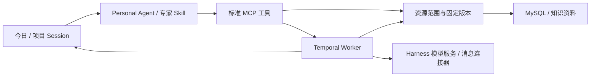

# 个人工作台

正式入口：[个人工作台](https://dsh.qianlan333.cloud)。当前版本 `native-20261108-01`。

官方 Harness 管对话，Temporal 管执行，MySQL 管资源与业务事实。保留“今日”Personal Agent；项目通过允许列表引用自有/共享资源，专家 Skill 使用标准 MCP 工具。

- [使用与配置](native/docs/QUICKSTART.md)
- [架构与 PRD](docs/plans/2026-11-07-native-workbench-prd.md)
- [通用工具和 Skill 开发规范](native/docs/EXTENSIONS.md)
- [当前实现与验收边界](docs/IMPLEMENTATION.md)
- [来源与首次切换说明](native/docs/SOURCE-AND-CUTOVER.md)

代码只保留 `native/` 新实现。旧 Go/React 工作台、旧专用插件和自制工作流运行时已从工作目录的受管源码移除，可从本机 Git 历史/备份恢复。`scripts/release-common.py` 与 `release-native.py` 继续服务同一个固定发布锁和入口；首次不兼容切换的恢复逻辑仅在发布层。

验证：在 `native/worker` 运行 `go test ./...` 与 `go vet ./...`；在根目录运行 `node --test native/harness/*.test.js native/connectors/*.test.mjs`、`python3 scripts/test-release-native.py`。官方 npm 依赖固定在 `native/package-lock.json`，Linux 包通过 `native/scripts/package-release.py` 构建。

真实资料、密钥、运行日志和验收产物不入 Git。原上下文中心与 CRM 是继续运行的外部数据来源，不随旧工作台清退。
