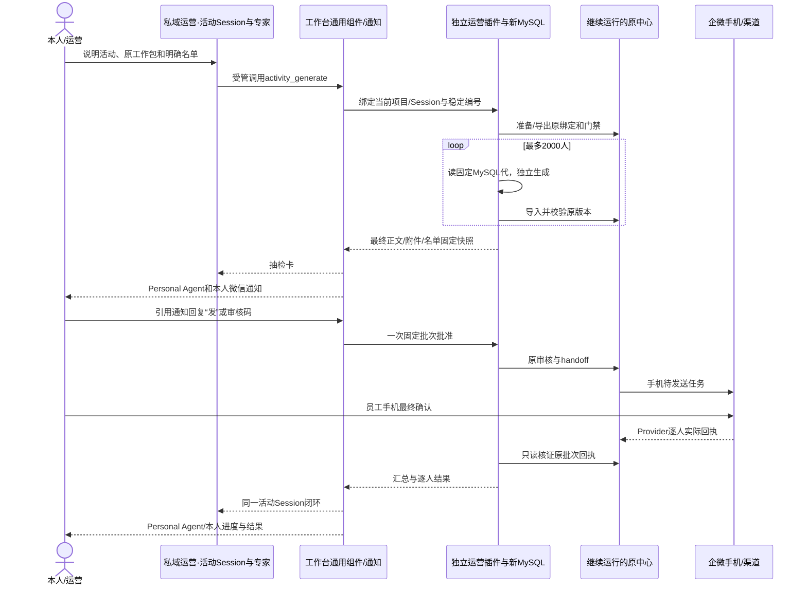

# 私域运营：一次2000人活动怎么使用

本指南适用于单项目闭环版本。原上下文中心继续运行，企微仍需员工手机最终确认。

## 配置与职责

| 入口 | 配置内容 | 实际执行与查看 |
|---|---|---|
| 设置 → 连接与工具 → 工具组件 → 运营工具 | 所属项目、允许动作、固定版本、本人确认动作、微信连接；凭据由服务端保管 | 专家通过list_components/call_component调用；不能取得凭据或跨项目调用 |
| 私域运营 → 数据拉取与清洗Session → 运行配置 | 原数据治理专家、固定清洗版本、sync_contexts、原固定参数 | 既有定时每6小时20分执行；成功后原子发布MySQL代，失败保留旧代；本Session看任务/来源水位 |
| 私域运营 → 每个具体活动的Session | 选“运营活动闭环”专家，说明活动、工作包、名单、素材和要求 | 插件逐人读取固定MySQL代并生成；进度、失败、实际待发送样本与回执都关联本Session |
| 私域运营 → 关键用户推荐Session → 运行配置 | 原推荐专家、原目标/查询参数、固定方法版本 | 既有09:10任务在本Session给证据和推荐，不自动触达 |
| 资料 → 历史来源 | 七个原项目的只读关联与文件/配置快照 | 原Session/Harness、消息、Run和原配置留在原身份下；不改归属、不重拼对话历史 |

原7类专家方法、85份源配置、150个登记兼容操作及原业务门禁继续复用。统一项目只有一个运营组件连接；新开发的是固定MySQL批次、通用抽检/通知/本人确认、原发送适配和逐人回执读取。原13个定时执行权不迁走，不重复开启。

## 例：11月体验活动回访2000人

1. 在“数据拉取与清洗”Session看最近一次同步是否成功，必要时点“按配置执行一次”。任务先把完整源快照写入暂存代，校验后切换新MySQL发布代；不在工作台SQLite存全量客户上下文。
2. 在同项目另开活动Session，选“运营活动闭环”专家，说：“为11月体验活动准备今天这一批，最多2000人，沿原已发布策略和素材生成，先给我抽检，不提前发客户。”专家先用activity_catalog读取工作包，再用activity_candidates准备明确有效名单。二者是可查回的后台任务；全库list_user_refs不是运营资格。
3. 确认实际工作包、有效名单和素材后，专家调用activity_generate，传name/package_id/week/items/instruction。固定程序逐人读新MySQL快照、保留原方法/版本绑定，生成后导回原门禁。固定模板保留原稿。成功项不重做；质量失败可修复补跑，原依赖版本变更需重新开批。
4. 全部通过后，系统冻结原门禁处理后的正文、附件和名单，抽取最多8条分散样本。活动Session出现抽检卡；Personal Agent收到带来源的只读通知，本人微信收到同一批次的样本和审核码。完整样本可让专家调用activity_samples读取。
5. 核对后，引用微信通知回复“发”，或回复“发 审核码”。唯一待审批次也可直接回复“发”；多批不明确时不会发送。也可在活动Session点击固定批次确认。修改内容需新抽检，旧授权不能覆盖新版本。
6. 宿主在进入模型之前校验本人、通知、批次摘要和重复事件；批准仅关联这一固定批次。插件沿原审核+handoff创建企微待发送任务，继续执行原身份、拒联、人工接手、频次、素材及版本门禁。
7. 员工在企微手机端最终确认发送。此前的“已审核”“已受理”“手机待发送”均不计为实发。插件只查原批次，不对未知结果换键重发。
8. 原渠道核证的逐人成功/失败/未知自动收回同一活动Session，并向Personal Agent和本人更新。可让专家用activity_status看汇总、activity_receipts分页查具体回执、batch_results查生成结果。逐人回执与汇总相符才结案。

每批最多2000；5000人按2000+2000+1000拆批，每批分别抽检和批准。没有承诺把2000条真实稿全部人工审阅过；容量合成验收、真实模型技术验收与真实客户发送是不同证据。

## 仍依赖原中心的步骤

源系统原始数据拉取与快照、当前策略及资格、动态原提示词和素材、输出校验、原企微连接器、手机待发送计划及Provider回执仍复用原中心。工作台统一操作入口与闭环记录，新MySQL负责已发布上下文，固定插件执行长任务；当前不能停掉原中心。

