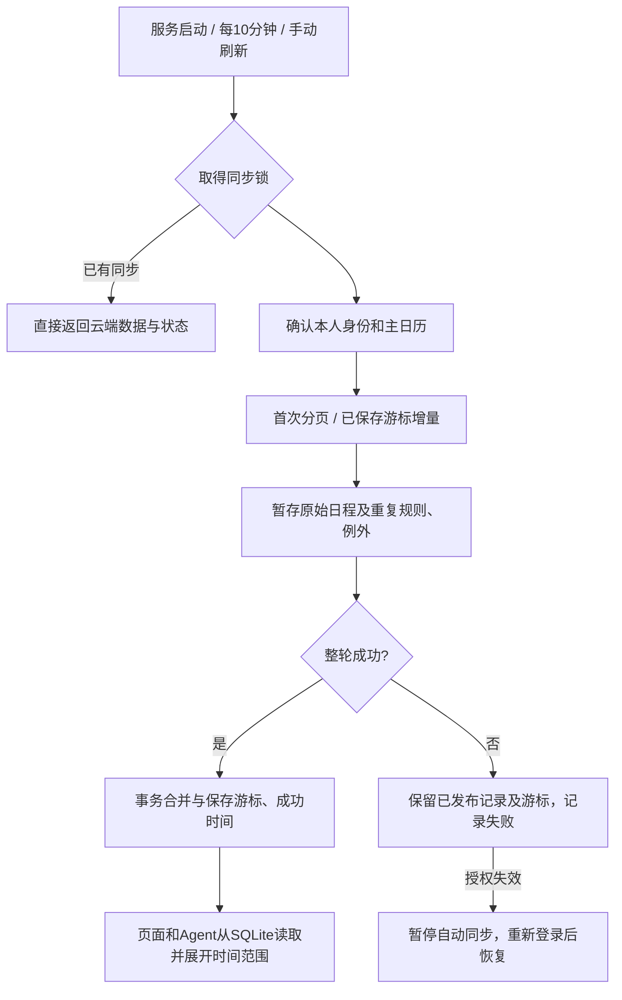

# 日历持久同步

## 行为与边界

复用 igo 服务、SQLite、现有 CLI 和 Podman 凭据隔离；不调用 Harness，不占用业务运行名额。每10分钟一次，无变化仍只检查增量。手动刷新请求异步同步，页面保留旧记录并展示上次成功时间和错误，打开页面本身只读云端。已有 `remote=1` 的兼容查询可显式触发一次同步但仍返回云端内容。

以当前飞书应用、本人账号和实际主日历ID绑定游标；账号变更不混用旧数据。首次从平台可读历史起点分页，之后使用sync_token。游标只在整轮分页成功后发布，重启中断暂存不会影响正式内容。平台明确取消才隐藏日程，空增量不清库。游标失效后重新全量合并；授权失败暂停自动拉取，授权恢复由手动刷新恢复。普通网络失败下一轮再处理。

保留原始日程及重复规则，不预建无限未来实例。使用固定版本 rrule-go 展开当前日/周/月窗口，单次例外按原始实例标识覆盖，包含改期移入窗口和取消；标准支持的时区与全天日期保持。已有本地关联、版本与未知外部写入受保护，成功写入立即更新当前记录并请求后续增量。

## 页面

沿用现有日历、按钮和灰绿配色。增加“飞书上次同步时间 / 同步中 / 同步暂停”文字。未同步时明确显示状态。失败只更新状态，不清空已有事项。刷新期间可继续浏览。

## 对抗验收

首次加载后断联仍能查询；空增量保留；分页中断和重启不推进游标；取消与移出窗口正确；重复规则、例外改期和全天/时区正确；同步与本地编辑并发不覆盖待核对意图；并发刷新只执行一轮；授权失败不反复调用；游标失效可重建；旧数据与鉴权沿用。完成自动测试、race/vet、前端构建、真实隔离飞书与Chromium验收、read-only review后，按既有发布skill上线并验证旧整理仍暂停。

参考飞书官方日程列表/FAQ的page_token与sync_token协议，以及teambition/rrule-go标准重复规则实现。当前CLI支持 `api` 通用入口，可复用用户授权。

## 设计评审与修正

采用飞书原生增量API，rrule-go固定v1.8.2。审核范围包含完整改动与原调用者、数据库恢复、CLI鉴权、项目/个人工具入口和发布兼容。复核中修复了游标错误被误判授权暂停，以及跨轮分页发布时用最后一轮时间覆盖先前本地修改两处问题，分别补了回归。分页暂存和进度同事务落盘，每轮最多10页，超出后下一周期续传，避免大历史反复从头抓；只有完成的整轮才发布。

真实共享授权在隔离执行器内验证，不复制Refresh Token分叉测试凭据。主日历首次读取71条原始记录，本周6条与飞书实例视图一致；首次、增量和一次对照共5次CLI请求，约4.5秒。真实隔离日历创建、编辑、读取、取消通过。失效鉴权、网络故障、提交失败、分页断点、过期游标与账号切换通过隔离故障注入验证，已缓存数据均保留。正常周期额外确认一次主日历身份，因此单日历一页增量通常为2个API请求/轮，约288次/天，0个模型Token。

## 验收与 review 结论

完成全量 Go race 测试与 vet、前端类型检查及构建，8组日历同步行为回归，以及原有聊天状态和渠道12项测试。新增覆盖定时唤醒、授权后立即恢复、DST时区、跨轮分页进度、提交失败重启发布、缓存正文与游标不泄漏、来源切换和本地待核对修改。Chromium实测手动同步失败后日程保留，日/周/月切换不发远端请求，390px无横向溢出，截图在本机 artifacts/calendar-cache。

按 review-agent 对全部差异与原调用入口做只读复核，修复上述发现并再次回归后，无剩余阻断发现。真实外部平台覆盖主日历全量、增量、实例视图对照与独立日历CRUD；失效授权和网络中断为隔离注入，不撤销本人授权。仅同步当前主日历，其他订阅日历未自动纳入。回滚保留新增缓存表和同步进度，旧版会忽略这些附加表。

发布读回同时检查MCP入口说明，已把旧的“remote=true包含飞书”更新为“默认云端缓存已含飞书，仅明确要求立即同步时传remote=true”，避免Agent沿用旧说明每次都访问外部接口。属于原同步范围内的工具提示修正。
