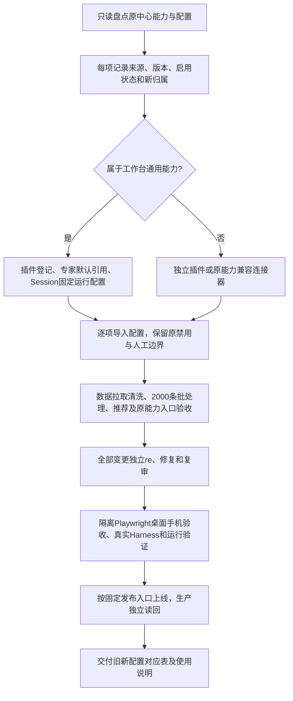

# 完整交付PRD：工具插件、上下文中心配置迁移与使用闭环

2026-11-05。用户已授权：完整开发、全部上线前独立/re、修复后复审、验收通过上线，并迁移原中心配置及说明配置/使用方法。原中心继续运行；重复业务副作用始终禁止。

## 业务判断流程

## 完成交付的含义

不能以“通用入口已完成”代替全量交付。每项能力必须有代码/配置、可用入口、验收状态与残留依赖。对暂时复用旧中心后端的功能，标明兼容连接器和数据/执行依赖，不宣称已经独立替代；原服务允许继续提供能力。完整退役不在当前授权中。

完整范围：
1. 工具组件接入与动作权限、结果引用；已完成首项代码，需整体验收。
2. 专家默认工具、Session固定组合配置、手动及确定性定时调用；每次运行固定组件/专家/规则版本。
3. 独立数据插件：原中心只读用户上下文→MySQL→确定性清洗→校验发布→来源及异常查询。保留事实/推断边界。
4. 通用批处理：单批最多2000条、每项上下文隔离、限流、逐项恢复及补充执行；专家方案/提示词由配置输入。
5. 用户推荐：复用原候选及证据规则，经过对应专家解释；不默认自动发送。
6. 原中心主要能力入口：服务计划、活动策略、内容素材/报告、群运营、指标、身份纠错、历史/回执及运行检查。通过独立适配器复用现有接口，权限/副作用清晰。
7. 配置迁移：全部相关提示词含发布覆盖版本、策略JSON、产品方法、Agent运行参数、定时参数、连接引用。凭据只存受管私有位置，不进Git、不回显到对话。
8. 旧新配置对应表、启用状态、来源摘要、缺项原因、使用步骤和回退方法。

## 复用原则

MCP作为插件入口；工作台不承载MySQL客户表、不复制旧中心整个单体程序、不新建通用工作流平台。数据/任务状态留在独立插件；原复杂业务可通过明确兼容动作复用旧服务。重复逻辑经过真实第二个用例再抽取。

原提示词迁移不仅MD：当前manifest、JSON素材、动态拼装、输出校验和发布覆盖一起记录。原disabled/shadow等状态保留，不擅自提升为active；原人工确认和“自动发送不允许”的业务限制保留。

## 研究依据

复用已核查的MCP工具输入输出、VS Code宿主通用入口/扩展具体能力、Airbyte增量/主键去重与Prefect提交执行分离机制。此次没有引入这些平台。具体链接见既有一期PRD与TOOL_COMPONENTS.md。

## 验收

- 每一类能力有明确入口与真实只读/隔离测试；未迁移项不能静默遗漏。
- 组件/专家/Session关联与版本固定、定时发生项幂等、取消/恢复、权限和未知状态均有测试。
- 数据首次全量与变化更新有统计、来源时间和发布水位，断连不破坏旧数据。
- 2000条合成输入进行恢复、去重和上下文隔离测试；少量真实Harness/模型样例另行记录，不将合成验收冒充2000条真实内容质量。
- /re覆盖全部最终diff和迁移脚本；修复后复审No findings。
- 页面使用用户明确授权的项目既有隔离Playwright，桌面与手机主要交互及错误状态通过。
- 上线保留旧中心，原发送和定时执行权不被复制；对兼容连接器的原依赖逐项说明。
- 用户可按使用说明完成配置查看、同步、查询、批处理、推荐和异常处理。
