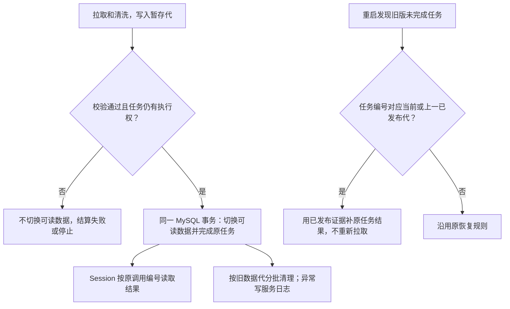
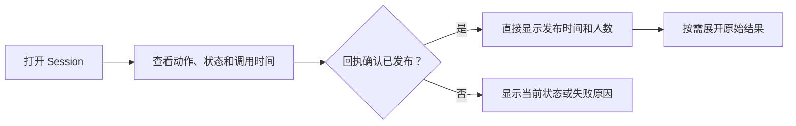

# 数据拉取与清洗：发布和完成状态一致

11 月 6 日 12:20 任务在 12:21:36 发布 25,126 人。旧版在发布事务提交之后执行旧数据全量清理，再单独写任务结果，并忽略结算写入错误。插件记录了 12:21:51 的 MySQL 读超时；数据库统计显示旧记录清理到 12:22:43 才结束。页面反映了插件数据库中的未结算状态。旧日志没有保存最后一次状态更新的 SQL 错误。

范围只覆盖同步插件和已有任务的恢复；Session、定时、原数据源和发送链路不变。复用 MySQL/InnoDB 和 [Go 事务](https://go.dev/doc/database/execute-transactions)，不增加任务种类或部署依赖。

验收：任务结果写入失败则发布回滚、旧代仍可用；清理失败仍可从原调用读取成功与实际人数；恢复旧任务时保持发布代及时间、不访问上游；没有发布证据的旧任务沿原规则恢复。只删除已结束的暂存代，保留当前、上一代和活动仍使用的记录。

## Session 卡片

参考 [GitHub Actions 运行历史](https://docs.github.com/en/actions/how-tos/monitoring-and-troubleshooting-workflows/monitoring-workflows/viewing-workflow-run-history) 的列表与详情分层，沿用工作台现有折叠卡。卡面区分同步、状态查询、配置读取和原系统读取，时间显示为北京时间。同步使用调用记录的发起时间和回执中的实际发布时间。状态查询使用查询发起时间，同时展示它查到的发布时间。历史记录缺少时间时只显示已有字段。验收覆盖折叠态、已恢复回执、未获授权提示和窄屏布局。
