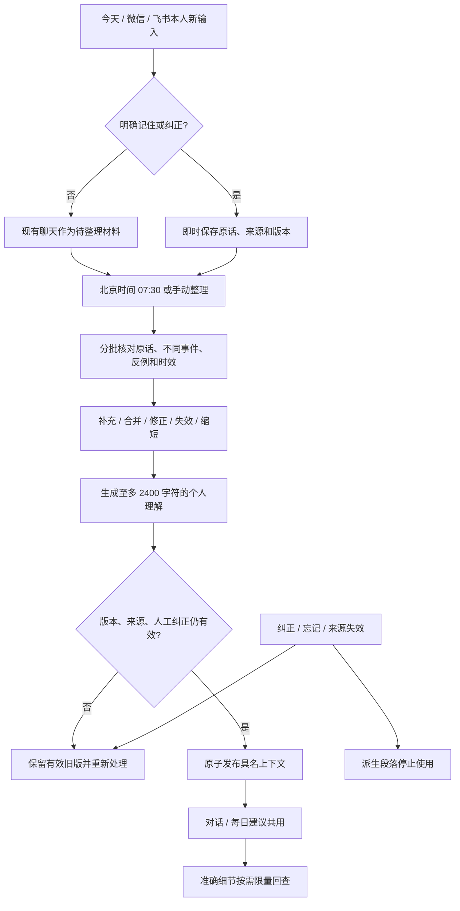

# 个人记忆精简：PRD 与实施依据

## 业务判断流程（开发前）

## 参考与取舍

2026-11-01 阅读官方资料：
- [Letta Memory blocks](https://docs.letta.com/v1-sdk/memory/memory-blocks)：借鉴常驻记忆的容量预算与独立检索层；不引入其运行服务。
- [OpenClaw Memory](https://docs.openclaw.ai/concepts/memory)：借鉴可核对的长期记忆与检索；本系统不采用不断增长的每日 Markdown 文件。
- 当前代码已具备 SQLite、持久 Harness、低优先级维护调用及具名 required context，直接复用。

## 范围与验收

只有两项产品变化：一份受控的个人理解；相关依据和准确细节按需回查。保留已有入口、暖白灰绿样式、720px 阅读弹窗及移动端覆盖模式。现有线上面板截图为视觉基准 `artifacts/memory/before.png`，按 Product Design image-to-code 与 design-qa 检查。无新增图片资产、导航或分类表单。

正文 <=2400 Unicode 字符，必要依据引用对应记录版本。三项主操作：纠正、查看依据、忘记。显示截止时间、状态、重新整理。依据区域支持关键词和分页；不把完整记忆表加载为模型上下文。明确事实退出正文仍能查到。

自动推断只能为有情境的待核观察；一次 ABC 选择、助手说法、重复事件不增加独立支持。考虑反例，不把反复压缩的结果当新证据。显式纠正受保护，未知旧 AI 来源为待核。临时约束未给期限默认七天，到期从读取和模型上下文退出。

## 最小实现

扩展 personal_memories 的证据、确认/保护、作用范围与替代关系；个人理解版本、维护游标存 SQLite。原记录保留，不为每句话建文档。首次启动固定新消息水位，只从有效旧记忆初始化；不会扫旧聊天。

整理分为可恢复的小批次：从新增本人输入提取必要依据，再分批读取有效依据修订正文。每批保存进度；发布时校验输入指纹和人工版本。每天 07:30（无增量不调用），手动请求可提前；重启续跑，交互优先。08:00 建议可使用最近有效理解，不被整理无限阻塞。

正文段落后台持有依据 ID/版本，读取时再次过滤过期、删除和遗忘。遗忘记录保留不含原文的排除信息；旧后台结果不能发布。显式遗忘沿用原生上下文清理并提示，普通纠正/整理不重建会话。精确事实由受限工具限量查回。

个人规则继续由本人编辑。只追加本次已同意的记忆归纳边界；整理器无规则写入权限。项目仍完全只读。

## 验收、迁移和上线

隔离 Go 行为测试覆盖容量、一次选择、不同事件、反例、过期、精确回查、反复压缩、并发纠正、遗忘、删除来源和重启游标；运行 race/vet、前端检查构建。真实 Harness 验证具名替换、长期会话、模型归纳与回查；桌面及手机浏览器验证阅读/依据/纠正/状态/输入连续性。代码保证与模型语义判断分开记录。

迁移不删除原记忆；发布前保留数据快照，等待任务结束，发布后重启验证和渠道连接核验。回滚保留新增数据与遗忘账本，不恢复已忘记内容。
