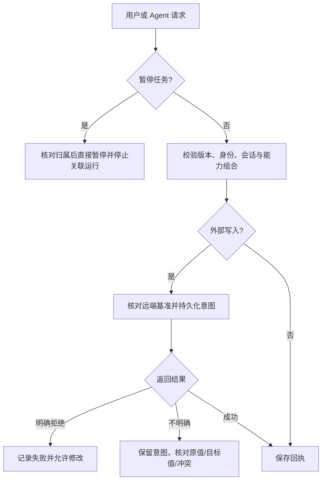

# 日历、任务、站内信修复 PRD

## 判断流程

沿用 Google Calendar 重复事件的原始实例身份与分段修改模式，参考 https://developers.google.com/workspace/calendar/api/guides/recurringevents 。此处增加明确的新系列起点，并验证实际时间碰撞。外部事件标记仅作为关联线索，不作为本地主键。

## 行为要求

本次逐项修复 review 的 17 个问题。暂停不受失效依赖阻挡。新项目整理规则默认关闭。飞书 CLI 使用已有 Podman 外部工具隔离。日程保存区分明确失败、未知回执和冲突，保留可修复路径。项目失效仍可取消日程。远端删除和移出窗口必须核对并保存。周期向前改期不漏第一轮，例外不可碰撞，间隔任务起点固定。项目整理不能复用原生历史会话。失败明细遵守回收站可见性，重跑核对要求不能随日志删除消失。回滚旧调度器前暂停不兼容规则。个人待办来源与正文作为同一草稿保存。浏览器导航恢复旧项目地址并保护草稿。验收脚本退出清理规则。

## 验收与发布

补充隔离行为测试，运行 Go 测试、race、vet、前端检查和构建。使用现有界面与 Product Design 审查交互，真实 Harness 与飞书隔离日历验收。正式发布遵循 project-workbench-release，旧整理维持暂停，新整理由用户逐项目开启。保存源码版本、测试结果与真实验证边界，复用一正式版和一回滚版轮转。

## 本轮验证结果

- 隔离行为回归覆盖暂停失效依赖、默认关闭、整理会话互斥、系列向前改期与例外碰撞、间隔任务、飞书来源主键碰撞、明确失败修复、未知回执与第三方修改、采用远端现状、归档项目取消、移出窗口持久化、回收明细和日志清除后的重跑保护。
- Go 全量测试、race、vet，前端类型检查和构建通过；原有 10 项聊天状态与渠道单测通过。SQLite 临时数据验证旧版回滚保护矩阵通过。
- 云端真实 Harness 持久会话恢复与 Shell 文件产物通过；飞书专用验收日历在同一 Podman 隔离执行器内真实创建、修改、查询、删除通过，并删除验收日历。
- 微信与飞书的隔离入站/出站回执回放、网页创建规则、失效绑定失败通知、修复配置后幂等重跑通过。此处为协议回放，未让本人重新发送真实客户端消息。
- Chrome 实际检查项目→日历→后退恢复原会话；个人待办带入草稿、清空后发送其他消息不关联原待办（仍为 pending）；桌面布局和 390px 设备模拟无整体横向溢出、输入可达。沿用现有暖白灰绿界面。浏览器默认视口已恢复。
- 验收脚本退出后查询剩余定时规则为 0。真实模型的首次本机服务外启动测试因容器环境失败，改为与正式服务一致的用户级 systemd Delegate 环境后通过。

外部故障分类、重复回执、第三方修改与数据覆盖使用可控故障注入验证；真实平台未注入网络中断。当前 UI 对待核对且有远端标识的日程提供“采用飞书现状”，经用户明确选择后结束旧意图。未知创建保持原幂等键核对。
