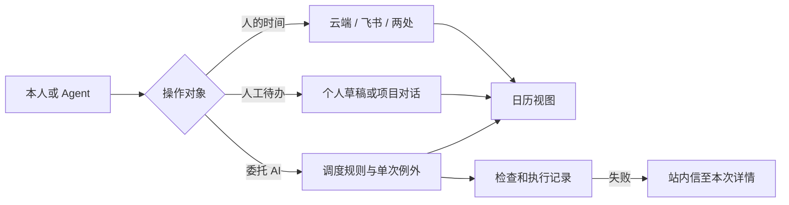

# 工作台日历、任务与站内信

日历按上海时间显示日、周、月。查询接口 GET /api/v1/calendar 使用半开毫秒区间 start、end，可带 projectId 和 remote=1。日程创建显式传 destination 与 operation，修改使用 id 与 version。飞书创建重用同一 idempotency_key。AI 任务独立支持 onceAt 或 cron，sessionId 为空时每次独立运行。旧规则继续使用原来的输出设置。参考 RFC 5545 的原定时间标识、Google Calendar 的实例例外、Codex 自动化的指定对话，以及飞书 calendar v4 实例视图和创建接口。

POST /api/v1/schedules/:id/occurrence 接收 original、version、at 或 skip；series 同样使用 original、version 和新 cron。新周期导致未来例外失效时返回冲突说明；核对后才传 replaceExceptions。网页和 Agent 均使用同一服务逻辑。

通知生产者在业务事务内向 user_notices 写 kind、event_key、title、summary、link。唯一键按类型和事件去重；链接使用已注册的站内详情路由。首个生产者为 schedule_failures，执行前失败也有独立标识。清空标记、重跑回执与执行历史分别保存。无需部署新定时器或额外服务。
