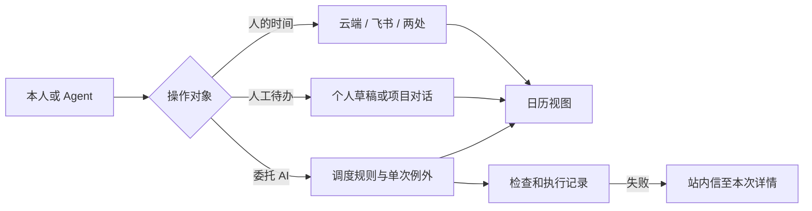

# 工作台日历、任务与站内信

日历按上海时间显示日、周、月。查询接口 GET /api/v1/calendar 使用半开毫秒区间 start、end，可带 projectId 和 remote=1。日程创建显式传 destination 与 operation，修改使用 id 与 version。飞书创建重用同一 idempotency_key。AI 任务独立支持 onceAt 或 cron，sessionId 为空时每次独立运行。旧规则继续使用原来的输出设置。参考 RFC 5545 的原定时间标识、Google Calendar 的实例例外、Codex 自动化的指定对话，以及飞书 calendar v4 实例视图和创建接口。

POST /api/v1/schedules/:id/occurrence 接收 original、version、at 或 skip；series 同样使用 original、version 和新 cron。新周期导致未来例外失效时返回冲突说明；核对后才传 replaceExceptions。网页和 Agent 均使用同一服务逻辑。

通知生产者在业务事务内向 user_notices 写 kind、event_key、title、summary、link。唯一键按类型和事件去重；链接使用已注册的站内详情路由。首个生产者为 schedule_failures，执行前失败也有独立标识。清空标记、重跑回执与执行历史分别保存。无需部署新定时器或额外服务。

## 验收记录

全量 Go race、vet、前端类型检查与构建、渠道及聊天状态测试通过。单次改期、重启去重、未来周期例外冲突、绑定对话失效、失败消息去重、按当前配置重跑、个人任务草稿关联以及双写回执丢失均有行为回归。定时指令不会作为本人的新表达进入个人记忆。

隔离服务器通过真实 Harness 验证微信入口创建个人日程、飞书入口查回、项目对话保存规则、绑定对话失效后修正规则再在原指定对话执行。渠道为入站及 outbox 回放。独立飞书日历使用已授权账号真实创建、改期、读取、删除双写事件，并清理验收日历。生产日历只做读取验证。浏览器验收截图见 artifacts/planner。

生产最终发布 cloud-20261102-19-planner-r2，应用源码 f1a6ed0。生产网页、日历、飞书主日历读取、待办及未读数读回通过，微信和飞书均有上线后的 connected 心跳。发布前后的 schedules 与 context_jobs 逐行摘要相同，project_context_paused 为 true。初次发布快照 /opt/project-workbench/rollback-today-20261102-121456；随后仅增加个人记忆来源判断，切换前对业务表和项目文件与该快照进行了核对。回滚复用当前数据目录并保留新日程和站内信表。固定回滚入口会先暂停旧调度器不能识别的单次、系列例外、指定会话及新对话输出规则，增加版本并记录原因；核对后由本人开启，避免旧程序将单次任务当作每日任务。
