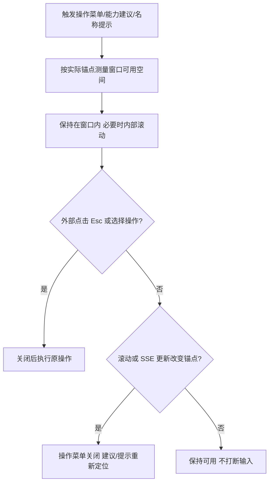

# 工作台弹出菜单排查与修复

日期：2026-11-02。沿用现有外观与业务操作，通过 Product Design 检查当前实际组件。初始基线 `6c65d7d`；发布前同步到线上 `f1a6ed0`，保留新日历/计划页，独立 worktree；原目录中的后端开发不纳入本轮。

## 判断流程

## 盘点与当前代码证据

| 入口 | 当前实现 | 需要实际验证 |
| --- | --- | --- |
| 对话三个点 | 已修复的原生 auto Popover | 作为既有回归，避免引入退化 |
| 项目文件“添加” | details + 绝对定位 add-menu | 外部/Esc/操作后关闭、底部裁切、锁定状态 |
| 专家能力文件“添加” | 同样的 details + add-menu | 关闭、遮挡、切换目录/版本、只读禁用 |
| 项目与个人助手 `/` 能力选择 | textarea + 绝对定位 listbox | 多标签/小窗口空间、异步目录、SSE 不误关、键盘与输入法 |
| 导航中的项目名称提示 | focus 时保存名称与固定坐标 | 滚动、窗口调整、项目改名后的旧文案/位置、Esc |
| 原生 select | 浏览器原生下拉 | 抽样检查关闭和更新行为 |
| 内容折叠与确认表单 | details 内容区、独立 dialog 流程 | 记录边界；保持内容展开、忙碌与未保存保护 |

## 参考与方案

- [MDN Popover](https://developer.mozilla.org/en-US/docs/Web/HTML/Reference/Global_attributes/popover)：顶层弹出避免祖先 overflow 裁切；auto 提供外部关闭与互斥。
- [WAI Combobox](https://www.w3.org/WAI/ARIA/apg/patterns/combobox/)：能力建议保持输入焦点，Esc、方向键与确认行为。
- [Radix Dropdown Menu](https://www.radix-ui.com/primitives/docs/components/dropdown-menu)：参考键盘、禁用项和边缘避让。

不引入新组件库。优先复用已验收的 SessionMenu 行为，提取可复用 ActionMenu 与定位函数；保留每个入口的标签、图标、原回调和禁用条件。能力建议保留受控输入与草稿，用实际可用空间定位；项目提示显示最新项目数据。只修复当前浏览器证据确认的问题。

## 验收要求

1. 先在当前基线捕获各入口截图与交互结果，记录确实失败的断言。
2. 两个添加菜单验证外部、Esc、重复触发、操作后关闭、所有项可达、低窗口/手机和键盘；文件选择仍须由用户手势同步触发。
3. 能力列表验证空结果、加载、选择、内部滚动、长标签、小窗口、个人入口，SSE 更新不打断输入与选择。
4. 名称提示验证滚动、Esc、更新后的名称和位置，不能覆盖可交互菜单。
5. 保留原生下拉、文件/专家创建、上传、只读、专家未保存保护；原 18 组对话菜单回归继续通过。
6. 类型检查、构建、相关浏览器行为、Go 测试/vet 及渠道基础检查；保存 Product Design 对比与实际限制。
7. 发布前重新核对线上基线，仅发布前端，保留同期后端与回滚入口；专用测试数据线上复验并清理。已有生产授权按本轮维护范围继续执行。

## 复现收据与最终实现

当前线上源码 `f1a6ed0` 的独立构建 index SHA256 与公网安装基线一致：`a2160d2e4252a4fc27c7070dfe704b01e9202e4cde7aeaf977fecaea51a75437`。基线原生 HTTP SSE/Chromium 测试有 12 组失败、2 组通过；不是用旧版截图推断现状。

- 两个添加菜单都不能通过 Esc/外部点击/选择操作收起；1280×340 时项目菜单 y=293、202px 高，专家菜单 y=308.09、164px 高，均越界。
- 项目能力建议在 390×568、8 个标签时顶部 y=-81.55，发生遮挡；个人入口在最新页面布局下可见，仍作为共用组件回归。
- 选择能力后立即输入，待执行 RAF 会把光标从 3 改回 0，导致建议消失；新增取消过期回调与失焦保护。
- 项目名称提示 Esc/祖先滚动后仍在，真实 `project.updated` SSE 后保留旧文案。

最终提取共用 ActionMenu/视口定位；能力建议锚定实际 textarea，并在滚动/窗口变化时重新测量；名称提示从当前 projects 读取内容。短窗口开菜单前浏览器可能先将触发器滚入视口，异步 scroll 事件只有实际移动已定位锚点时才关闭，避免开后立即消失。

新日历/计划/任务页面另做源码盘点：所有 select 为原生控件，details 为关联资料、执行记录或高级配置等内容折叠，不属于浮层操作菜单。保留原业务保存、上传、只读及未保存保护。

本地新增 23 组检查通过，原 18 组对话菜单回归通过，4 项状态合并、6 项渠道回放、Go 测试/vet 与前端类型检查/构建通过。截图/JSON 在 `artifacts/popup-audit`；完整分步检查见 `POPUP_MENU_AUDIT.md`。生产结果独立记录，不以本地测试冒充线上验收。
