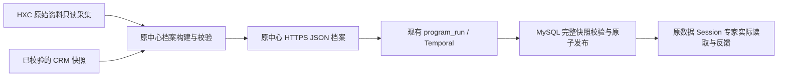

# 正式数据接入与本人真实应答验收

2026-11-08，使用线上 `native-20261108-07`，上一成功版本 `native-20261108-06`。本轮只运行现有数据程序、配置本人联测和核验结果，没有修改或重新发布应用代码。原上下文中心、CRM、原回调和现有定时配置保留。

## 数据实际经过的路径

HXC 统一 `/sync` 消费是另一条既有链路，仍由 `daru-hxc-unified-sync.service` 维护原中心 `current.sqlite`，没有把这个 SQLite 当作新工作台业务库，也没有宣称七个独立资源都已迁移到新工作台。

## 档案刷新与 MySQL 发布

- 原档案程序使用 `--run --publish --refresh-hxc --reuse-validated-crm --archive-only --skip-queue-refresh`。一次性执行通过临时 systemd unit 托管，没有新增 timer。16:40:16 开始，16:52:45 完成；发布成功，HXC 来源已刷新，原已审稿件及运营队列保留。
- CRM 快照为 `2026-11-07T19:48:31.020176Z`，启动校验时约 12.93 小时，未将复用快照描述为实时刷新 CRM。
- 源 JSON：`workbench-20261108085045569`，生成时间 16:50:45；25,137 条、25,137 个唯一 ID。
- 源文件 SHA256：`f87a8081892fbbe32373fb318e4f58742dfba04d8690b66a57c367b305c85102`。
- 原数据 Session：`c2236213-f657-426f-ae2f-be41eb338d94`；所属项目 `p_3a978b38a5446e75bac696ed`。
- 现有 MCP `program_run` 根任务：`a93a0834-1d4c-5437-90b0-ef0011e3b243`，执行完成。
- 导入子步骤及 MySQL 发布版本：`0d232b7d-5b50-55fe-987f-4246d4f38cc7`，16:54:58 发布成功。资源为 `live-context-snapshot`。
- 从新工作台真实 `/resource-export` 导出全部原文板块，按 ID 排序后，以相同 JSON 规范计算逐条摘要。25,137 条记录与源 JSON 全部一致；不是仅比较条数或首条记录。
- 全量记录摘要：`84aebbd45e8033f927b3f02400fadd2de9852ba0aab5d5d2891f819ec1547053`。
- 数据 Session 的真实 Harness 先调用 `run_get`、`run_steps`、`resource_read` 核实本轮发布，反馈进入同一对话；随后补读一条记忆非空的真实画像，确认记忆摘要和三类需求状态可读。未生成活动话术或创建客户发送任务。
- 模型首次将字段数手算为 16，已在原 Session 更正为程序实际返回的 17；条数、版本、发布时间继续以程序结果为准。

## 数据质量边界

程序遍历整个画像板块：HXC 需求字段涉及 3,682 条档案，记忆摘要非空 790 条，业务阶段非空 1,140 条。这些不是 25,137 人都具有完整画像的证明。行业和业务焦点在当前源档案中为空，未用模型猜测填充。需求状态字段存在也不代表需求已经确认。

## 原 HXC 消费继续验证

新 JSON 发布后，再执行同一原消费服务：16:53:45–16:54:19 成功，`mode=incremental`，仅一次尝试，没有全量回退。checkpoint 已关联新档案 `workbench-20261108085045569`；context 水位 718308，context-all 水位 718311，其余五资源水位保持。完整性检查为 `ok`。这是第二次真实消费成功，不是后续 timer occurrence 已执行的证明；原 timer 为 active/waiting。

维护持锁进程已退出，未重新暂停服务。维护及后续消费证据保存在原服务器 `var/hxc-unified-sync/pr362-maintenance-20261108b/`，包含 `formal-json-source.json`、`formal-followup-sync.json`。

## 本人真实自动应答

- 重新查询原网关账号，`online`、`sendEnabled=true`。
- 原自动应答项目 `p_73b444507ce388caab268b23` 启用，配置修订为 2；连接器允许名单仍只有本人测试联系人。
- 实际入站：16:42:46，标记 `LIVE-1108-1641`，入站编号 `10037fef-9003-51c4-af7f-23c691809012`。
- 实际客户 Session：`object-27636e9a-d323-51f6-9003-1b57cc4c172f`。真实 Harness 加载 Skill，调用 `message_context`、`message_reply`；不是模拟入站。
- 回复在 16:42:50 创建；网关原消息 `msg_25357f0e6424036010d8`，独立 GET 查询确认 16:43:06 为 `sent`。没有 `delivered` 或已读证明。
- 内容为一句问候。这证明本人通道的入站、专家执行、发送、回执链路。该项目公共知识仍为空、没有个人资料绑定，不把本次问候当作客户业务知识或个性化资料接入已经验收。
- 用户随后明确：应由专家判定转人工，系统自动停答并通知企微侧边栏，运营人员在侧边栏一键恢复；不继续以两部手机的人为对话模拟代替这条系统边界验收。该跨端链路尚未验收，未开放更多客户。

## 用户纠正后的接管联动核查

已对照旧工作台合同与代码、当前原生版源码和实际部署。线上 Worker SHA256 为 `c20feb6a75c2ae8d7c66310b5cb66a0f26142b4eff126e69cbe14aabf582bbe4`，与被检查的 9d76d5f 发布文件一致。

| 能力 | 当前原生版事实 |
|---|---|
| 专家决定 `handoff` | 已有 `message_disposition`；不需要人工先发一条消息才能停答 |
| 系统关闭该客户自动回复 | 同一 MySQL 事务将 AutoReply=false、递增版本、暂停待处理输入并登记接管事件 |
| 拦截迟到的即时回复 | 提交前检查会话、配置版本和消息状态；已有 |
| 通知本人/今日 | 已有本地事件与今日通知；不等于已通知 CRM 侧边栏 |
| 工作台会话列表恢复 | 已有带预期版本的恢复操作；本身不应补发旧稿 |
| Webhook 通知 CRM 侧边栏 | 当前原生实现和配置未接入旧合同 |
| CRM 侧边栏查询状态、一键恢复 | 当前工作台未提供旧 CRM 协议的对应受限入口，不能认定已打通 |
| 人工状态同时约束批量发送 | 当前批量分支检查本人确认、资格及其版本；没有与即时回复共用客户会话模式检查，不记为已覆盖 |

旧合同位于原工作台 `docs/plans/auto-reply-contract-v1.md`，旧实现包括 `gateway_crm.go` 的状态通知、查询、恢复、版本与请求去重。旧验收说明明确 CRM 侧边栏旅程使用隔离后端和设备 SDK 替身，不能作为当前原生版或本次真机验收。当前 V4 本地代码搜索未找到同名集成，未因此推断线上所有 CRM 版本均无此功能。

最小补齐方向：保留现有 MySQL 会话状态与版本为唯一权威；专家决定后先提交人工状态和待通知事件，再由现有执行层调用标准 Webhook 适配；侧边栏显示状态并通过受限接口恢复原会话。将需要受人工接管约束的 AI 外发都接到同一客户发送门禁。通知失败保持人工状态，恢复后仅接新消息，不补发旧草稿。人工在企微亲自回复仍可作为额外触发来源，不作为正常流程的必要前置步骤。本轮只核查，尚未实现这些缺口。

## 在线读回

17:00:34：主程序、Worker、Temporal、渠道服务、Caddy 均 active；Worker `ready/backgroundReady=true`，模型桥与连接器 ready。17:08:40 再次读回这五项服务均 active，新资源版本保持。真实公网登录后桌面及 390px 页面均返回 200，没有页面异常和横向溢出。原数据 Session 两轮真实模型工具读取均已结束。

现有六小时数据导入定时仍启用，原中心凌晨档案刷新仍启用；这是一条定期快照链路，不描述为实时流式同步。本轮没有新增调度、修改网页布局、客户群发或应用发版，线上仍只保留正式版和一个回滚版。

工作台服务器的脱敏验收记录：`/var/lib/project-workbench-native/acceptance/live-data-20261108/`。本机网页截图与状态保存在被 Git 忽略的 `.var/live-data-acceptance/`。
