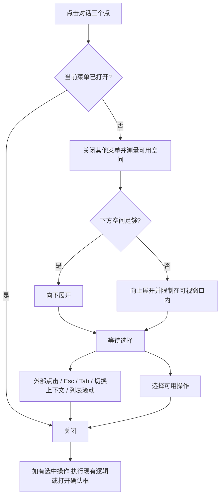
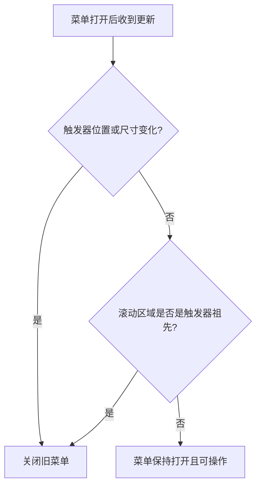

# 对话侧栏操作菜单修复 PRD

日期：2026-11-02。范围：项目工作台对话列表的三个点菜单。初始授权为修复与隔离 Chromium 验收，随后用户明确授权线上发布及复验；发布边界见本文最后一节。

## 业务判断流程

## 当前问题与证据

- 用户两张截图：菜单在对话列表底边被裁切；只显示前三项或第一项。
- 本机与线上当前静态资源均使用原生 `details.session-menu`；未实现外部点击、Esc、操作后关闭及多个菜单互斥。
- 菜单绝对定位在 `.session-row` 内，祖先 `.session-list` 为 `overflow:auto`。增加 z-index 无法逃出祖先裁切。
- 第四项“删除”本来存在；不是接口缺失。归档/删除继续由原有确认框与 API 处理。

## 参考与方案选择

1. [MDN Popover](https://developer.mozilla.org/en-US/docs/Web/HTML/Reference/Global_attributes/popover)：`auto` 弹层进入浏览器顶层，不受祖先 overflow 裁切；提供外部点击、Esc 和弹层互斥。
2. [Radix Dropdown Menu](https://www.radix-ui.com/primitives/docs/components/dropdown-menu)：参考菜单焦点、方向键、禁用项及碰撞避让行为。
3. [MDN showPopover](https://developer.mozilla.org/en-US/docs/Web/API/HTMLElement/showPopover)：用于显示后测量实际弹层。

比较：补丁式保留 details 仍须自行实现所有关闭及脱离裁切；引入 Radix 能力完整但增加依赖。采用原生 auto Popover，补齐锚点定位、方向键、上下文与滚动关闭；复用 React、Lucide 和现有样式，不增加运行依赖。

## 交互要求

- 维持既有暖白/灰绿、边框、阴影、圆角、文字和三个点图标；新增完整可达的第四项。
- 同时最多一个菜单。重复点击触发器、点击外部、Esc、Tab、选中可用项立即关闭。
- 关闭后才执行操作或展示确认框；点击禁用项不执行任何操作。
- 切换项目/对话/标签/抽屉、滚动列表、缩放窗口关闭旧菜单，避免弹层滞留。
- 以触发器右侧对齐；优先向下，空间不足向上；保持窗口内边距，极小窗口允许菜单内部滚动。
- 使用 button 触发器、menu/menuitem 语义；Enter/Space/方向键可打开，方向键/Home/End 导航并跳过禁用项，Esc 返回触发器。
- 保持会话 ID、草稿、标题、置顶、归档和删除业务逻辑；归档中的禁用状态与“停止归档”保留。

## 验收与交付

1. 隔离测试数据、真实 Chromium：重现旧版本截断与不关闭；修复后四项均可见、可点击。
2. 验证重复点击、外部点击、Esc、Tab、互斥、动作前关闭、键盘、禁用项、上下文切换与滚动。
3. 桌面/手机/低窗口底部菜单、长标题、长列表，检查视口边界和页面横向溢出。
4. 用相同视口、内容与状态截图比较；记录字体、间距、颜色、图标和文案。检查 console/page errors。
5. 前端类型检查和构建、已有前端状态测试；按仓库规则运行 Go 测试及 vet，区分已有改动造成的问题。
6. 更新 IMPLEMENTATION.md、根目录 design-qa.md，保存隔离截图与测试收据。未经本轮明确授权不发布生产。

## SSE 动态更新补充（2026-11-02）

审查发现两项 P2：聊天自动滚动会误关侧栏菜单；会话重排后固定弹层仍留在旧位置。本轮沿用既有菜单样式和业务操作，用户已授权修复及隔离 Chromium 回归。

方案比较：把所有列表元数据拼进关闭条件会导致无关 SSE 也中断菜单；观察整棵 DOM 增加维护成本。选用 [React useLayoutEffect](https://react.dev/reference/react/useLayoutEffect)，在界面提交后、绘制前比较实际触发器矩形，移动或尺寸改变即关闭，未变时保持打开；滚动关闭仅响应触发器祖先及视口。继续参考 [Radix Dropdown Menu](https://www.radix-ui.com/primitives/docs/components/dropdown-menu) 的菜单状态及碰撞处理。不增加组件库、轮询或持续动画帧。

补充验收：使用本地 HTTP SSE 流及浏览器原生 EventSource，经过实际 App 事件处理与 refresh/mergeSessions；不能只替换 EventSource 或调用组件内部方法。

- 长聊天收到真实 SSE 后发生自动滚动，侧栏菜单仍打开；可用菜单项可聚焦并可打开原确认框。无几何变化的 session.updated 同样保留菜单。
- SSE 置顶重排或前序标题换行改变触发器矩形时，旧菜单关闭；重新打开后紧随新位置且命中正确。
- 列表更新但本菜单触发器矩形不变时，保留菜单；不把列表对象刷新等同于位移。
- 已有侧栏滚动、窗口变化、互斥、键盘、触摸、草稿和操作确认场景全部继续通过。
- 先在 758734f 构建上观察两项新增断言失败，再验证修复候选，并重新保存桌面、手机及 SSE 前后截图与测试收据。本轮不发布生产。

## 线上发布与复验授权（2026-11-02）

用户随后明确要求将此修复部署线上并复验菜单和 SSE。发布目标为已验收前端 `66c4a10`；线上应用已有后续定时任务修订，前端源文件与本修复基线已逐项核对，采用既有前端增量发布方式，保留线上后端、渠道与数据库。

发布流程：核对线上版本与产物摘要 → 真实 Harness/渠道预检查 → 保存旧页面入口与版本收据 → 上传散列资源（保留旧资源）→ 原子替换页面入口 → 公网独立读回与实际浏览器/SSE 复验；任何发布或验收失败只回退本次前端入口。参考项目既有 `.var/publish-workspace-ui.sh` 和 `docs/OPERATIONS.md` 的原子切换及事件流读回要求，不替换 Caddy 配置。

线上验收只使用本轮新建的专门测试项目，通过正常 API 生成与置顶/改名更新、实际原生 EventSource 及真实 Harness 消息，不拦截或伪造线上 API。归档/删除确认框取消；测试结束清理本轮项目，保留不含凭证的收据。原有会话映射、项目 ID、定时任务、运行进程、应用二进制和渠道状态分别读回核对。

发布完成：前端 `66c4a10`，入口与两个散列资源公网 SHA256 与本地验收相同；保留线上后端 `ac1b77e`。正式 Chromium 10 组验收全部通过，含真实 Harness、原生 SSE、置顶/标题换行、无位移更新、长列表、键盘及手机宽度触摸。收据在 `artifacts/session-menu-live/report.json`、`deployment.json`；操作与回滚见 `OPERATIONS.md` 最新章节。
