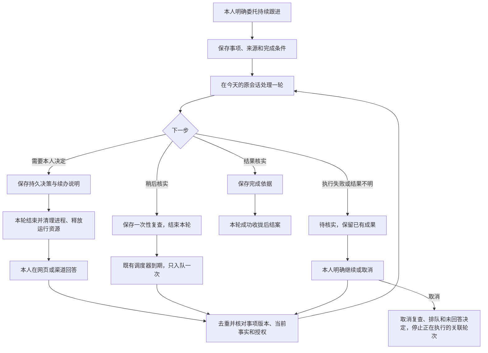

# 今天：持续跟进、等待决策与到期复查

状态：按 2026-11-04 用户授权进入开发；本地交付，不包含生产切换。
基线：`ea51003`；复用 Go/SQLite、inbox/runs、原 Harness 会话、schedules、personal_decisions、events 和 deliveries。

## 1. 业务判断流程

取消先持久化撤销状态，随后收拢运行；旧回答和迟到回执不能重新打开事项。只有清理执行进程完成后才释放现有锁。跨天保留事项；不把每日建议自动变为事项。

## 2. 目标与范围

“今天”是个人助手与持续跟进的入口。本人明确要求“持续跟进／稍后再查／等我决定后继续”时，助手保存同一事项的进度，而不是让用户反复解释上下文。

首版交付：创建持续事项、查看原始依据和最新进度、等待持久决策、回答后续办、一次性到期复查、证据结案、取消、失败显式保留。

保留：个人理解与遗忘规则、每日建议、已有安排、稳定 Session/Harness 身份、各项目原有任务和文件写锁。事项不复制项目任务，只可记录原项目编号和只读核对线索。

不在首版范围：更换模型执行内核、第二套后台服务/队列、自动拆分原会话、通用工作流编辑器、PR/发布自动化、改写项目正文、把原生工具审批强行转换成可恢复审批。原生审批仍沿用已有运行流程；业务等待使用持久决策并结束本轮。

## 3. 参考案例与取舍

2026-11-04 查阅官方项目/文档：

- [Agent Autoloop 协议](https://github.com/KKKKhazix/agent-autoloop/blob/main/docs/protocol.md)：事项与短轮次分离，等待持久化，回答/复查是后续输入。借鉴生命周期，不引入 Node 中台。
- [LangGraph Interrupts](https://docs.langchain.com/oss/python/langgraph/interrupts)：持久化人工中断与恢复；恢复可能重跑节点，副作用必须幂等。借鉴检查点和明确续办范围，不重建 Harness 上下文。
- [Temporal Workflow Execution](https://docs.temporal.io/workflow-execution)：工作流状态、事件历史、定时等待与运行分离。借鉴持久状态，不新增 Temporal 服务或全量事件溯源迁移。

只做页面增强不能解决重启续办；整体替换会重复现有身份、隔离和交付机制。选择在现有单体内补齐共享事项关联，以“今天”为首个消费者。

## 4. 用户旅程

1. 本人说“跟进这个项目的反馈，下午再查一次”。助手只读核实项目资料，保存标题、完成条件、已做和剩余步骤；到期复查沿用原个人会话。
2. 查到两个方向，需要本人取舍。保存一个带 2–3 个选项和推荐理由的持久决策；本轮结束。网页、微信、飞书的其他消息可以继续处理。
3. 本人回答原问题。服务端验证所属事项、版本和当前依据，幂等入队一次；助手重新核实当前事实，仅继续剩余步骤。选择不自动转成长期偏好或项目写入授权。
4. 到期后通过现有 schedules 入队。无需重新授权原范围内只读复查；无新进展保持安静。需要新决定或发现实质变化才显示待处理状态。
5. 确认完成条件达到并保存依据，当前轮成功结束后结案。模型报错或外部结果未知进入待核实，不自动重放副作用。
6. 本人取消后，不再触发未来复查或消费旧决定。正在执行的关联 Run 通过现有 Stop 收拢，已发生的外部动作不被宣称撤销。

## 5. 状态和数据规则

事项持久化：稳定 ID、个人 Session、固定 key、标题、完成条件、续办说明、来源 Run、版本、状态、当前决策/一次性调度/关联 Run、完成依据、复查次数、创建与更新时间。

状态：待跟进、待决定、待复查、已排队、执行中（从关联 Run 派生）、待核实、已完成、已取消。事项状态与单轮 Run 状态分开。

- 相同个人会话和 key 创建幂等；已结案/取消不能被重试重新打开。
- 修改使用版本校验。自动复查只能更新自己关联的事项，不能创建其他事项、扩大范围或无限派生任务。
- 一次复查对应一个现有单次 Schedule；保存、事项变更和决策创建在一个事务完成。到期入队、计数和关联在既有调度事务完成。
- 首版每事项最多自动复查 3 次，未来时间范围 1 分钟至 30 天；达到上限进入待核实。已有的独立定时任务不受影响。
- 决策回答、手动继续、到期复查均有稳定幂等键。未消耗的问题不会重复创建；迟到回执、取消和再次操作通过版本及关联 Run 校验隔离。
- 完成必须有依据；执行失败/中断不能仅凭工具声明结案。服务重启保留等待与未来调度，已在执行的事项进入待核实。
- 原始状态和通知发送状态分别保存；accepted/unknown 不等于本人已收到。复用 deliveries，不新建发送重试器。

## 6. 权限与只读边界

个人 Agent 不获得任何项目正文写工具或项目卷挂载。跨项目只读继续走 find_project_sources/read_project_source。新跟进工具只改个人事项、自己的持久决策及受限一次性复查。

复查本轮提供明确的“只读复查”执行模式：不装载通用 CLI/MCP、日历修改、记忆写入或调度管理等外部写工具，只提供必要的工作台只读查询和本事项状态工具；不能用“本人以前授权过”恢复完整工具。

人工回答绑定已保存的具体问题，不视为项目写操作或长期授权。范围变化、认证缺口和未知外部结果保留待办；不通过失败自动重试绕过。

取消、终态和过期决策在服务端校验。事项信息是数据，不能指定命令、凭证、项目写入权限或新通知收件人。

## 7. 前端 / Product Design

以当前“今天”的页面、排版、颜色、按钮和决策卡为视觉来源，保留主对话及已有安排。增加可收起的持续跟进区域，按需显示状态、下一次检查时间、最新进展与“查看/继续/取消”。决策复用原 DecisionCard；同一问题在事项内有唯一操作入口。

移动端纵向排布，长标题/内容换行，主操作可触达；版本冲突和提交失败保留输入，不把点击成功当成业务完成。空状态说明如何通过对话委托跟进，不要求填写技术编号。通过 Product Design 截图审视、增量实现与视觉/交互验收，不另搭原型产品。

## 8. 验收标准

| 场景 | 必须成立 |
|---|---|
| 创建与重复调用 | 同一 key 仅一个事项，无项目任务/正文改写 |
| 等待决定 | 结束本轮后无占用的执行锁；其他个人输入可执行 |
| 回答两次/跨入口 | 唯一问题仅续办一次，正确关联原事项 |
| 决定依据变化 | 明确过期，不能执行旧决定 |
| 到期与重启 | 未来复查保留；重复 tick 不重复 Run |
| 等待跨天 | 事项不被每日内容替换或删除 |
| 复查只读 | CLI/MCP、项目写、日历写、记忆写和任意新调度不可用 |
| 复查上限 | 第四次自动复查不派发，呈现待核实 |
| 完成/失败 | 成功轮次且有依据才完成；失败/中断保留待核实 |
| 取消竞态 | 排队/运行/已回答/到期同时发生，也不能复活事项 |
| 页面 | 桌面/手机可操作，无横向溢出；旧对话、建议、安排可用 |
| 投递 | 不增加真实联系人，不重发 unknown，不冒称送达 |

本地测试、真实 Harness/渠道与生产安装分别记录。当前授权为开发和本地验证；不隐含生产切换或 GitHub 写入。

## 9. 架构决策

- ADR-1：事项记录加关联，复用 inbox/runs/schedules/decisions/events/deliveries。收益是保留所有身份与幂等边界；代价是需为关联和取消增加事务检查。
- ADR-2：自动复查使用受限执行模式，个人交互继续现有工具模式。收益是自主唤醒不能扩大外部效果；代价是某些复查需本人主动操作或现有专用接口。
- ADR-3：先覆盖业务持久决策，不改 Harness 原生审批。收益是风险和验证范围可控；原生审批的跨重启恢复另行设计。
