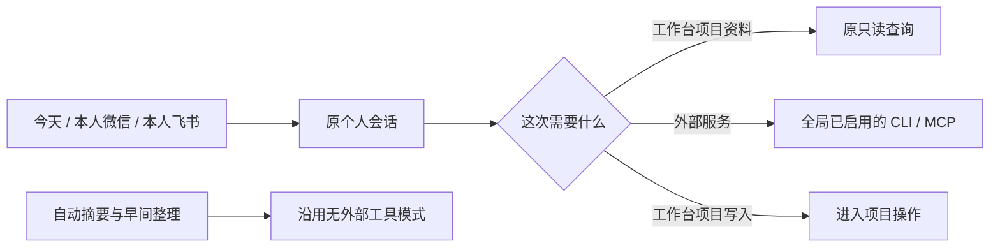

# 今天调用全局工具

目标：一次安装、授权，全局使用。用户可以自然描述操作，网页也可在原输入框输入 / 明确指定工具。保留当前个人会话、草稿和渠道来源。不增加授权页、工具库或项目副本。个人规则仍由本人编辑。外部服务写入须来自本轮明确请求，查询不附带外发。工具选择本身不授权业务动作。

工具来源沿用设置中的 CLI 和 MCP，项目专属专家不进入个人目录。CLI 按注册命令和参数数组执行，不向模型提供宿主机 shell。生产中个人外部工具只在隔离环境运行，工作台业务目录、数据库、Harness 历史及模型凭证不交给外部程序。HTTP MCP 沿用已有适配器；stdio MCP 仅在隔离执行环境启动。路由、归档、自动记忆、每日建议不自动使用这些账号。

参考：项目现有 CapabilityComposer、全局 MCP 与 CLI wrapper；[MCP SDK 工具及结构化参数](https://ts.sdk.modelcontextprotocol.io/server)。

验收：同一全局配置供项目和个人选择；三个入口的真实工具调用；禁用即不可用；业务项目写工具拒绝、外部进程看不到业务目录；自动整理不加载工具；网页 / 键盘选择不自动发送。
