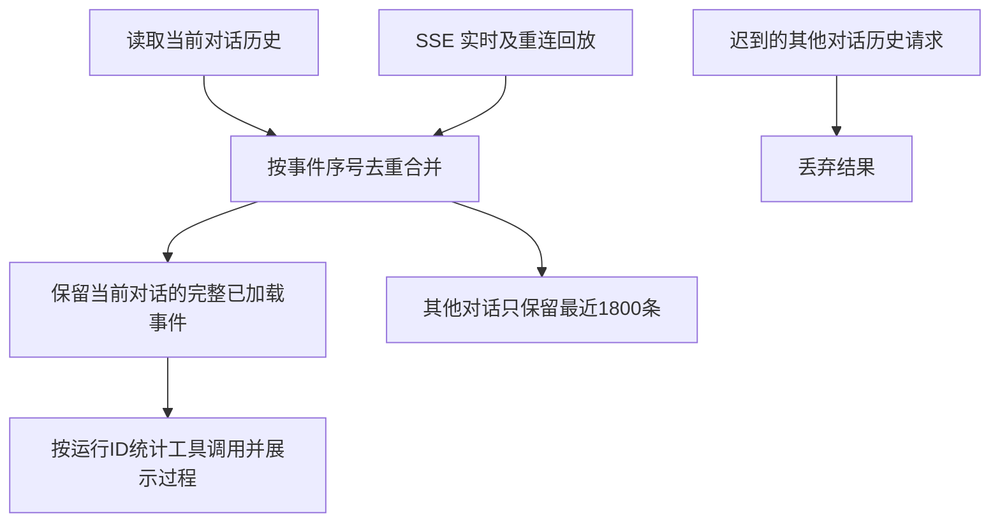

# 工具调用次数稳定性修复

## 判断与范围

目前 SSE 每到一条新事件就把整个事件数组裁剪到最后1800条，包含刚加载的当前对话历史。全局事件和旧历史回放能驱逐当前对话的工具记录，页面再按残缺数组计算出0。修复复用原事件存储，以当前会话为保留边界，并取消切换前迟到请求的回填。

参照 MDN 的 SSE 事件ID与自动重连说明，按服务端 seq 去重，支持历史与实时请求任意到达顺序。参考 https://developer.mozilla.org/en-US/docs/Web/API/Server-sent_events/Using_server-sent_events 。

## 验收

自动回归覆盖超过1800条对话事件、其他项目持续事件、重复回放、乱序历史、会话切换后的缓存收敛。界面沿用现有执行过程组件，按 Product Design 核对截图中同一运行的次数与过程是否稳定。发布使用现有前端增量组合版本流程。

## 验证结果

线上截图对应三个 Run 的数据库工具记录分别为1、3、8条，该会话230条事件，系统累计6033条事件。修复前的原始前端在相同 Chromium 测试中出现0次调用闪动并触发断言；修复版在2400条其他项目事件及重复回放期间保持1/3/8，MutationObserver记录到的归零次数为0。

6项聊天状态回归、前端类型检查与构建、Go全量测试及vet通过。依据用户截图与隔离 Chromium 截图按 Product Design 核对现有执行过程交互，没有新增界面。业务回复与工具执行均未为此次诊断重跑。

## 正式发布

已发布 `cloud-20261102-23-tool-counts`，前端源码 `bd21df6`，组合版本沿用上一成功版后端。正式 Chromium 打开截图对应的真实会话，持续20秒监测全局 SSE 回放后，三个 Run 始终为1/3/8，归零回退0次；加载资源为 `index-9P-offZr.js`。服务与渠道重启状态正常，保留上一成功版本 `cloud-20261102-22-r8-e6c11cac5640`。真实页面核对过程仅查询既有运行，没有重发业务消息或调用模型。
