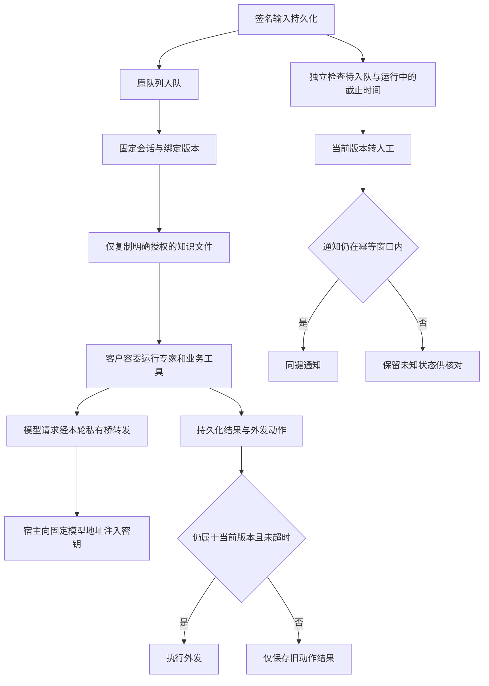

# 连接器七项审查修复 PRD

范围：本地开发与故障回归，不部署、不读取生产凭证、不真实联调。基线 `9bb06e5`。

## 业务判断和最小实现

1. 客户运行不发布浏览器，执行阶段同样不查询浏览器端口；本地协议替身覆盖完整 Execute。
2. 模型真实密钥保留宿主。容器只持占位值，通过已存在的本轮 Unix socket 桥调用固定的 DeepSeek Messages 路由；不建设通用代理平台。拒绝任意目标、重定向、非配置模型与失效会话。保留业务 CLI/MCP 能力。
3. 绑定增加精确的 `knowledgePaths` 文件白名单，默认空。运行只挂载这些文件的快照，不挂载项目全文；归档和隐含文件不得进入客户快照。版本更改使旧任务失效。专家包仍单独只读挂载。
4. 原有超时扫描也覆盖 `gateway_pending`，不依赖入口语义路由完成；过期输入只能按原会话版本转人工。
5. 所有异步失败与超时只可影响其原会话/绑定版本，旧回执仍更新旧投递记录。
6. 飞书重试次数与一小时时效在外发前检查，覆盖重启后 pending 和 sending；过期尝试结果未知，不再次执行外部动作。
7. 同一租户允许保留多个已停用连接，但仅一个启用入口。停用后可建立新账号范围的连接；旧连接不能与替代连接同时启用，旧会话归属不变。

## 参考案例

- [Anthropic sandboxing](https://www.anthropic.com/research/claude-code-sandboxing)：凭证留在沙箱外，由受限代理附加认证。只借用边界思路，不引入其服务或依赖。
- [飞书 CLI](https://github.com/larksuite/cli)：沿用现有发送命令和一小时幂等约定，不增加消息机器人。
- 本地固定 Harness 源码的 `llm-deepseek-api-key`、`messagesApiRoot` 和 SDK 协议用于核对参数及流式兼容性。

## 本地验收

每项至少一个故障回归；额外覆盖凭证路径/符号链接、其他客户归档不可见、代理目标/方法/模型/重定向与取消、慢入口路由、暂停恢复后的晚到回执、超过一小时 pending 重试、替代连接冲突。使用临时数据库、本机 HTTP/Unix socket 和子进程协议替身；不调用真实 Provider、企微、飞书或 Podman。

最后检查修复完整差异，记录对抗性发现、修正和剩余真实环境验证项。

实现与本地回归完成，结果及相邻边界修正见 [审查记录](WECOM_CONNECTOR_REVIEW.md)。
