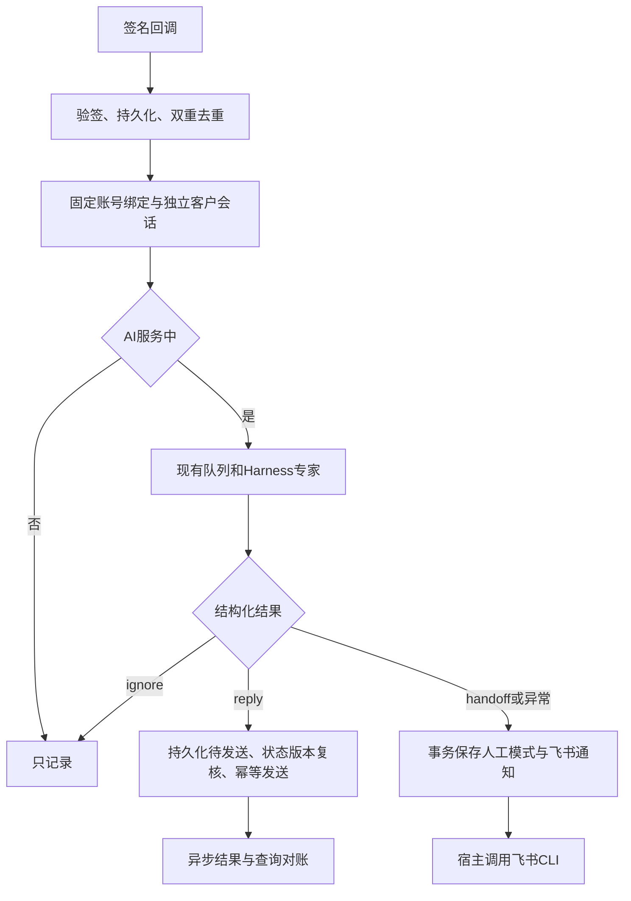

# 标准企微连接器 PRD

状态：本地开发完成，未上线。基线：5f50733。配置文件优先，不修改前端，不部署共享服务。
2026-11-02 用户明确收窄交付：完成当下开发，不上线、不完成实际测试；真实联调停止并留待后续。
七项审查修复及安全边界见 [修复 PRD](WECOM_CONNECTOR_HARDENING.md)：知识文件显式共享、模型密钥宿主代理、独立超时检查和旧版本隔离。

## 目标与范围

第三方使用同一发行包，通过网关、账号、项目、专家和飞书通知配置接入。
首期兼容网关 v1，客户私聊文字、reply/handoff/ignore、人工回复停答和显式恢复。
业务判断、取数和知识继续属于现有专家与项目；连接器没有业务名称分支。

## 责任与不变式

- 公共协议包供独立 CLI 和宿主适配复用；不新增 MCP、插件市场、运营商适配平台。
- 宿主扩展已有 inbox/runs/deliveries/队列与项目写锁，不新建任务调度系统。
- 连接配置与账号业务绑定分离；同一网关租户账号只有一个有效绑定。
- 会话键包含连接实例、租户、账号、客户和绑定版本；会话项目不能改写。
- 回调原始字节 HMAC 验签、时间窗、头体 ID 一致性校验；持久化成功才确认。
- 客户不能执行入口控制命令、改变发送目标或访问宿主发送凭证。
- reply/handoff/ignore 严格解析；异常和收到消息起 120 秒超时均转人工。
- 转人工与通知原子保存；人工消息更新模式版本，迟到结果不能恢复 AI。
- 202 只代表网关接收；传输超时复用原键原正文，unknown 不自动重发。
- 单一租户回调冲突不覆盖；密钥只安全保存，不自动轮换。已提交消息不可撤回。

## 参考调查

- 网关接口：https://wecom-gw.zhishicat.com/api-docs.html （2026-11-02 阅读）
- 飞书 CLI：https://github.com/larksuite/cli （独立工具与配置交付）
- Chatwoot：https://app.chatwoot.com/hc/user-guide/articles/1677497472-how-to-use-agent-bots （会话级人工模式）

## 验收

同一发行包配置两个业务项目；重复/乱序回调、崩溃窗口、连接身份冲突、绑定变更、
人工抢答、通知失败、模型异常、异步发送回执、五客户与长任务争用均需行为验证。
真实 Harness、真实网关和真实飞书收发分别记录，不以替身测试冒充真实验收。
首期不开发工单、认领、提醒升级、营销、独立知识库或配置页面。
