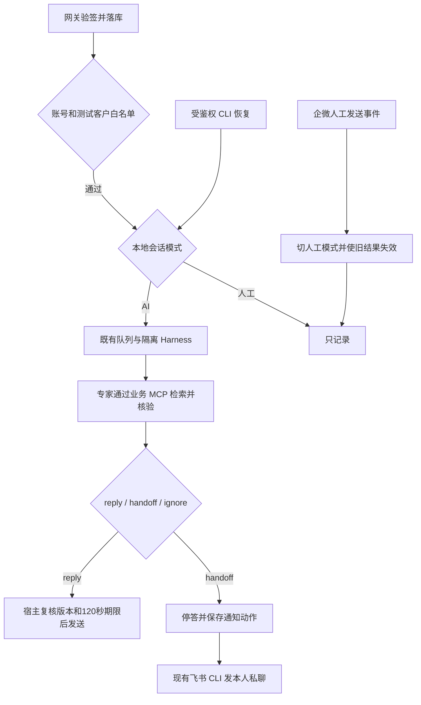

# 企微隔离预览

2026-11-02 用户授权使用现有云服务器和既定测试客户真实联调，正式入口保持现状。

## 运行范围

预览入口为 `https://dsh.qianlan333.cloud/wecom-preview-15142ee/`，独立密码在本机
`.var/gateway-live/preview/owner-password`。私有 profile 为同目录 `gateway.json`。
这两份文件不包含在发行包、专家目录或客户容器挂载中。

云端目录：

| 用途 | 路径 |
|---|---|
| 临时代码与 CLI | `/opt/project-workbench/previews/wecom-15142ee` |
| 独立数据 | `/var/lib/pwb-wecom-preview` |
| 宿主运行配置 | `/etc/project-workbench/wecom-preview.json` |
| 私有操作配置和收据 | `/var/lib/pwb-wecom-preview/operations` |
| 业务检索服务代码 | `/var/lib/pwb-wecom-preview/business-service` |
| 业务语料快照 | `/var/lib/pwb-wecom-preview/business-data` |

以 projectwb 运行两个临时 user unit：`pwb-wecom-preview` 与 `pwb-wecom-evidence-preview`。
后者只挂载业务脚本、该服务的认证 token、语料快照和只读检索依赖，不挂载模型或发送凭证。
没有定时器、第二套正式渠道消费者或新的稳定发布版本；current 和 previous 未切换。

## 业务判断流程



## 配置实例与标准能力

连接器仍无黄小璨分支。业务实例继续采用现有专家与证据检查方法；全量语料只供受认证的
业务 MCP 使用，客户容器只取得三个查询/核验工具。没有把整个项目目录重新挂回客户容器。
专家的最终协议映射为 reply/handoff/ignore，维护与 CRM 同步保持暂停。

业务服务参考已安装 MCP TypeScript SDK 1.27 的官方 stateless Streamable HTTP 示例：
[SDK 文档](https://ts.sdk.modelcontextprotocol.io/server)。没有给标准连接器再包装 MCP。
业务适配源码与语料、配置均保留在私有预览目录；发行包保持通用。

## 管理命令

本机使用发行包 CLI，或在源码工作区用 `go run ./cmd/wecom-gw-cli`：

```sh
wecom-gw-cli binding list --config .var/gateway-live/preview/gateway.json
wecom-gw-cli session list --config .var/gateway-live/preview/gateway.json
wecom-gw-cli session pause --config .var/gateway-live/preview/gateway.json --id SESSION_ID
wecom-gw-cli session resume --config .var/gateway-live/preview/gateway.json --id SESSION_ID
```

云端 CLI 为代码目录下 `bin/wecom-gw-cli`；profile 是私有操作目录的 `gateway-cli.json`。
暂停和恢复仅改变本地客户会话；恢复只处理新消息。当前飞书私聊只用于接管通知，没有认领或恢复指令机器人。

新增 `TestRealGatewayHarness`：指定 `PW_REAL_GATEWAY_CONFIG`、可选专家目录
`PW_REAL_GATEWAY_EXPERT` 和私有 MCP 配置文件 `PW_REAL_GATEWAY_PLUGIN`，可选问题
`PW_REAL_GATEWAY_QUESTION` 及期望 `PW_REAL_GATEWAY_EXPECT=reply|handoff`。
测试创建临时 Store，使用真实隔离运行和模型，但不启动投递 Worker、不发送企微消息；不能代替真实渠道验收。

## 后续边界

本次为单客户临时预览。生产切换、扩大白名单、恢复语料同步、设置开机自启均未执行。
预览结束时应先停用绑定/连接并处理网关回调，再停止这两个临时服务、移除专属 Caddy 路由和预览目录；
不得停止正式渠道或删除生产数据。不要在另一次正式发布中将活动预览误作已结束目录删除。
最终生产发布需重新整合当时最新主线并按现有发布入口验收，不能直接将这份较早分支切到正式入口。
