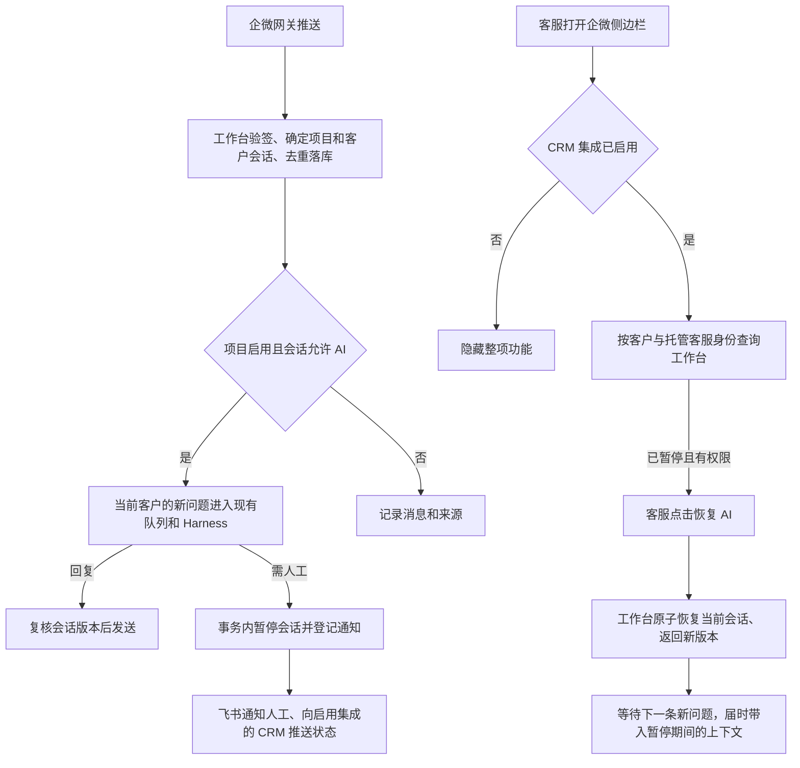
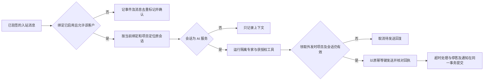

# 自动化应答项目与 CRM 企微侧边栏联合开发计划

阶段为方案定稿。目标是让客服在当前客户的企微侧边栏点一次「恢复 AI」，由一号位工作台从该客户的下一条新问题开始应答。黄小璨为第一个配置实例。后续业务新建独立项目，复用同一套连接器与 CRM 功能。

## 业务流程

## 三个决定分别归谁管

| 决定 | 权威位置 | 生效范围 |
|---|---|---|
| 这套 CRM 是否提供此功能 | CRM 管理后台，标准发行默认关闭 | 关闭时隐藏整个侧边栏区块，停止相关查询，后端拒绝该集成的恢复请求。打开 CRM 功能只恢复入口可用性 |
| 这个项目是否接收自动应答业务 | 工作台项目设置，复用已启用的连接、托管账号绑定及项目专家 | 同一网关租户的一个托管账号只有一个生效项目。项目停用后，侧边栏操作不能越过项目总开关 |
| 这段客户对话能否进入模型 | 工作台当前客户 Session 的持久化状态及版本 | AI 判定转人工或观察到人工发送时，由系统暂停。客服恢复只改变这一段会话的状态 |

用户已确认关闭 CRM 集成对工作台项目及各会话状态没有写入效果。重新启用 CRM 时，打开侧边栏直接读取工作台现状。正常应答时工作台对话框沿用原界面，暂停时才显示「AI 已暂停　✓ 恢复」。CRM 侧边栏在集成开启且当前关系已绑定时可展示状态，只有暂停时提供恢复按钮。

## 对接合同与两个可编辑网址

以 CRM 为视角命名两个字段，避免“收”“发”因查看方不同而颠倒。路径在实现时与现有连接路由一起定版。

| CRM 后台字段 | 方向 | 承载内容 |
|---|---|---|
| 接收状态通知地址 | 工作台 → CRM 后端 | 工作台持久化模式变化后，发送当前关系、模式、版本和事件 ID。CRM 用它刷新或失效已有侧边栏展示。通知丢失，下次打开仍可查准 |
| 工作台请求地址 | CRM 后端 → 工作台 | 读取当前会话状态；客服点击后 POST 明确的恢复请求。返回工作台确认的模式及版本 |

工作台对外保留一个连接接收入口。网关沿用原协议推送，CRM 用自身服务身份查询或请求恢复。同一 URL 可分派给两个固定处理器，请求头选择解析器，验签结果决定能执行的动作。网关事件保持原始报文验签。CRM 服务凭证限定绑定范围与操作，不能调用 owner 管理接口。状态通知只携带定位、状态与版本所需字段，聊天正文继续走原消息链路。

两个地址都是双端安装配置的一部分。安装时由 CRM 对外地址、工作台对外地址及连接绑定生成，预置到 CRM 后台，并把回推目标登记进对应工作台连接。黄小璨预览由交付方成对配置，验收时用户无需填写。标准包从各买方自身环境生成默认值，显式保存的覆盖值在升级后保留。同一 CRM 接第二个工作台项目时，配置归属对应绑定，避免覆盖第一个项目。

管理员可在 CRM 后台改写两个完整 HTTPS 地址。保存后读回实际生效配置。更换通知地址须把新目的地登记到工作台；编辑地址不会自动创建公网路由。先对候选地址做双端鉴权和无客户正文的连通校验，两端尚未确认时显示“待生效”，继续使用上次已确认配置。跨域更换目标要重新匹配该目标的服务凭证，禁止携带旧凭证跟随重定向。配置保存与开关启用分开，避免安装预置时意外启用。

## 身份与恢复语义

- 客服操作针对「外部联系人 ID ＋托管客服 ID」。企业、应用身份范围及项目连接由已认证绑定确定。CRM 后端从已登录员工及当前客户关系核对两项 ID，区分实际点击按钮的员工与客户所属的托管客服。同一客户添加两名客服时有两个可独立控制的会话。
- CRM 复用侧边栏 bootstrap 的已认证身份和 OneID 解析。CRM 的内部员工数字 ID、企微员工 userid、网关 accountId 和 contactId 各有自己的作用域。工作台按已验证的托管账号和联系人映射定位现有会话。一对零、一对多、跨企业、绑定已换代或无员工操作权限时返回明确结果，不创建客户或 Session。
- 查询返回模式、当前绑定及会话版本。恢复携带预期版本和唯一请求 ID。状态检查、版本更新、审计与幂等结果在工作台同一事务内完成。关掉后再开的网络乱序、重复点击、两个客服同时操作，都不能把旧请求施加到新一轮接管。超时先查工作台结果，CRM 只在得到确认后显示已恢复。
- 暂停时所有属于该会话的输入先持久化。入队、启动运行、模型请求及外发均核对状态与版本，取消仍能取消的运行。迟到的答案失效；已提交给设备的消息受网关能力限制。
- 恢复事务只记录恢复边界。之后第一条有效新客户问题才触发一次模型运行。工作台按来源、方向和顺序附上同一会话内未交付的暂停区间，把它明确标为历史。延迟到达的旧消息按原事件时间及持久化边界归入历史。保留完整记录，超出模型输入窗口时分段读取，已注入的范围随本轮持久会话接受记录提交，失败重试和重启不得丢失或重复注入。检查连续暂停两次、期间没有新模型轮次的情况。
- 当网关仅提供人工发送事件，保留「人工已回复，正文不可用」及时间。现有预览已观察到这种输入。后续模型不得补写人工承诺。

## 分工与开发顺序

| 顺序与负责人 | 工作及直接入口 | 交付判据 |
|---|---|---|
| 1．工作台与 CRM 接口负责人共同冻结合同 | 固定双端地址方向、签名、身份字段、状态读写、版本与幂等结果。拿试点的同一组外部联系人和客服标识核对两端身份映射 | 一份脱敏合同夹具，两边对同一成功请求、权限不足、无唯一会话、过期版本和重复请求得到一致结果 |
| 2A．一号位工作台 | 基于 `internal/workbench/gateway_http.go`、`gateway.go`、`worker.go`、`gateway_delivery.go`。复用现有模式、入站表、队列和投递记录。补 CRM 受限入口、模式变化通知、恢复边界与历史补入。项目设置复用连接绑定配置；暂停会话可在本地轻量恢复 | 关闭期间零新模型运行，恢复按钮本身零模型运行、零客户外发。只有下一条新问题触发应答，并能正确引用暂停期间的一个已知事实 |
| 2B．CRM V4 | 在现有系统设置和 `internal/sidebar/handler.go`、`web/src/sidebar/main.ts` 的当前客户上下文接入可选组件。增加管理员配置、签名回调、受权查询和恢复。发起恢复由后端完成 | 新安装默认关闭；关闭即隐藏且 API 拒绝；启用可看到准确状态。切换客户后，上一客户的晚返回结果不能显示或操作在当前客户上 |
| 2C．安装配置负责人 | 复用两端已有配置与密钥注入方式，为当前预览成对预置地址和凭证引用。设置按绑定保存，可修改并重新读回 | 初次安装零手填；修改后两端走新地址；单边校验失败仍有明确的有效配置；第二个业务项目只换配置即可接入 |
| 3．联合验收 | 两端使用同一套夹具完成合同回归，再在隔离环境以真实企微侧边栏完成下表旅程。工作台与 CRM 的前端在编码前以 Product Design 对齐既有组件 | 验证真实客户、真实客服、工作台状态、模型运行数和外发回执能逐一对应。最终发布各走原项目流程 |

2A 与 2B 可以在合同确定后并行。CRM 的身份分类为读取既有客户并解析已验证关系。执行分类为本地配置事务、工作台状态读取和工作台恢复写入。CRM 不代发企微客户消息。既有工作台投递机制承接状态通知，CRM 的展示缓存允许删除并重新查询。

## 对抗性验证与联合验收

以下为设计推演及未来必须执行的测试；本轮没有部署或联调。

| 输入或故障 | 验收观察 |
|---|---|
| 客户在企微发送完整恢复命令或伪造管理事件头 | 只走客户消息处理路径，暂停时运行数为零 |
| 同一外部联系人添加两名客服，员工篡改请求中的客服 ID | 正确身份对只恢复一个 Session，另一会话仍暂停；越权请求拒绝 |
| 项目 A 的凭证请求项目 B，或账号重新绑定后使用旧通知 | 按连接及绑定版本拒绝，历史归属保留 |
| 转人工时模型正在生成或发送正在等待 | 模式与版本立即更新，尚未提交的旧回复不得外发；已提交结果保留对账 |
| 人工期间收三条消息，两次点击恢复，随后重启 | 三条历史持久可读；恢复请求没有生成新运行。下一问题只处理一次，人工消息若缺正文则有明确来源标记 |
| 客服已恢复，稍后又转人工，旧页面或旧通知才到 | 旧版本不能重新开启；打开页面读回实际状态 |
| CRM 关闭集成时侧边栏已打开，旧页面直接提交请求 | 后端重新查集成开关并拒绝，刷新后整块消失。独立验证工作台项目启停与会话仍遵从工作台设置 |
| 工作台已恢复但 HTTP 回执丢失，或状态通知重复、乱序、缺失 | CRM 查询权威状态并按版本刷新。未确认时显示状态待核对，不能显示“已开启” |
| 改错地址、跨域重定向、预览与正式环境混配 | 配置校验失败可见，旧绑定仍可用，凭证不发送到未授权主机 |
| 第二个项目使用同一网关租户 | 复用租户回调，按托管账号分项目。后配置的项目不能覆盖前一个项目的回调或会话 |

上线前的真实旅程依次为：首次默认关闭 → 安装预置并启用 CRM 功能 → 客户触发转人工 → 当前客服打开侧边栏 → 人工期间记录来信 → 点击恢复 → 在客户未发言时核对零外发 → 客户提新问题且答案正确使用暂停期间事实 → 关闭 CRM 功能并检验侧边栏隐藏、工作台项目独立运行。

参考现有 [隔离预览验收](../WECOM_CONNECTOR_ACCEPTANCE.md)、[企微网关接口](https://wecom-gw.zhishicat.com/api-docs.html) 与 [Chatwoot 会话级人工交接](https://app.chatwoot.com/hc/user-guide/articles/1677497472-how-to-use-agent-bots)。本期交付围绕一个项目绑定、一份权威会话状态和一个恢复动作，不增加个人助手管理指令、工单、认领、独立恢复机器人、通用 Webhook 编排器或第二套客服对话存储。

## 上线后修复的业务判据

账号转移到新项目才建立新的归属。修改同一项目的通知目标保留人工状态与 CRM 配对；撤销业务授权需使旧执行失效。客户模型通过宿主提供的限定 MCP 桥使用业务工具，每个客户会话有自己的 CLI 状态。验收包括旧库重新打开、回滚拦截、迟到成功回执、通知写入故障、归档后待发取消和跨客户搜索隔离。独立预生产使用合成客户和隔离数据库，配合真实 Harness/知识服务验证；生产只读核对原绑定及已签名接口。

参考现有飞书命令行集成、SQLite 写事务的提交和回滚语义。[飞书 CLI](https://github.com/larksuite/cli) [SQLite 事务](https://www.sqlite.org/lang_transaction.html)
