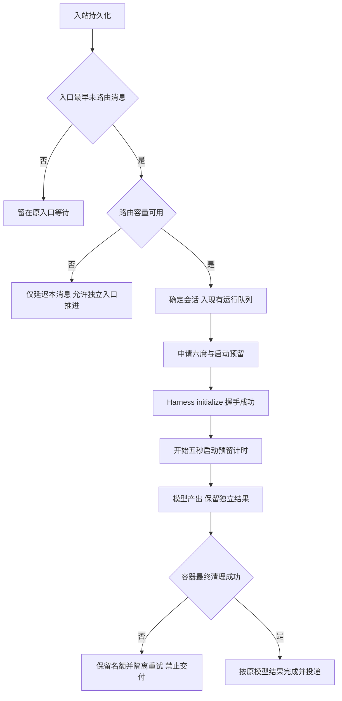

# 六并发审查修复 PRD

范围：只修复既有六并发中的入口顺序、启动内存预留、清理重试结果与空闲查询成本。继续复用 inbox、runs、单 Worker 和已有发布控制器；不新增队列服务、前端或 CRM 能力。

入口顺序：同 entry_key 的所有消息，按 created_at、rowid 保持顺序，避免延后路由使“继续”等消息读取旧焦点。显式 SessionID 也会更新焦点，必须遵守相同入口顺序；独立入口可推进。每次候选查询重新判断依赖，跨入口可推进；不引入应用内依赖表。

启动：利用已有 initialize 成功响应证明容器中的实际 Harness 已运行，不增加 Podman 轮询。握手前预留不因时间流逝失效，握手后才开始五秒观察期。

清理：首次失败保留隔离名额；复用现有重试。Worker 的最终清理成功时只去掉清理错误，保留真实模型错误；直接路由和归档没有最终 Worker 清理的路径继续安全失败。若最终仍失败，保留 stopping 和会话保护。

数据库：增加只包含待处理行的部分索引与表达式索引。先验证旧数据上可创建、旧二进制可继续读写；仅索引的向后兼容迁移不恢复旧数据库。真实发布前保留单份一致性迁移恢复点。

验收：同入口先路由 B 后“继续”不能进入 A，其他入口不受阻，同入口显式切换与后续继续保持顺序；握手延迟超过五秒仍保留启动预算；首次清理失败、最终成功保留有效回复，真实模型失败仍失败；大历史表下 EXPLAIN 查询走待处理索引，FIFO 与延迟重试正确；全量 race/vet、既有前端检查、独立只读审查无可操作问题后，隔离真实 Harness/渠道回执验收并同包晋级。

参考：SQLite 官方 [部分索引](https://www.sqlite.org/partialindex.html)、[表达式索引](https://www.sqlite.org/expridx.html)；Podman 官方 [容器检查](https://docs.podman.io/en/latest/markdown/podman-inspect.1.html)。启动就绪使用既有协议握手，避免添加容器检查循环。
