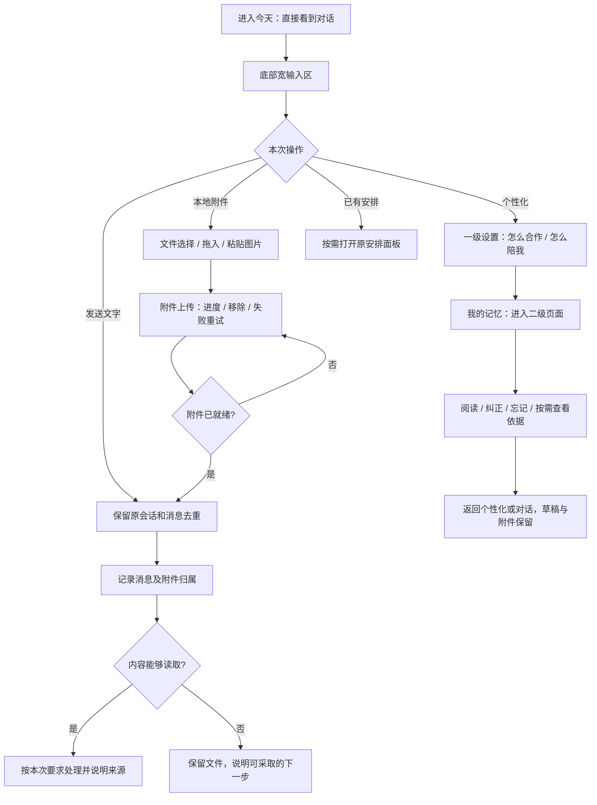

# 今天：纯白界面、附件与个性化 PRD / 设计草案

2026-11-04。状态：用户已选择实际显示的第3版；进入开发，采用居中个性化设置层及“我的记忆”二级页面。当前代码基线 `53c0477`，既有上线边界为后端/runtime `94f692e`、前端 `024e6c6`。本次依据用户最新截图，不恢复其中已经删除的“个人助手”说明。

## 目标与业务判断流程

让主界面用于对话和提交资料，把低频设置收到底部及二级页面；清理技术术语、重复标题、常驻状态和重复说明。个人规则、记忆、持续跟进与原会话继续复用，不改项目正文只读边界。

## 参考案例与取舍

已查看官方资料（2026-11-04）：

- [OpenAI Personalizing ChatGPT](https://openai.com/academy/personalization/)：在同一“个性化”入口下组织用户指令与记忆，同时保持含义区别。采用统一入口、分别管理；不把事实记忆直接混入合作规则。
- [OpenAI Working with files](https://openai.com/academy/working-with-files/)：从输入工具入口添加文件，并在当前对话提出任务。采用就近添加附件；不要求进入项目文件管理页先上传。
- [ChatGPT Chat Bar](https://help.openai.com/en/articles/9295241-how-to-launch-the-chat-bar)：查看了官方附件芯片与加号入口截图。仅借鉴交互位置，不沿用截图的深色主题。
- [ChatGPT Memory](https://help.openai.com/en/articles/8590148-memory-in-chatgpt)：查看了官方白色记忆阅读/纠正截图。采用正文阅读、按需纠正；不复制其数据政策或引入不存在的功能。

设计依据还有用户截图和当前 Today / PersonalRulesPanel / MemoryPanel / 原项目附件上传代码。纯白方向由用户明确指定；三个方案只比较结构、入口和设置呈现，不用不同品牌色制造假选项。

## 主界面

- 删除大号“今天 + 日期”整行、刷新按钮、Enter/Shift提示；“今天”保留为导航位置。
- 已删除的“个人助手”标题和能力说明保持删除。
- 页面直接进入对话；正常完成的回答不重复展示“个人助手·已完成”。执行中、停止、失败、未知等需要用户理解的状态继续显示。
- 原右上角操作收到底部输入区：附件、个性化、已有安排。删除两个旧设置入口，合为“个性化”。原有 / 工具选择保留键盘能力，默认占位文案简化为“发消息，或添加文件”。
- 正常连接状态不常驻占一行；断连或实际错误时就近出现可操作反馈。全局通知保留原功能，不新增通知中心。
- 持续跟进有事项时在输入区附近显示紧凑一行；没有进行中事项时不占一整条横栏，底部仍可进入历史。决策保持唯一可操作入口。
- “已有安排”默认关闭，底部显式打开；打开方式与选中视觉方向一致，移动端为临时抽屉，不永久挤压输入框。

## 输入与本地附件

- 桌面输入容器目标最大1200px，随主内容区伸缩；回答正文维持约760–840px阅读宽度。不能为了加宽输入而把长回答铺满整屏。
- 去掉键盘帮助占用的常驻行；保留现有 Enter / Shift+Enter 行为，并正确处理中文输入法组词状态。
- 附件通过加号或回形针选择本机文件，目标支持多选、拖入、粘贴图片；手机调用系统文件/照片选择器。
- 文件在输入框上方显示名称、类型图标和移除按钮；上传中/失败时才额外显示进度/重试，不用上传成功冒充“已读”。有可用附件时允许不填文字发送。
- 发送前移除只撤下本次引用；消息提交后附件与该消息绑定，重复提交不产生重复业务轮次。失败保留文本、附件和原消息标识。
- 附件归属当前个人对话，不默认写入其他项目文件、不自动导入专家包、不默认为长期记忆。
- 上传原始文件与解析内容分开：文本、Markdown、CSV、JSON优先复用现有只读入口；PDF、Office与图片需要补齐经过验证的读取适配。设计包含这些目标格式，但每种格式须在开发验收中证明内容确实到达模型，不能只验证“上传成功”。
- 已有原始上传大小上限128MB；实施时沿用现有上限并在超限时给出短错误，不把技术限制铺在主界面。解析还需独立控制大小/耗时。

## 个性化与我的记忆

一级“个性化”：

1. “怎么合作”：任务推进方式、输出习惯、沟通偏好；加载原agent规则，不自动改写正文。
2. “怎么陪我”：语气、互动与支持方式；加载原soul规则，不自动改写正文。
3. “我的记忆 ›”：进入二级页面，不在一级页面堆整库内容。
4. 仅保留必要的保存操作；有未保存修改时才提示状态，关闭时保护草稿，版本冲突时保留编辑。

二级“我的记忆”：

- 清楚的返回“个性化”入口；以可读正文/轻列表展示助手目前保留的理解。
- 可纠正、忘记，依据按需展开，不常驻引用编号、时间戳、版本、技术解释或重复导语。
- 沿用现有事实/观察/过期含义，不把推测包装成已确认事实，不新增默认勾选或自动授权。
- 忘记操作保留必要确认，明确聊天记录仍保留；原有派生依据停止使用、上下文清理和旧决策失效语义不变。
- “重新整理”如保留，放入更多操作并用明确文字；不保留含义不清的图标刷新入口。

前台不再出现SOUL.md、AGENT.md、两份规则、原生上下文、Markdown预览/下载、常驻版本号等实现术语。精简的是界面组织与系统文案，不擅自删改用户已保存的规则和记忆正文。

## 视觉语言

- 基础面 #FFFFFF；次级表面 #F7F7F7 / #F4F4F4；主文 #171717、次文 #737373；分隔 #E8E8E8。
- 取消当前暖黄底、绿色用户气泡、绿色主操作；发送为黑色圆形按钮，用户气泡浅灰，助手正文直接在白底阅读。
- 系统中文字体；正文15–16px、行高1.65–1.8；辅助文字12–13px。用间距、对齐和少量细分隔组织层级，避免层层卡片。
- 输入框圆角20–24px，边框轻，阴影只用于浮层。图标采用现有Lucide并统一大小/笔画。
- 屏幕重心为对话及输入；菜单、设置、记忆只在打开时出现，不能将所有功能同时摊在画面上。
- 全局基础颜色可覆盖导航和这条Today旅程；其他业务页是否同步只改token需在实现前核对实际消费者，不借此次设计重排其他业务模块。

## 三种待比较结构

- 对话优先：主界面最少元素，宽输入与工具收在同一区域；个性化按需打开。默认推荐这类主界面布局，视觉噪声最少。
- 侧栏设置：底部入口打开右侧个性化抽屉，可边看对话边调整；仅打开时占用横向空间。
- 分层设置：个性化使用独立居中设置层，我的记忆在层内进入下一页；设置更专注，返回对话保持草稿与滚动。

最终编号以实际设计图在对话中的显示顺序为准。此处不是提前绑定编号或最终选择。

## 已确认的实现缺口

- Today.send当前固定 attachments: []，文本为空直接阻止发送；不能只放一个附件按钮了事。
- 原项目上传会写入项目文件；渠道StageUpload要求本人渠道绑定，不能直接假装网页上传来源。需复用其存储/校验模式，为已鉴权网页用户补个人消息附件入口。
- read_message_attachment当前通过readPersonalText读取UTF-8文本；不能据此宣称已有PDF/Office/图片解析。
- PersonalRulesPanel、MemoryPanel目前是独立弹层；需要统一外壳和二级返回，同时保留版本校验、编辑草稿、纠正/遗忘与来源查询。
- 现有2.5秒页面数据刷新继续工作；删除手动刷新图标不等于停止数据更新。

## 后续开发验收门槛

选择视觉方向后，再确定详细实现计划。必须覆盖桌面1440/1280、手机390/320和短屏；输入框/发送操作始终可见；键盘与焦点返回；文件选择/拖入/粘贴、取消/失败/重试、仅附件发送、中文输入法；附件实际可读与归属隔离；个性化保存/版本冲突/关闭草稿；记忆纠正/忘记/二级返回；原持续跟进与多渠道行为不回退。真实附件内容进入Harness需单独验证，不以静态mock或HTTP上传成功代替。

本轮仅形成流程、PRD和图片设计方案。没有修改业务代码、现有规则、真实记忆、生产服务或渠道。

## 视觉结果与选择状态

已生成三张独立图片，均为设计概念，非可运行页面。编号严格依当前聊天实际显示顺序；已选择图3，严格按绑定结果实现。原始图片保留，副本及尺寸在`artifacts/today-white-design/options/`，绑定记录`artifacts/today-white-design/display-order.json`。目标视口1440×1024；生成图片实际为1487×1058，属于等比例概念图，不作已实现像素验收证明。

- 图 1：`/Users/qianlan/.codex/generated_images/01a1a482-6cdc-7562-8caf-f9a86f0207a9/exec-8a2e3f8b-e848-41f2-bf16-09e10a580156.png`
- 图 2：`/Users/qianlan/.codex/generated_images/01a1a482-6cdc-7562-8caf-f9a86f0207a9/exec-c3ecec1b-44ae-4767-9a72-81f3ba0211a1.png`
- 图 3：`/Users/qianlan/.codex/generated_images/01a1a482-6cdc-7562-8caf-f9a86f0207a9/exec-e18bc4b9-4bd0-4fd5-87fd-6c439e7ee1e6.png`

选择后补充：桌面居中设置层目标宽840px/高度约630px，手机为全屏层；原Today节点保持挂载，返回时恢复焦点与草稿。附件读取采用受限固定解析器，文本/Office本地解析、PDF文字提取、图片OCR，不把OCR称为完整视觉理解；外部解析通过无网络、只挂载本次附件的运行容器，附加进程必须随本轮清理。
