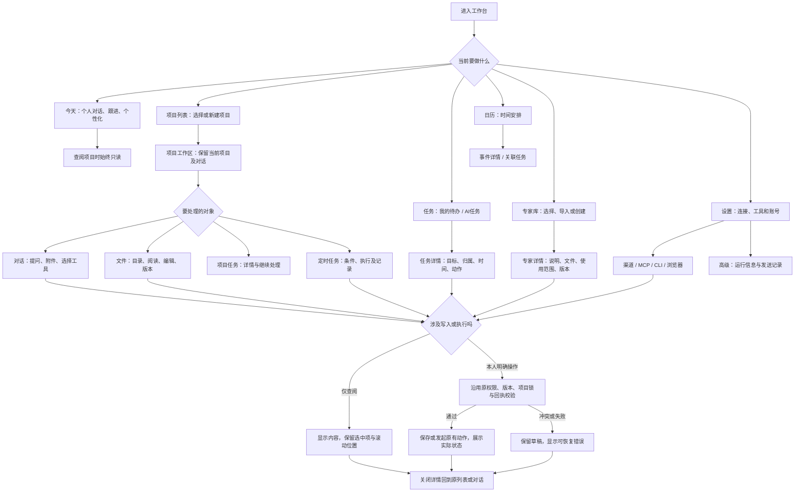

# 工作台全页面纯白统一改版：流程、参考与PRD

状态：用户已选择方案3“单栏专注，按需侧栏”，进入统一实现。承接已选“今天”第3版，不重新更换品牌方向。业务流程与PRD已完成，按选中方案展开实施规格。

## 业务判断与页面流程

设计判断：纯白底色只是基础。实际需要统一页面壳、导航、标题、正文、输入框、列表、详情、表单与状态。减少重复信息，同时保留权限范围、来源、错误、保存冲突、执行中、发送未知等会影响决策的信息。

## 当前证据与参考案例

- 当前实现基线：6b76a38，应用发布源eba379b。已阅读web/src/main.tsx、workspace.tsx、project-files.tsx、expert-detail.tsx、planner.tsx、planner-tasks.tsx及style.css。当前截图直接展示项目、专家、任务页残留的绿色文本/边线、大号页头与冗长说明；项目内两层侧栏及被挤成竖排的“对话/文件/任务/定时”；项目输入区仍有键盘提示。
- 用户截图4个本机文件均已直接打开；另依据消息内的设置页截图及当前Settings源码确认常用连接与底层参数混排。仅取布局，不把截图里的业务正文、账号或项目资料转成示例数据。
- 延续本次对话中已经选定并实现的Today第3版，参考artifacts/today-white/preview-main.png。
- [ChatGPT Projects](https://help.openai.com/en/articles/10169521-projects-in-chatgpt)：借鉴项目内对话、文件与设置的就近组织，项目设置按需进入；不照搬其权限或记忆逻辑。
- [ChatGPT Memory](https://help.openai.com/en/articles/8590148-memory-in-chatgpt)：借鉴个性化下的二级记忆管理；原Today的纠正/遗忘/依据逻辑沿用。
- [Linear Display options](https://linear.app/docs/display-options)、[Custom Views](https://linear.app/docs/custom-views)：借鉴列表密度、分组与快速详情的展示策略；不引入新的看板、指标或工作流引擎。

以上为2026-11-04查阅的官方资料。界面取舍为本项目设计判断，不代表参考产品的完整复制。

## 目标与约束

用户应能从任何页面继续工作，感觉属于同一个产品；当前上下文、主要动作和返回路径应一眼可见。普通使用先看到内容和可操作项，低频参数按需展开。

保留所有现有能力、深链接和数据：Session/Harness映射、项目不可改归属、同项目一个写入任务、Today读取项目正文只读、全局工具与项目启用范围、渠道回复来源、消息幂等、发送未知不可盲目重试。项目工作区原有的本人编辑/项目任务执行权限继续有效，不能把Today的只读边界错误扩成所有项目不可编辑。

不改账号、文件、专家包、规则正文、项目说明和历史对话内容；精简的是界面文案与默认展示。示意稿只用虚构项目“产品验证”“内容计划”和虚构专家，时间以2026-11-04为锚点。

## 全量页面覆盖

| 层级 | 入口与页面 | 本轮设计要解决的问题 | 必须保留的行为 |
|---|---|---|---|
| 全局 | 导航、页头、通知、退出、移动菜单 | 一套白/灰/黑壳，去重复“工作台”和无意义口号 | 当前选中、返回、键盘、未读、断连/错误 |
| 个人 | 今天、个性化、我的记忆 | 继承第3版，统一全站组件细节 | 对话草稿、附件、跟进、等待决策、到期复查 |
| 项目入口 | 项目列表、新建项目、最近工作、归档入口 | 小标题、紧凑项目项、一行简介，消除巨幅空白与重复“新建”占位卡 | 新建、选择、归档恢复；最近工作明确归属 |
| 项目工作区 | 对话、选择/重命名/另开/停止会话、项目设置 | 压缩重复侧栏和机器人标题，四个项目入口不换行；输入框与Today共用视觉 | 深链接、稳定会话、草稿、斜杠工具、引用与附件 |
| 项目文件 | 目录、文件阅读/编辑、版本、恢复、上传/下载 | 文件树+正文；保存与版本清楚，非必要信息折叠 | 编辑冲突、锁定提示、历史比较、只读/编辑区分 |
| 项目任务/定时 | 列表、详情、编辑、触发条件、执行记录、项目专家 | 同一行式列表和详情模板，参数按需展开 | 原触发语义、归属、执行记录、并发和取消 |
| 任务中心 | 我的待办、AI任务、筛选、新建、详情 | 默认突出未完成；已完成独立分组；长说明进详情 | 原操作、归属筛选、草稿交接、AI规则有效条件 |
| 专家 | 列表、创建/导入、详情、文件、使用范围、版本 | 名称与用途优先；版本散列与包结构不常驻卡片 | 目录/ZIP/Git导入、编辑保存、项目/规则绑定、版本 |
| 设置 | 渠道、MCP、CLI、账号、浏览器、运行信息、发送记录 | 常用连接与能力先到达，运行参数进入高级 | 启停/授权/全局范围、未知回执、账号操作 |
| 关联页面 | 日历及事件详情、站内信及失败详情 | 同一标题/筛选/详情壳，避免遗漏未截图页面 | 缓存读取、显式同步、日期时区、关联任务/回执 |
| 公共状态 | 登录、空、加载、失败、确认、回收站、表单/菜单 | 同一控件体系，删除低价值说明与重复成功标签 | 保护未保存内容、危险操作确认、错误恢复 |

## 统一视觉与组件

纯白#fff；主要文字#171717；辅助文字#737373；选中/气泡#f4f4f4；边线#e8e8e8。颜色用于必要状态，旧绿色大面积选中、灰绿正文、绿色代码底色一并收掉。正文对比度不得为了“轻”而变浅。

系统中文字体与现有图标库；页面标题24–28px，主要正文15–16px，辅助12–13px，行高1.55–1.75。中文导航、页签保持整词不竖排；长名称可换两行，真实内容不能删改。

页面头高56–64px，标题出现一次；删除WORKSPACE/CAPABILITIES/PREFERENCES等英文眉题和品牌口号。保留项目/对话定位、返回、通知入口；正常连接不常驻占整行，异常明确显示。普通列表不用卡片套卡片或大面积阴影。

共享组件覆盖PageHeader、SectionHeader、ListRow、Status、Composer、DetailPanel、Form、ActionMenu、ImportMenu、EmptyState、ErrorState。先以同一组件规范覆盖上述全部页面，再验证遗漏；不逐页叠加绿色覆写CSS。

## 关键页面设计规格

### 项目列表

标题“项目”与一个新建动作同一行；项目名称、一行纯文本说明、最近工作时间和更多操作构成紧凑项目项。说明仅展示原字段的短预览，不把项目正文或最近聊天拼作简介，不改原字段。无专家时不显示“0位专家”；不重复显示“打开工作区”与整项可点击这两种等价动作。最近工作保留，限制首屏数量，明确项目/今天归属，已有分页或展开入口继续可达。归档放次级操作。

### 项目工作区与文件

对话正文保持约800–880px阅读宽；输入区最大约1200px。删除“项目内持久对话·跨端继续”“当前范围…”和键盘提示。主入口围绕对话、文件、任务、定时任务，具体位置通过视觉方案选定；会话选择保留在就近入口。专家/工具选择保留实际当前项，不用说明句堆满页头。

文件模式保留目录及大正文阅读/编辑区；保存、版本和编辑状态明确。全屏编辑/分栏沿用现有能力；文件列表、会话列表和编辑草稿独立保留。切换项目或关闭未保存文件时保留原保护。

### 专家库与详情

列表展示实际专家名、最多两行用途、更多；创建为主要动作，目录/ZIP/Git收进明确的“导入”菜单，选了方式才解释SKILL.md等格式要求。列表去版本散列、长技术说明。详情用说明、文件、使用范围、版本等清楚区段，继续提供原编辑、绑定与历史，不改变包正文或名称。

### 任务、AI任务与日历

任务一行优先展示标题、归属、时间、必要状态；长WHY/做法/背景进详情。普通待办优先未完成，已完成可查看；AI任务仍独立入口，不和Today的持续跟进混成另一套业务状态。新增/详情/编辑使用同一面板模板。任务来自哪个项目、是否运行中、下一次何时执行仍明确。

日历继承纯白标准，时间网格线轻、当前选择明确；同步操作继续存在，明确命名“同步飞书日历”，不能因Today移除无意义刷新而误删实际Provider同步能力。事件详情、关联任务、AI执行记录全部同壳。

### 设置及下钻

按连接与工具、账号、高级分层；主要渠道/MCP/CLI入口在前。DeepSeek Harness、podman、并发上限放高级中的只读运行状态；浏览器接管就近可达。连接状态译为正常用户语言，保留异常的原因和动作。MCP/CLI必须可见当前是否全局启用；停用、移除、授权、发送回执保持实际差异。修改凭证只在相应编辑表单显示，不展示旧秘密。

现有设置说明“每个入口独立记住当前对话”与Today统一会话的真实逻辑不符，应改为“微信、飞书和网页接续同一段个人对话”；只在配置或帮助处必要时出现，不常驻导语。

## 三种结构探索

- 统一侧栏、内容直达（推荐）：保留可读的全局侧栏，项目内使用紧凑横向入口和按需历史；常用页面内容同一对齐线，列表与详情保持稳定返回路径。适合这次全站一次性整合。
- 紧凑目录、双栏工作：全局导航缩为窄栏，项目目录/会话形成清晰的第二栏；文件和任务高频用户少切换。相对占用固定横向空间更多，手机需分别收起两栏。
- 单栏专注、按需侧栏：对话/正文成为主画布，资料、任务、设置以明确入口展开；普通列表更轻，低频配置折叠。阅读面积最大，跨对象切换会多一次展开。

三个方向均沿用近乎纯白的Today第3版，不以三套颜色重复制造选项。每张视觉稿是一套跨页系统，展示主要项目工作区和项目/专家/任务/设置的配套页面，不是把多个互不相关方向拼在一起。

## 响应与交互状态

1440×1024为单页桌面基准；图板上的缩略页只是设计总览，实施时必须展开每页按实际CSS视口核对。覆盖1920、1440、1280、1024、768、390、320，另测短屏。移动端只保留一块主内容，目录/详情全屏或临时抽屉，返回后定位原项。

所有入口具可访问名称、焦点环、键盘操作；弹层限制焦点并归还入口，隐藏区不可Tab进入；悬浮菜单防出屏。内容区域可滚动，输入/保存操作不可被列表或虚拟键盘挡住。表单加载不得覆盖已输入内容；409保留草稿；切页和关闭继续使用必要未保存保护。

## 验收与后续实施边界

选择视觉方案后再开发。实施需一次覆盖此清单全部页面及嵌套表单/状态，逐入口截图对照，不以全局改几个颜色变量算完成。完整回归：项目选择→对话/附件→文件阅读/保存冲突→任务→定时规则→专家绑定→连接/工具设置→站内信/回执→Today个性化；并检查刷新/后退/深链接/移动端。

本轮不修改后端架构或权限；实施与发布按下一句的既有流程推进。选定设计后的开发和部署继续沿用原review→修复→复核→适用Harness/渠道→同包发布和独立读回。设计图不能被称作可运行页面或已验收功能。

## 本轮视觉结果与选稿映射

按本轮聊天中实际展示顺序记录，不能再用提交调用的顺序推断：

| 展示编号 | 结构方向 | 图板 | 像素 |
|---|---|---|---|
| 1 | 统一侧栏，内容直达 | artifacts/workbench-white-suite/option-1.png | 1448×1086 |
| 2 | 紧凑目录，双栏工作 | artifacts/workbench-white-suite/option-2.png | 1536×1024 |
| 3 | 单栏专注，按需侧栏 | artifacts/workbench-white-suite/option-3.png | 1536×1024 |

原始生成结果路径和摘要见artifacts/workbench-white-suite/display-order.json。各图板包含同一套结构下的六个页面，单页缩略比例仅供结构比较；选定后需按完整桌面/手机视口展开细节。用户已选择展示编号3，按其精确原图实现。

概念稿的文字不是权限或能力证据：实现时渠道用途统一为接续本人个人对话及真实通知，不照搬图中“飞书文档写入”等泛化描述；项目对话的工具栏不额外加入个人记忆/个性化，个人入口仍留在Today；专家的使用范围显示真实绑定，不因图中示例“所有项目”而自动全局启用；任务/文件编辑器不得引入原系统没有的子任务或富文本能力。所有运行时能力、状态和操作回到本文已核对的现有消费者。

已直接核看三张完整图板：白/灰/黑方向一致；覆盖项目对话、文件、项目列表、专家及详情、任务及详情、设置及连接；未出现源截图中的账号项目或真实业务正文。图板内未展示的日历、站内信、归档、登录与弹层仍属于上文覆盖清单，选稿后必须随同一套规范展开，不能在实现验收时遗漏。
