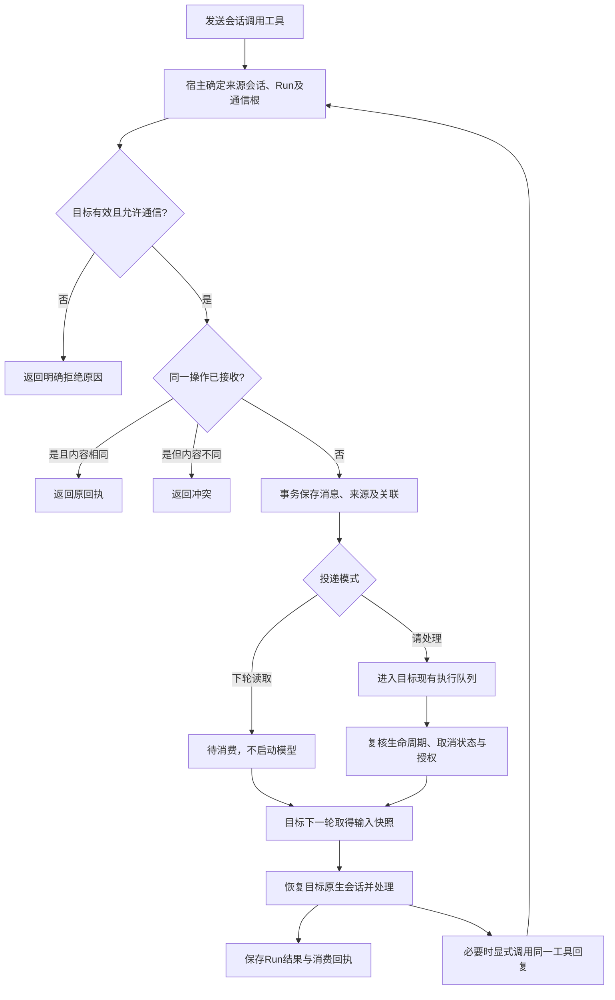

# 通用双向会话通信实施计划

状态：2026-11-05已获用户开发、验收后上线授权。

**Goal:** 让已授权的已有会话互相发送带可信来源的消息，选择立即排队处理或留待下一轮读取，使用原会话上下文并准确跟踪回执。

**Architecture:** 复用工作台的 inbox、Run、事件流、会话映射和执行器。通信是宿主提供的能力，Harness 和未来其他内核通过同一受限工具调用；传输与业务语义分离，个人助手与项目会话使用同一协议。

**Tech Stack:** Go/igo、SQLite WAL、现有 Harness SDK、MCP bridge、React/TypeScript。确认后按 executing-plans 工作流分阶段实现与验证；不要求更换执行内核。

## 1. 第一性原理与范围

一条会话消息只需要回答：谁发、发给谁、说什么、何时消费、是否已接收/处理，以及能否采取相应行动。

“项目汇报”“个人助手分派”“跨项目讨论”是协议的使用方式，不是三种后台模块。正文为自由文本，没有必填的成果、风险、WHY、建议等业务字段。

首版包括：已有会话之间的双向发送、显式关联回复、立即排队/下轮读取、来源标记、回执、取消、去重、重启恢复、有限自动接续及授权校验。

删去：固定汇报模板、自动创建任务、每条消息绑定持续事项、自动组队、通信中心页面、独立消息服务、全量历史复制、同步阻塞等待、自动替发送者挑会话、默认转发所有模型答复、未变更内容的周期性模型轮询。

适用范围是工作台内本人拥有的有效会话，支持今天↔项目、同项目会话↔会话、项目A↔项目B。无根消息接收方角色限制，不为“今天”写专用路由。外部客户、路由器、后台记忆整理等受限运行默认不获得该工具；原定时任务不会因上线而自动开通或改写。

应用 Session ID 是地址；项目ID和标题仅用于定位、展示。目标固定到接受时验证的实际会话，不能跟随渠道焦点变化。首版不创建新会话，沿用现有创建能力；不向草稿、归档、回收站或已删除会话投递。

## 2. 业务判断流程



发送返回持久化接收回执即结束，不等待接收方回答。来源Run结束、目标Run开始是两件事，不要求进程同时存活。收到消息不意味着业务任务完成。

## 3. 标准消息与工具

Agent侧提供三个轻量工具，实际命名实现时与当前工具目录统一：

- `list_session_targets`：分页查询可通信会话的ID、标题、项目、有效状态；不返回整段历史。名称不唯一时由调用方明确选择。
- `send_session_message`：发送或回复，正文不限业务格式。
- `get_session_message`：按消息ID查询接收、消费和关联Run状态；只可查询本人/当前运行有权访问的通信，不借此读取任意目标历史。

建议发送载荷：

```json
{
  "toSessionId": "目标应用会话ID",
  "text": "自然语言正文",
  "delivery": "wake",
  "operationId": "本次逻辑发送的稳定标识",
  "replyTo": "可选：正在回复的消息ID"
}
```

`delivery`只有`wake`和`context`。默认`wake`；`replyTo`与投递模式独立，不推断“回复一定立即运行”。调用方在同一逻辑发送重试时复用operationId。宿主用来源会话+operationId做唯一约束，并核对目标、正文和模式摘要；改内容不能复用旧键。同一正文可以是两次合法发送，不做内容相似度去重。

`replyTo`必须是当前会话收到、且当前运行有权使用的消息。回复目标从原发送者解析并与toSessionId一致；不能伪造关联到别人的消息。普通输出不自动回传，只有显式发送才产生新消息。接收回执由程序生成，不需要Agent回一句“收到”。

接收方按自身规则和专家能力决定是否回复及后续动作；后台不要求回复，即便消息来自另一Agent也不自动确认收到。需要发送新内容时才使用同一工具关联回复。该规则不生成固定回复模板。状态查询不会返回目标整轮的原始答复或工具日志，尤其不能暴露顺带消费context消息时的本人对话；只有显式发回的消息才是给发送方的答复。状态查询不启动模型、不自动安排轮询，单次执行继续受既有超时和停止机制约束。

服务端填写：senderKind=agent、来源project/session/run、目标session、创建时间、因果根与上游消息、授权引用、接收序号、消费Run和结果状态。模型不能声明senderKind=human、替换来源或创建新的因果根。

首版正文上限16KiB UTF-8，超限明确拒绝、不静默截断。正文可含站内成果链接，但链接不自动挂载文件、不扩大读取权限。必要节选由发送方有权读取后写入正文；附件复制、跨项目目录共享和通用多媒体传输不纳入首版。

通过现有`/api/v1`提供目标查询、消息发送/状态查询及取消入口。本人API/CLI调用也必须声明可核验的实际调用身份；只有绑定当前Run的bridge能生成Agent来源。普通网页消息提交不能靠传`source=agent`伪造来源，运行环境不注入所有者永久密码。`pwb api`可访问所有者管理接口，CLI自身身份不能伪装正在运行的Agent。

## 4. 消费、顺序与并发

### 请处理（wake）

一个新接收消息最多关联一个首次执行Run。目标空闲则按既有调度策略领取，忙碌则等待当前轮完整收尾。首版不做运行中steer/interrupt注入，不重启目标当前Run。

同会话按宿主接收序号消费；同项目仍遵守现有写入互斥，不因来自另一个会话绕过。不同项目与个人助手沿用现有并发能力。用户输入不被无界机器消息挤占：自动投递次数有界，只有领取之前才按既有交互优先规则调度，不重排已进入同一会话的消息序号。

### 下轮读取（context）

消息先保存并可在会话中查看，不创建Run。目标下一次正常处理输入时，按接收序号读取此前待消费的上下文消息，仍作为Agent资料块，不成为本人指令。取得输入快照后到达的消息留到下一轮。

待消费上下文每轮最多32KiB，超出保留待消费状态并提供按消息ID查询；不为了清空积压自动启动模型。消费关系记录具体Run和消息ID。模型已接受但结果未知时保留“处理状态待核实”，不能把同一批输入自动重复执行。

上下文消息不能把只读运行提升为可写。若由一个用户主动运行顺带读取这些资料，行动依据仍是该轮本人指令和已有授权，不能因为历史里出现了建议就扩大权限。

### 回执语义

界面区分：已接收、等待下轮读取/排队、处理中、已处理、失败、已取消、待核实。执行阶段从关联Run派生，不再创建一套平行执行状态机。“已处理”只表示该消息对应的处理轮成功结束；是否回复、业务是否完成分别显示。

入库成功而SSE失败不撤销接收；客户端按operationId查回执。只重试明确未发生的传输操作，不能将超时自动等价为未执行。Harness提交前持久化投递意图，提交后记录SDK回执；崩溃处于两者之间时核对原会话，无法确认则待核实，不改用新Session或盲目再发。

## 5. 身份、授权与记忆

模型输入、网页历史、导出、压缩与记忆提炼都要保留Agent来源。修改现有`本人本轮输入`生成逻辑，新增可信来源封装；即便底层SDK以输入消息承载，也不赋予本人身份或系统指令地位。

Agent消息不直接作为个人偏好、本人决定、长期目标或行为授权的原始证据。带有本人原话时保留来源引用，实际证据仍回指可访问且有效的本人原消息；不得以转述重复制造多个独立证据。来源删除/遗忘时，派生判断沿用现有失效规则。

通信权限与执行权限分开：

1. 默认的Agent消息触发只读处理。可使用目标现有历史及授权的只读查询，不能调用任意Shell、写工具或无法验证只读的CLI/MCP。对项目文件使用只读挂载及工具白名单，不能只靠提示词写“只读”。个人接收运行同样不能自行写日程、外发或改长期记忆。
2. 需要代办写入时，发送者先提出明确执行请求。复用现有持久决定机制展示目标会话、交代正文和将使用的执行范围；本人确认后在宿主生成与目标、消息摘要绑定的授权记录。已有有效、覆盖本次操作的本人确认或保存任务配置可以复用，不重复确认。
3. 自然语言正文只能提出请求，不能自己生成授权。仅凭“用户已同意”字符串或指向任意一条本人消息，不足以通过工具层校验。
4. 已获授权的目标Run使用其既有项目执行环境，权限不超过目标原有能力。此次授权不自动传给第三个会话；再委托需要已有授权明确涵盖目标，或重新取得范围授权。
5. “今天对项目只读”继续成立：今天本身不取得项目写卷。通过项目会话执行修改是显式委托写入，不包装成只读查询。

这不是新增通用审批系统；只为会话委托复用一类既有决定记录。没有授权的读消息直接处理，写请求持久等待，不占运行进程。

## 6. 防循环、停止与生命周期

不根据正文是否像“谢谢”判断循环，也不依赖模型自觉停止。

- 同一个本人输入Run或已授权定时触发构成一个因果根；其派生通信继承该根，模型换operationId也不能重置计数。
- 首版每个因果根最多接收8条Agent通信消息，包括各分支和回复，context也计入。重试命中原消息不再计数。计数和消息接收在同一事务中完成；并行发送不能突破上限。
- 到达上限停止接受新的派生消息，返回明确原因，不自动再生成一封告警消息唤醒Agent。待办状态在原会话执行详情可见；本人主动继续才能开始新的有限轮次。
- 8是可配置的系统默认值，不做预算面板；Agent不能修改。无消息不调用模型，无自动“收到”往返，无失败自动改编号重跑。
- 单条消息可取消；`停止此轮协作`取消该根尚未消费的消息、待授权操作，并停止只由该根触发的运行。若某条context已被用户正常运行作为资料读取，不中止无关用户工作，但撤销其后续自动派生。
- 停止状态在投递、领取和新的发消息工具调用时复核；停止前已发生的文件/外部修改不宣称撤销。运行收拢后才释放已有锁。
- 授权后的执行失败、取消或结果不明，不自动复用授权重跑外部动作；本人在原记录核对后手动重试，新尝试保留原消息及尝试关联。原操作去重和外部回执继续有效。
- 归档、回收、删除目标，或撤销权限，拒绝后续投递/处理；保留明确结果，不转到同项目其他会话。来源Run/会话失效时取消尚未交付的自动动作。
- 清理消息正文、源引用和派生记忆沿用会话生命周期。必要的最小去重墓碑只保留ID/摘要及终态，不保留已删除正文；删除后不被迟到消息重新学回或重新建会话。

## 7. 界面与对外通知

Product Design上下文检查无额外保存素材，沿用现有会话消息区、执行卡片、来源标签和侧面详情组件。设计目标是识别来源与投递状态，不改导航结构；开发阶段按Product Design完成真实页面设计核对和桌面/手机验收。

- 目标消息显示“来自 项目名 · 会话名”，明确标记Agent，不使用本人气泡。
- 来源侧显示一张发送记录；两侧引用同一个messageId，不各造一条业务消息。
- 点开详情查看正文、原会话、接收/处理状态、关联回复和Run。页面展示等待原因，不把仅入库写成已读。
- 回复按钮先在当前输入框准备一条可编辑的关联指令，不自动发送、不覆盖现有草稿。Agent也能直接调用发送工具回复。
- 取消/继续协作复用现有执行操作；权限确认复用既有持久决定卡，不增加独立授权管理页。
- 内部通信不修改网页/微信/飞书的当前焦点，不默认外发，不新增站内信类别。用户在原渠道明确委托并要求结果时，沿用该原始请求的已保存通知目标；不能以“最近用过微信”作为通知依据。

普通回答、转发资料、自动处理结果使用同一组件，不生成进展汇报模板或强制栏目。

## 8. 技术落点与最小持久化

2026-11-05核对的正式版为`cloud-20261104-32-suite-white-78a6002`，后端记录`eba379b`。当前执行入口仍是Harness；原Submit只接受web/wechat/feishu/automation，不具备通用Agent来源。开发开始时重新核对最新正式组合，不能用计划工作树覆盖后续发布。

现有`Message/Incoming/Run`扩展Agent通信元数据，复用inbox存放入站消息；唯一索引复用来源命名空间+稳定操作键。根控制状态附着来源Run，持久化累计消息数、撤销标记与授权引用。消息创建、根计数、关联Run和消费进度使用事务。

不建立第二套执行队列、事项系统或轮询服务。SDK/运行器只接受宿主验证后的输入。MCP工具在项目和个人两个环境注册相同语义；未来内核只需接入同一宿主协议。

主要文件（按正式基线核对后实施）：

| 范围 | 文件 |
|---|---|
| 通信核心 | 新建`internal/workbench/session_communication.go`及行为测试 |
| 模型/存储/入口 | `model.go`、`store.go`、`messages.go`、`http.go` |
| 调度与会话恢复 | `worker.go`、`harness.go`、`session_lifecycle.go` |
| 工具与权限 | `app_bridge.go`、`personal.go`、`personal_global_tools.go`、`runtime/app-mcp.mjs` |
| 记忆与压缩 | `personal_understanding.go`、`session_archive.go`及实际摘要消费者 |
| 渠道隔离 | `channels.go`、`today_channels.go`及对应发送路径 |
| 界面 | `web/src/main.tsx`、`chat-state.ts`、`message-submissions.ts`；按现有组件边界抽取通信卡片 |
| 文档/验收 | 本计划、`docs/IMPLEMENTATION.md`及通信验收记录 |

运行适配测试通过后才能承诺保留原Harness身份；不得为只读接收轮偷偷重建会话。若现有SDK不能在恢复时正确收窄工具，应先修复适配，不降级为仅提示词限制。

## 9. 对抗性验收矩阵

| 测试 | 阻断标准 |
|---|---|
| 今天↔项目、项目A↔B、同项目两会话 | 同一套API；无需新增场景字段；目标历史接续正确 |
| 改名、重名、渠道切换 | 依据稳定ID投递，不误入其他会话 |
| 同时发两条/重复提交/同键不同文 | 顺序稳定；重复一次；改内容冲突 |
| 请处理与下轮读取 | 前者入队一次，后者不新增Run/模型调用；下轮消费可追踪 |
| 输入快照之后又到消息 | 不被标记已消费，不丢失，不插进已经开始的轮次 |
| SDK接收回执丢失、提交间隙崩溃 | 原会话对账，无法核实即待核实；不盲目重跑 |
| 接收方正常结束但没回复 | 显示已处理且无回复；不伪造回复、不自动往返 |
| A等B、B回A | 来源Run可释放资源，继续原会话，不因等待锁死 |
| A↔B无限回话、并行扇出 | 全分支共享计数，超过8条被拒绝，换键不能重置 |
| 无授权消息要求写文件/发飞书 | 只读工具与挂载阻断；不能继承目标会话的旧写权限 |
| 本人明确确认委托 | 指定目标按一次授权处理；改正文/目标、再转发第三方不得复用 |
| Agent声称用户偏爱某方案 | 不直接进入已确认个人记忆；引用需回到有效本人依据 |
| 客户会话伪造本人或项目发送者 | 工具不可用且服务端拒绝，不能调用所有者API绕过 |
| 停止与投递/领取竞争 | 不再派生；正在运行正确收拢；保留已发生修改 |
| 归档、回收、删除、遗忘后迟到 | 不复活会话、不继续授权、不恢复被删正文/个人理解 |
| 项目更新推翻之前结论 | 来源和时间可见，执行前按需核对，不把旧消息视作实时状态 |
| 微信/飞书活动时收到内部消息 | 不改变焦点、不向无关渠道发消息、不泄漏其他会话正文 |
| 草稿、刷新、手机详情开关 | 不丢输入、不重建Session、不丢回执；有明确可达的来源入口 |

## 10. 分阶段实施与验证

每一阶段先补失败的行为测试，再实现，再运行相应测试；不把“代码能编译”当作跨会话真实验收。

1. **协议与事务接收**：实现标准载荷、可信来源、目标校验、唯一键和查询。先跑重复、冲突、伪造身份测试，再核对接口与CLI契约。
2. **原会话消费**：接入wake/context、输入序号、消费水位和现有调度；测试忙会话、并发项目、context不调用模型及SDK未知结果。
3. **权限与控制**：实现只读运行、已有授权/持久决定复用、有限因果链、取消、归档删除和记忆来源排除；权限和死循环测试必须先通过。
4. **工具及界面**：双方使用同一工具；Product Design核对现有视觉目标后实现最小通信卡片、回执、回复草稿和停止入口。桌面/390px手机浏览器实测，不生成新的一级板块。
5. **全量review与候选验收**：核对完整调用链和所有直接消费者，修复后复审；执行Go行为/race/vet，前端类型检查/构建及相关Node测试。
6. **真实模型验收**：隔离项目与个人测试会话，验证A→B→A、今天↔项目、已有上下文接续、只读拒写、授权后受限执行；记录调用次数、耗时、排队、重启恢复和未验证项。

基本命令：`go test ./...`、`go test -race ./...`、`go vet ./...`；web目录`npm run check`、`npm run build`，并运行现有聊天状态/渠道测试及新增通信行为用例。自动测试不得连接真实客户会话或写入现有业务项目。

## 11. 发布与回滚

本计划确认前不开发、不上线。确认后的开发使用最新已验收基线，遵守工作台独立发布控制器和正式/上一成功版保留规则。

新增能力默认仅向允许通信的本人交互会话开放；旧整理仍暂停，现有定时规则保持其启停状态和能力范围。上线不会制造一批自动消息，不扫描历史推导委托。

数据变化采取可兼容的新增字段/索引。发布前做必要迁移备份，等待或安全收拢相关活动运行；切换后验证原生会话、真实模型、页面、微信/飞书连接和已存在任务。未经当前范围授权不推送GitHub。

回滚前暂停新通信接收和自动消费，收拢Agent来源Run；保留新消息、接收回执、取消和授权记录。旧版不识别的Agent输入保持冻结，不能作为web消息重放。回滚程序不覆盖上线后的业务数据库。

交付源码、协议说明、迁移/回滚方法和验收报告。报告分别列明代码约束、自动测试、真实Harness、真实平台及未验证范围。

## 12. 参考与关键取舍

- [DeepSeek Harness SDK](https://github.com/deepseek-ai/deepseek-harness/blob/ce7073d51254c26cd63b22a60835b8f948deb447/packages/sdk/protocol/README.zh.md)：复用持久会话恢复及新输入协议，宿主负责可信通信来源。
- [OpenClaw Session Tools](https://docs.openclaw.ai/concepts/session-tool)：参考精确会话寻址、跨会话来源、接收与执行区分；不照搬其全部会话管理功能。
- [Agent Autoloop协议](https://github.com/KKKKhazix/agent-autoloop/blob/main/docs/protocol.md)：参考事件/轮次分离和规则控制权限；不新增中台或强制事项对象。

ADR-1：选择在现有会话入口增加标准通信，避免复制消息、执行与状态系统。
ADR-2：选择显式回复，普通输出不自动变成跨会话输入，降低循环与泄漏风险。
ADR-3：选择应用层保留Agent身份，普通消息触发只读；需要写入采用明确委托。增加一个授权绑定步骤，换取不能借消息绕过原只读边界。
ADR-4：选择异步接收、有限接续和未知状态暂停；不承诺跨模型及外部系统的绝对exactly-once。
ADR-5：选择现有消息流呈现，保留源链接与回执，不新增通信中心或汇报模板。
