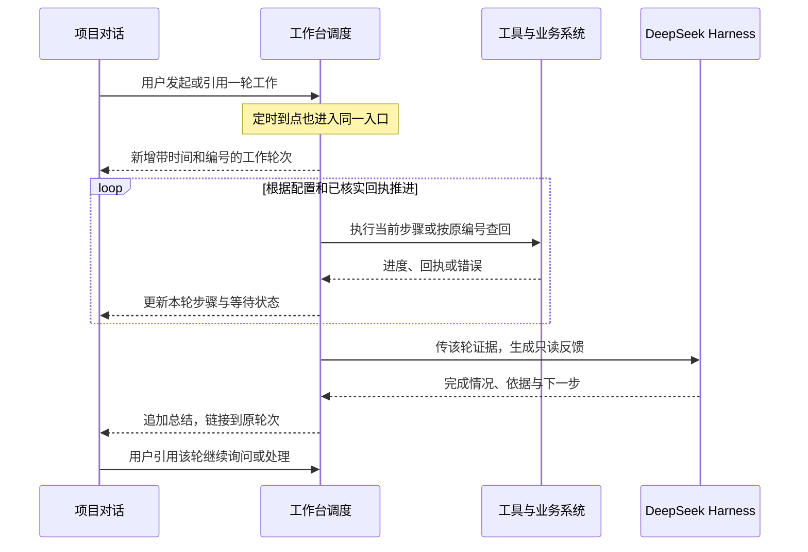

# 项目工作台：工作流进对话的优化计划

状态：待评审。本文只确定产品和技术方案。

## 1. 用户要完成什么

在同一个项目对话里，用户可以像翻聊天记录一样查看每一轮工作：几点触发、实际执行了哪些步骤、现在卡在哪里、交付了什么、接下来还有什么。一次定时触发或一次用户委托可以包含多个工具，工具结果归在该轮下面。业务结果确定后，助手根据回执发一条总结；用户可以引用这一轮继续问、要求核实，或让系统在权限内继续未完成的步骤。

以数据拉取与清洗做首个真实试点，同时用另一种只读多工具流程验证通用性。活动抽检、既有通知和渠道回执可接同一套运行记录，它们各自的业务规则仍由原能力负责。

## 2. 当前实现与缺口

| 现有能力 | 已能做什么 | 本次补哪一段 |
| --- | --- | --- |
| 项目对话 | 聊天 Run 有时间、助手回复和本轮 Harness 工具详情；组件卡作为独立区域，渲染在聊天轮次之前 | 把有归属的工具、审批和结果挂到对应工作轮次，整页按对话时间读 |
| 定时与组件 | 固定程序定时能按稳定编号提交、后台查回；专家型定时能进入 Harness。固定程序路径的触发回执只说明已排队 | 以业务条件驱动后续步骤，等实际结果后产生对话反馈 |
| 模型取证 | `read_component_results` 能看同一会话最近 10 条，单条大结果会省略 | 按工作轮次和具体步骤精准定位，保留跨轮追问所需的证据 |
| 复查、权限和审批 | 已有定时、任务轮询、人工决策、组件权限、活动抽检和既有发送查回 | 复用其存储、授权与恢复做法。个人跟进的权限范围不同，不直接打开组件写权限 |

代码入口：`web/src/main.tsx`、`web/src/tool-components.tsx`、`internal/workbench/component_configs.go`、`schedules.go`、`components.go`、`followups.go`、`worker.go`。以上是当前代码核对。用户截图中的 12:20「运行中」是当时的诊断文本，后来已核对该次实际发布。截图中关于来源新鲜度的提示仍应以源快照证据单独核实。

## 3. 产品展示

1. 运行配置留在会话设置和定时入口。定时开始或用户发起时，在对话流新增一条「12:20 · 数据拉取与清洗 · 定时」；同一轮有多次工具调用时，在这条下面更新进度和步骤，默认只露出关键信息。
2. 点开某一步能看到开始时间、状态、尝试次数、产物和可核对的回执。正常时一条反馈收尾，失败时直接说明哪一步、已经做成什么、后续是否暂停、还需要什么证据或决定。原始回执按需展开。
3. 总结以实际生成时间进入同一对话流，并带回本轮的链接。中间已有新聊天时，完成消息出现在最新位置，原来的执行记录保持原位置。批次内的进度变化更新原条目，避免每次轮询刷屏。用户翻旧记录时保留阅读位置。
4. 支持引用某一轮发问。没有明确引用时，用会话、时间和任务名称定位。若有多条匹配，显示候选供用户指明，不能混入别的批次或把一次状态查询当成一次新工作。桌面和手机用同一顺序与状态文案。

示例，仅用于说明未来页面：

> **12:20 · 数据拉取与清洗 · 定时**　拉取 → 清洗并发布 → 核对发布 → 检查数据源版本
>
> **助手**　这轮发布了 25,126 人，发布时间是 12:21:36。已用这轮任务的原编号核对发布。如果源业务版本与上一批相同，另显示「数据已发布，来源未更新」，并说明哪些后续工作依赖更新。
>
> **你**　那 12:20 这一轮具体卡在哪一步？如果是源没更新，帮我先查一下。
>
> **助手**　带着该轮引用读取原回执，检查已授权的来源状态，说明核对结果和下一步。

## 4. 执行与反馈如何接通

**工作台持久化一轮业务执行。** 最少需要会话与项目、触发来源与时间、定时发生编号或人工请求编号、固定配置版本、步骤状态、工具调用及原业务回执引用。模型每次执行仍用现有 Run；一轮业务可以跨多个 Run，也可能只调用固定程序。定时、手动按配置执行及明确接续都进入同一入口。普通聊天的工具调用先按现有 Run 归组，只有已登记的业务动作进入自动恢复。

**先确认回执，再继续。** 工作台持有步骤条件、下一次检查时间和恢复预算。业务组件负责实际执行、落库、返回真实状态；进度未提供时显示「等待回执」。前一个必需步骤的回执满足条件才启动后续步骤。到期仍无证据时保留原编号和现状，进入待核，避免同一业务产生第二笔副作用。后台等待期间释放模型执行槽和不再需要的锁，写入继续受项目锁约束。

**总结属于对话，事实来自回执。** 状态落库后，独立排一个只读模型轮次，输入仅包含本轮目的、步骤、回执摘要与可查引用。反馈写回原会话，保留助手来源和真实时间。关键状态、数量和时间由系统提供结构化字段，模型负责解释和建议。模型不可用时先显示基于同一回执的系统摘要，允许只重试总结；一个结案结果只生成一个有效总结条目。临时阻塞或待本人决定可以先发阶段性说明，最终结案时再发一次。

**追问用同一份证据。** 把本轮引用传给后续 Harness，扩展现有只读查询为按轮次、步骤查询，支持同会话内按名称和时间搜索，按页取必要细节。工具与模型接收同一份已授权事实。跨会话沿用项目及引用权限，默认限当前会话；回执文本作为数据，权限、关键状态、继续执行都由工作台校验。

执行状态与反馈状态分别记录。业务可处于「排队、执行、等待回执、待人工处理、成功、失败、取消或跳过」，反馈可处于「待生成、已生成、暂用系统摘要」。等待状态带下一次查回时间和截止条件，待人工处理只接受明确的查回、决策或恢复请求。所有必需步骤成功后才结案；失败可进入预先定义的只读诊断和反馈步骤。需要触发另一流程时，由固定配置指定所需产物和目标流程，同一上游执行最多触发一次该后续流程。

## 5. 停止、恢复与冲突

| 状况 | 工作台处理 |
| --- | --- |
| 提交已受理，或执行正在进行 | 按原任务编号查回。已受理与已完成分别显示 |
| 短时网络错误、明确可重试失败 | 优先查回。仅当动作明示可安全重试时，按原身份恢复失败步骤，带退避、次数和截止时间。成功步骤保留 |
| 参数、权限或业务规则错误 | 记录失败与原因。助手可走配置中已授权的核对分支。授权变化或业务决策交给本人 |
| 外部动作可能已执行，回执未知 | 冻结后续有副作用步骤，查原业务回执。无法确认时显示「待核实」，不得换编号重发 |
| 已发布，但来源版本相同 | 同步仍按真实结果标为发布成功；数据新鲜度独立显示。要求新源版本的后续步骤按配置等待或停止 |
| 到点时上一轮仍未结案 | 同一业务目标首期默认跳过重叠的自动触发，并写明原因。配置变更也不能自动绕过该约束。人工查回和恢复指向上一轮 |
| 用户停止或服务重启 | 先核对已经生效的动作和执行进程，再从持久化状态恢复。人工取消的轮次不再自动推进，已生效的产物保留 |
| 活动抽检或发送 | 停在原本人确认边界；渠道受理、手机待发和实发按原回执区分。模型总结与自动恢复不能代替确认 |

## 6. 交付顺序与范围

| 阶段 | 开发范围 | 验收 |
| --- | --- | --- |
| 1. 工作轮次与时间流 | 给定时、手动执行和聊天工具补稳定关联，整合现有对话、执行详情、组件结果。兼容旧数据，只有能凭编号确认归属的旧记录才归组 | 一次调五个工具只出现一个工作入口；后发聊天不会覆盖先前记录；迟到反馈按时进入最新位置；桌面和手机可追到每个结果 |
| 2. 跑通定时闭环 | 用现有调度和轮询推进一个固定的多步流程，加入步骤终点、原回执查回、重叠处理、超时与只读总结。数据同步先做，再接一个独立只读流程 | 验证定时触发、成功、权限失败、重启、重复触发、迟到结果和模型总结失败。用真实 Harness 核对总结，并和工具事实逐项比对 |
| 3. 聊天接续与分批迁移 | 增加按轮次和步骤取证、引用追问、授权恢复。试点验收后，逐项迁移同类定时、专家流程和活动操作的展示 | 两个以上同名批次时，能准确引用指定轮次；问进度不会重新执行；只恢复失败步骤；原活动确认和渠道回执边界通过回归 |

各阶段默认复用现有工作台存储、定时、模型队列、项目锁、组件状态接口与活动审批。新增工作限于：轮次与回执关联、少量固定步骤的继续执行、对话投影与模型读取。第一期用版本固定的线性步骤和少数显式条件；暂不引入工作流画布、额外引擎或任意动态规划。需要触达客户的动作继续走现有审批路径。上线采用单流程切换，核对定时发生编号和在途任务，避免新旧入口同时触发。

## 7. 三项设计决策

| 决策 | 取舍 |
| --- | --- |
| 业务执行使用独立稳定编号，模型 Run 关联在其下 | 能覆盖跨轮、无模型的固定程序和重启恢复。代价是新增一条业务关联；仅靠时间猜测分组或复用一次模型 Run 会丢失这些边界 |
| 业务进度由工作台按回执推进，模型负责总结与已授权核对 | 恢复与权限可验证；每个可自动推进的步骤需事先定义完成条件。仅靠长模型对话难以在异步、重启和超时时区分执行与叙述 |
| 会话时间流作为默认视图，步骤及原始回执逐层展开 | 不需要另进一个任务中心，也能保留证据。需要为旧记录兼容、较长历史分页和迟到事件排序做明确验收 |

参考做法：[GitHub Actions 按次查看运行及步骤](https://docs.github.com/en/actions/how-tos/monitor-workflows/view-workflow-run-history)、[Temporal 持久执行与恢复](https://docs.temporal.io/workflow-execution)。这里采纳运行与步骤分层、持久化等待和按状态恢复的做法，首期仍用本项目现有基础设施。
