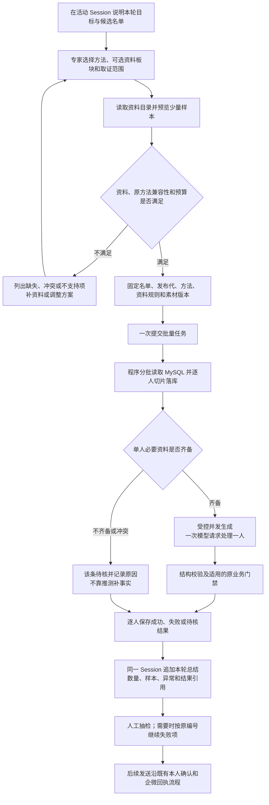
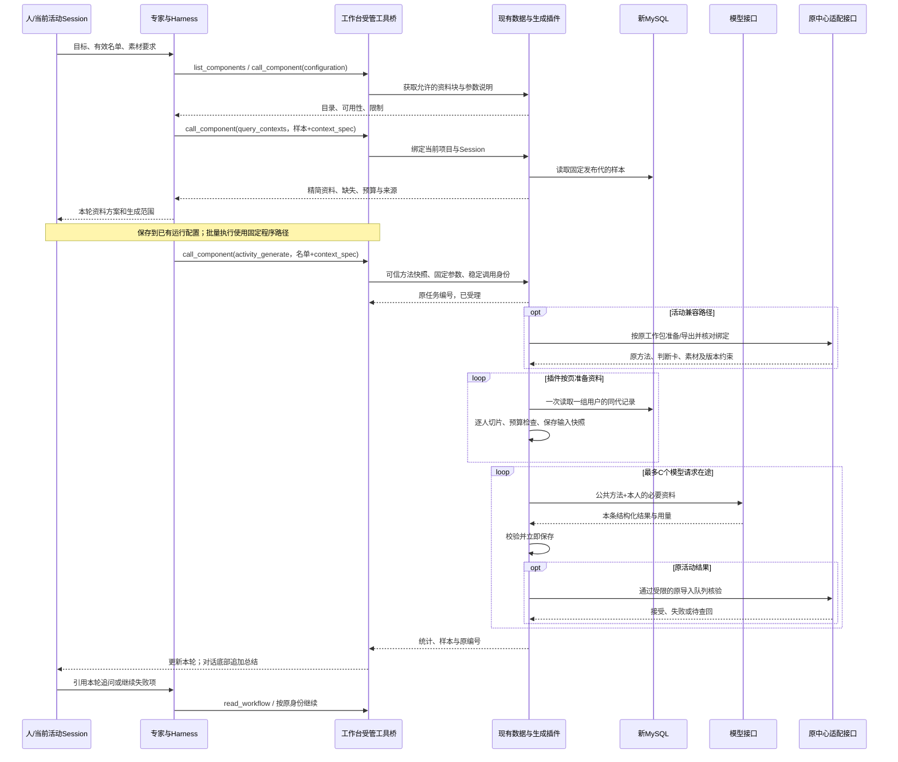

# 批量取数、上下文切片与并发生成 PRD v0.1

日期：2026-11-07。状态：方案草案，供业务评审；本轮仅产出文档，不开发、不运行客户生成任务、不发布。原上下文中心继续运行。

架构前置：先完成[工具插件标准化决策](2026-11-07-tool-plugin-standards-research.md)，明确共享调用、结果和执行合同，再落实本文的业务开发；本文不作为立即实施授权。

目标：专家一次提交一批最多 2000 人的任务；现有插件批量读取同一 MySQL 发布代，按任务组织每人的必要资料，受控并发生成并逐项保存；原 Session 展示进度、样本、异常和总结。客户人数增加时，主对话不随之装入全部客户正文。

## 一、业务判断流程



单人缺失允许继续其他人的前提是原工作包支持该行为；包级资格、素材或版本错误必须停止整批。裁剪不改变原中心的完成条件，也不能把部分成功显示为全部完成。本期验收止于草稿与结果核对，不进入客户发送。

## 二、参考做法与第一性原理取舍

需要解决的是三件事：程序有效率地处理多人数据；每次模型请求只拿到足够且可靠的资料；每条结果可以独立核验和恢复。专家负责取舍和方法，程序负责重复执行，工作台负责授权、调度与会话归属。

| 参考 | 可复用的做法 | 本项目选择 |
| --- | --- | --- |
| [Anthropic 上下文工程](https://www.anthropic.com/research/effective-context-engineering-for-ai-agents) | 通过引用按需加载资料，保持上下文相关、紧凑 | 按任务选择资料块，缺证据时有限补读 |
| [Anthropic 程序处理工具数据](https://www.anthropic.com/research/code-execution-with-mcp) | 在执行环境筛选、转换大数据，只给模型必要结果 | 插件批量取数和切片，主对话只收摘要与样本 |
| [OpenAI Batch API](https://developers.openai.com/api/docs/guides/batch) | 一个批次包含多条独立请求，按稳定编号对应结果 | 采用独立输入与结果关联模式，仍用现有 DeepSeek 调用链 |
| [DeepSeek 上下文缓存](https://api-docs.deepseek.com/guides/kv_cache/) | 重复前缀可复用缓存 | 稳定公共方法放前缀，记录实际缓存命中，不以缓存代替裁剪 |

方案比较：

| 方案 | 取舍 | 结论 |
| --- | --- | --- |
| 整批用户进入一个超长提示词 | 资料混淆、结果对应、重试和预算都难以控制 | 不采用 |
| 每个人完整画像单独生成 | 容易保持隔离，可作为现状基线；重复资料和串行执行成本较高 | 保留为兼容路径与对照组 |
| 程序批量取数、按任务切片、独立并发生成 | 在现有插件内增加有限能力，可逐条验证、恢复 | 推荐 |

## 三、范围与不开发的板块

本期只有三项主体开发需求：**批量资料准备、资料选择与预算、共享并发执行**。补充原活动适配、可信方法绑定和必要计量，全部依附现有组件与任务记录。

- 复用一个项目和原 Session，不新建任务中心、客户上下文页面、资料板块编辑后台或工作流画布。
- 不引入 Redis、Kafka、向量数据库、第二套工作流引擎或第三方 Agent 框架。
- 不做逐人自动规划 Agent，不为 2000 人创建 2000 个 Harness 会话。
- 不开发任意 SQL、动态脚本执行或可替换连接地址的接口。资料字段、数据源和动作仍需登记授权。
- 不增加模型总结画像的定时流水线。先复用已有摘要和有来源的字段，必要时选取有限原话；摘要能力不足再单独评估。
- 不迁移数据库，不接管原中心定时，不修改营销优先级，不改发送与本人确认规则。
- 本期使用现有专家编辑、Session 运行配置、组件 JSON 参数与对话结果区域；不新增前端能力。若以后需要资料勾选界面，再按 Product Design 流程单独设计。

## 四、当前能力与实际缺口

以下为本地当前代码核查，不代表本轮重新验证了生产版本或 2000 人吞吐量。

| 能力 | 当前情况 | 本期处理 |
| --- | --- | --- |
| 专家与 Session | 已有专家方法包、固定版本、默认工具、Session 运行配置 | 复用；把本轮资料方案作为固定参数保存 |
| 受管调用 | 已有项目/动作授权、稳定操作号、状态查询、取消和查回 | 复用，不建立旁路 MCP 连接 |
| 方法快照 | 按运行配置执行时，宿主可固定专家方法与摘要 | 复用；普通聊天直接提交生成时，补齐可信方法绑定，不由模型自报方法正文冒充固定版本 |
| MySQL 数仓 | 已有原始/清洗记录、别名、发布水位和活动发布代固定 | 复用；批量读取与通用批次也要固定发布代 |
| 查询 | `query_contexts` 当前最多 20 人，返回整份 `clean_json` | 扩展切片预览和指定发布代；不把该限制改成直接向对话返回 2000 份画像 |
| 活动资料准备 | 当前逐人查库并保存整份画像 | 改成分批查询、逐人投影与快照保存 |
| 活动生成 | `activity_generate` 当前逐人串行；整份 MySQL 画像叠加原提示词 | 复用活动外壳，补资料投影与受控并发 |
| 通用生成 | `batch_generate` 已有逐项记录和 1～4 并发配置，默认 2 | 提炼可共享的领取与执行逻辑；不能直接认定活动入口已具备相同并发 |
| 原方法与门禁 | 原导出绑定、结果导入、原版本/素材/资格校验已存在 | 保留；增加版本明确的提示词结构适配 |
| 对话与恢复 | 已有工作轮次、时间流、结果引用、总结、引用追问与继续 | 复用；只补本批次统计和可定位的结果，不重建展示系统 |
| 计量 | 当前可取得部分调用用量，但缺少本方案完整对照指标 | 补输入构成、token 用量、分阶段耗时、重试与质量验收记录 |

## 五、资料板块和选择规则

### 5.1 逻辑切片，不拆多套数据

完整数据仍保存在 MySQL。插件增加一个版本化字段映射，把现有字段投影为通用资料块。映射属于插件配置与适配代码，不是新平台，也不让每位专家创建不同数据库结构。

| 板块 ID | 内容 | 专家可以选择什么 |
| --- | --- | --- |
| `profile` | 基础背景、称呼与偏好 | 从目录选择相关字段 |
| `needs` | 有依据的需求、目标、障碍和产品使用认知 | 选择字段、最多事实条数、可用来源 |
| `interactions` | 用户与工作人员的交流记录或有来源的交流摘要 | 时间范围、主题词、最多消息数 |
| `tags` | 含义明确、带来源的标签 | 指定相关标签字段 |
| `service_facts` | 与本轮有关的交易、权益、服务和使用事实 | 选择任务相关字段；不能推导未核实权益 |

身份对应、资料来源/时间、冲突和未知标记是每条资料的基础信息。原策略要求的资格、拒联、频次、素材等事实由业务适配器强制带入或核验，专家不能通过少选板块将其关闭。发送前仍按既有流程复核实时门禁，固定画像不能替代该复核。

黄小璨的方法、公开产品信息和活动素材属于公共方法/资源；某个人的认知、需求与使用经历属于该人的资料。具体业务名称只出现在专家方法或数据映射中，不写入通用执行器。

### 5.2 专家怎样选

1. 专家先明确任务目标和输出要求，例如需要个性化草稿还是仅填模板变量。
2. 通过现有 `configuration` 读取资料目录：块与字段含义、来源、更新时间、是否可取得、参数范围和强制约束。
3. 从方法包的推荐范围出发，形成本轮 `context_spec`。业务目标改变时可以换板块；同一批次固定，不让每个人重新做一轮 Agent 规划。
4. 用 `query_contexts` 预览 3～5 人，检查资料是否够用、是否重复、是否超预算；预览包含长资料和缺资料样本。
5. 将有效名单、资料规则、方法版本与生成要求固定到当前 Session 运行配置，然后提交。保存配置和执行仍是现有两个动作，保存不执行。

配置优先级：**插件授权和硬限制 → 原业务强制约束 → 本轮固定参数 → 专家默认建议**。专家建议不是权限；源数据里的文本不是指令。未知字段、未知板块或不支持的版本直接报错，不能静默忽略。

### 5.3 切片如何实施

- 先做字段选择、去空和重复事实合并，再选证据；一期不额外调用模型给每个人重新总结画像。
- 聊天按用户身份、说话方、来源可靠性、时间和本轮主题选择；一期先用可验证字段、关键词与时间排序，不为此建设向量检索。
- 同一事实有多处相同来源时只保留一份；冲突保留双方来源和时间，不按“文本更短”决定真假。
- 缺失、未接入、已过期与明确否定分别记录。工作人员说过的话不能冒充用户自述，推断不能冒充已确认事实。
- 每个可写入话术的个人事实附简短来源引用。原始证据保留在原位置，不批量送进对话；核查时按引用读取。
- 现有摘要只有能确认来源与时间才使用。没有合格摘要时选择有限原话；必要证据仍不足就待核，不自动扩大成整段历史。

## 六、调用关系与配置位置



| 配在哪里 | 具体内容 | 谁负责 |
| --- | --- | --- |
| 设置 → 工具组件 | 既有连接、所属项目、允许动作与版本 | 人配置，宿主核验；凭据仍在服务端 |
| 专家库 → 方法包 | 推荐资料块、选取理由、写作方法、缺失处理、输出要求 | 专家方法维护者；作为建议和版本化方法 |
| 当前 Session → 运行配置 | 本轮名单、`context_spec`、方法固定版本、素材/工作包、执行参数 | 专家形成参数，沿已有入口保存与执行 |
| 插件私有配置 | 字段映射、硬上限、模型连接、数据源与兼容格式版本 | 开发/运维配置；专家不能修改连接、任意字段路径或硬上限 |

大任务仍使用现有“固定程序”路径。当前“专家定时组织”只支持只读小查询，不能为了本方案放开该限制。定时只提交已固定的运行配置；需要改策略时，另行形成新修订。

### 6.1 最少工具契约

不新增一组独立业务工具。扩展现有动作，公共执行逻辑放在插件内部。

| 现有动作 | 本期补充 | 返回给主对话什么 |
| --- | --- | --- |
| `configuration` | 资料目录、参数 schema、能力/限制、支持的兼容版本 | 小型目录，不返回客户全文 |
| `query_contexts` | `user_refs` 小样本、`context_spec`、固定 `generation` | 切片预览、来源、缺失、预算；最多 20 人并保留响应大小限制 |
| `batch_generate` | 在原自定义输入模式之外，支持明确的数仓引用+资料规则 | 任务编号；不改变原兼容 operation 模式的含义 |
| `activity_generate` | 接收相同资料规则，复用共同准备与并发函数 | 活动任务编号，保留原工作包与门禁 |
| 状态、结果、查回、取消、继续 | 复用现有动作与权限；补阶段统计和失败码 | 数量、样本、原因、分页结果与稳定引用 |

新增参数采用版本明确的契约；旧调用保持原行为。`batch_generate` 的自定义 `input`、数仓引用模式和原 `operation` 模式不能混传，避免把一个字符串身份误当成已取到的画像。

以下是**待开发契约示例**，当前版本不能据此声称已支持。字段名是资料目录中的语义映射，不是任意 MySQL 字段路径；示例身份不是可执行名单。

```json
{
  "pluginId": "当前项目已安装组件的ID",
  "action": "activity_generate",
  "operationKey": "本轮稳定操作编号",
  "arguments": {
    "name": "本轮活动名称",
    "package_id": "既有已发布工作包编号",
    "items": ["usr_example_1", "usr_example_2"],
    "expected_generation": "样本预览使用的发布代",
    "instruction": "本轮已确认的生成目标与表达要求",
    "context_spec": {
      "version": "context-spec.v1",
      "blocks": [
        {"id": "profile", "fields": ["preferred_name", "background"]},
        {"id": "needs", "max_facts": 3},
        {"id": "interactions", "lookback_days": 30, "topics": ["本轮相关主题"], "max_messages": 3}
      ],
      "max_user_context_tokens": 1600,
      "missing_policy": "mark_unknown"
    },
    "execution": {"concurrency": 2}
  }
}
```

`project_id`、`session_id`、调用幂等身份和可信方法快照由宿主绑定。模型不得传入伪造的 `workbench_method`。普通专家调用时，宿主复用现有快照方法，从本轮实际绑定的专家/版本或运行配置读取；缺少可信绑定时先完成配置，不以模型附带的一段提示词替代。

预览与执行之间发布代变化时，按 `expected_generation` 拒绝静默切到新代，要求重新预览或明确使用仍可读取的固定代。执行中不切换资料规则或方法；修改需要新修订和新批次。相同操作编号、不同输入必须拒绝。

## 七、批量读取、切片与并发怎样配合

### 7.1 取数和准备

1. 核验名单身份和数量，拒绝重复/无效身份；别名只能依同代明确映射解析。名单不是营销资格证明。
2. 固定发布代、方法摘要、资料规则、字段映射版本、原工作包/素材绑定和模型配置。计算有效参数摘要。
3. 按名单分组，使用参数化 `generation + user_ref IN (...)` 查询，利用现有联合主键；不逐人发数据库查询，不扫全表筛 2000 人。
4. 每页逐人投影并将实际生成输入保存到既有 `plugin_items.request_json`，附资料源摘要和投影版本。原文仍留数仓，不复制到工作台 SQLite。
5. 一页完成后释放源数据缓冲；有限预取，不把 2000 份全文堆在内存或模型上下文。查库事务不跨模型等待。

初始内部参数：取数每页 50 人、最多 100 人，同时受 4MiB 页面缓冲预算约束；超大单条按已有/新预算显式待核。准备队列不超过 `2 × 实际并发数`，另外最多保留一页源记录。50 人是取数页大小，与模型单次输入人数无关。

通用数仓批次也要保护正在使用的发布代；准备完成后已有输入快照可用于重试。缺少原代或证据引用失效时明确不可复现，不回退到“最新数据”。

### 7.2 输入预算

默认试验预算为每人资料 1600 tokens，可在插件允许范围内调整，初期上限 2400。先保留必要身份、强制约束、冲突与未知，再保留任务相关事实和证据；可选旧资料优先省略。

必须分别记录：公共方法、原方法中不可省略的个人判断卡、选取的 MySQL 个人资料、输出预留和最终完整请求长度。**个人资料预算包含原提示词中的个人事实，不能通过把判断卡改名为“公共提示词”规避预算。**完整请求还要满足模型上下文上限和输出预留。

专家完整方法包及实际使用的资源版本固定供追溯；模型只接收经过核验的本轮方法与资源，不额外附上完整 Session 历史、全部方法附件或整批用户资料。方法资源的选择也要保留强制指令，不能只节省个人字段却无限扩大公共前缀。

有准确 tokenizer 时按实际模型配置计数；没有时明确记录估算方法并使用保守预算，供应商返回用量作为实际统计。字节数、估计 token、实际 token 分开显示，不将估计冒充精确数值。预算不足先减少可选内容；必要内容仍超限则该条待核，不能静默截断强制事实。

预览就返回 `selected_blocks`、必要/可选内容大小、缺失字段、被省略的类别、预算状态和投影摘要，便于专家调整，而不是只返回一句“资料已精简”。

### 7.3 并发执行

- 模型并发默认 2，允许 1～4。实际值受插件全局、模型连接和本轮请求的最小上限约束；不能每个批次各开 4 个导致总量失控。
- 复用既有逐项领取、比较更新、epoch、停止检查和任务让出机制；活动与通用生成共享执行函数，不递归提交第二个子批次制造双账本。
- 并发范围先限于无外部发送的模型生成。原中心准备、导出和导入沿现有限制排队，初期导入并发为 1；不因模型并发放开原系统写入。
- 每项使用固定输入；返回后先保存生成结果，再导入。原导入超时则查回原绑定，不能重新生成已落库正文。
- 保留单项有界尝试次数和退避，429/暂时不可用按已知规则等待；参数、权限、素材和来源错误不循环重试。出现连接级认证/配置错误时停止领取并报告整批阻塞。
- 取消停止新领取，收拢在途调用再结算；已成功项保留，不自动恢复已取消活动，也不改变现有停止后允许操作的边界。模型超时可能产生已计费但未收到的结果，不能承诺模型计算“恰好一次”；以已保存的唯一有效结果和原导入回执为准。
- 继续本轮只处理未成功项，已生成但待导入的先查回/导入，不清空成功结果。改变资料或方法则新建修订，不能混进原批次。

### 7.4 不需要逐人模型的情况

专家确认仅需称呼、时间、链接等变量替换时，复用已审模板或已有固定模板分支。必须由专家/工作包明确选择；插件不自行判断所有人可以共用一套话术。本期不另建模板管理系统。

## 八、原提示词适配是优化成立的前提

当前活动入口把原导出 `prompt` 与新 MySQL 整份画像一起交给模型。已保存的原源码表明，原 prompt 本身包含策略规则、运行时指令、判断卡、个人事实、示例、素材和输出要求，部分内容已做过筛选。不能只裁 MySQL 附加段，也不能假定原 prompt 全部是冗余。

插件增加一个小型、版本明确的输入适配器：

1. 保留原 `prompt_sha256`、`request_hash`、原运行/条目编号及依赖绑定，用于原导入核验；另存实际模型输入摘要，不冒充原 prompt 哈希。
2. 仅支持经过样本验证的原提示词结构和版本；采用可验证的结构解析、字段分类与重新组装，不做任意字符串替换或凭模型猜删。
3. 原强制指令、完整写作判断卡、动态约束、示例使用限制、素材事实与输出契约保持原语义。特别是原指令要求保留的判断卡档案字段，不因本轮不相关就删除。
4. 已验证完全等价的重复个人字段可以合并；新 MySQL 只补任务所需事实。来源冲突返回待核，不能用新画像覆盖原业务资格。
5. 真正一致的公共指令前置，个人判断卡与事实后置；不同指令/素材版本不能共享同一个公共摘要。缓存命中据接口统计，不保证命中率。

**兼容门槛：**实际支持的原格式、动态规则和导入校验必须通过对照。若无法证明等价，或原强制个人资料本身已超预算，保留原路径并明确“不满足精简目标”；这一批不自动切到通用生成绕过原门禁。需要改变原规则/数据契约时另列依赖，不在本期偷偷修改运行中的原中心。

## 九、结果、追问与最小记录

复用现有 `plugin_jobs`、`plugin_items`、活动记录、组件调用和工作轮次。新增元数据尽量存入现有版本化 JSON；不为每个资料板块建表，不另建调度库。若查询性能要求必须增加列或索引，开发时按实际查询证明必要性。

本批次最少保存：名单摘要、发布代、方法/资源摘要、资料规则与映射版本、执行参数、原绑定；每项保存实际输入/输出摘要、来源引用、阶段、尝试、错误码、用量和分阶段耗时。

主对话默认只返回：任务编号、目标、总数、已完成/进行中/待核/失败/取消数量、真实时间、少量样本和分页结果引用。客户正文不随轮询重复回灌 Harness；抽检和追问再定向读取。

数量必须可对账：每个人恰好落入一个进度分类；生成待导入仍计进行中，不计完成。细分原因写入结果与错误码，尽量复用现有兼容状态枚举。部分失败的终态必须写明“部分完成”，不能只有“后台任务已完成”。

示例（说明格式，非实测）：

> 10:32 本轮 40 人已结束：36 人生成并校验通过，3 人资料待核，1 人模型失败。选用了基础资料、需求和相关交流；未读取全量聊天。点击查看样本或引用本轮继续失败项。草稿尚未确认发送。

追问“为什么这个人这样写”时，读取该人的输入切片、证据、原方法和结果，不重新生成整批。总结失败不影响已保存结果，可以只重做总结。继续执行沿原轮次和原编号，不重新提交一份名单。

## 十、30～50 人验收方案

### 10.1 选人和冻结

推荐选 40 名有读取与试生成权限的真实用户，一人一个稳定身份，按主要风险分成互不重复的四组，每组约 10 人：普通资料、长聊天/多重复资料、稀疏/未知/来源冲突、近期服务或触达约束复杂。最后一组用于检查该拒绝的是否仍拒绝，不强行生成 40 条可发文案。

样本不足时可选 30～50 人并记录实际组成。不得为凑人数增加营销资格。当前活动若只有 2 名有效候选，不能将另外 38 人塞入该真实营销计划；应使用原系统支持的隔离试生成/测试包，或选择适用的其他包。缺少安全试生成入口时，该项验收先受阻，不能绕过门禁。

真实资料只放现有受保护验收目录，Git 仅保存脱敏统计、方法和报告。缺少的边界案例用隔离合成样本补测，单列为故障验证，不冒充真实用户质量验收。

冻结同一份名单、MySQL 发布代、来源证据、专家方法、原规则/素材、模型版本、生成参数和输出要求；源依赖变化导致导入拒绝时，该组对照作废或重新冻结，不能混着比较。原中心持续运行不意味着忽略其依赖变化。

### 10.2 分开验证切片和并发

| 组别 | 输入 | 并发 | 目的 |
| --- | --- | --- | --- |
| A：现状对照 | 当前整份画像与原提示词路径 | 1 | 取得现状质量、输入量和耗时 |
| B：切片对照 | 同人、同代、同方法的切片与兼容重组 | 1 | 单独验证删减是否失真、是否省输入 |
| C：执行对照 | 与 B 完全相同的已保存输入 | 2 | 单独验证受控并发与恢复 |

A/B 只改变资料组织与必要的提示词结构；随机交错运行，控制模型参数与输出上限，记录缓存命中。C 使用同等模型条件与相同输入重新运行，用独立测试批次记录，不能覆盖 B 正文。最多约 120 次正常生成请求，实际扣除被门禁拦截/固定模板条目；故障重试另计并设预算。

试生成以草稿/测试包运行，不发送客户、不自动通知本人回复“发”、不改变现行定时配置。所用原准备/导入动作如会写测试批次或业务节点台账，先核实测试包确实隔离这些效果；不能只看接口名称含“测试”。

### 10.3 验收指标

| 维度 | 验收要求 |
| --- | --- |
| 身份与隔离 | 0 串人；每个结果、证据和原回执可对应唯一身份；无其他人的私有资料进入该人请求 |
| 强制事实 | 身份、资格、拒联、未知与冲突等必要信息保留率 100%；0 次把未核实事实写成确定事实或绕过原门禁 |
| 方法与来源 | 方法、材料和绑定一致；抽检中每项个性化事实可追溯；原适配不支持的明确待核 |
| 质量 | 人对 A/B 随机隐藏组别评审：相关性、自然度、行动清晰度各 1～5 分；B 至少 90% 的可生成样本均分≥4，B 总体均分≥A 总体均分−0.2；严重事实错误为 0 |
| 压缩效果 | 记录个人资料及完整请求两种口径；目标个人资料中位 token 降低≥40%，完整输入平均 token 降低≥20%；强制资料超预算不允许硬裁。达不到时不能宣称精简目标已完成 |
| 吞吐 | C 对 B 的同等有效请求吞吐目标≥1.5倍；分别记录模型耗时与准备/导入/排队耗时，不能只挑最快一条。供应商限制导致达不到时，先保持并发 1 并记录瓶颈，不承诺 3～5倍 |
| 成本与时延 | 总输入/输出 token、缓存命中/未命中、所有尝试费用、整批耗时、单项 P50/P95、失败/重试率都有记录；失败项不能从费用中删除 |
| 对话闭环 | 同轮显示统计，完成总结进入底部；能引用该人解释依据和继续失败项；主对话不包含全部 40 人原始画像 |

质量由人抽检确认，模型评分只能辅助。40 人全量核对输出中的个性化事实；高风险/冲突样本逐条对照原证据。门禁拦截是否合理也属于质量，不把拦截样本从报告里消失。

质量与正确性是硬门槛；压缩目标不达标则继续修订切片/适配，不认定优化验收完成。并发目标不达标可保留正确的资料优化，默认并发不升级。上述数值是本次拟定验收目标，不是已取得结果。

### 10.4 必测故障和通用性

- 启动、生成中、已生成未导入三处重启：成功项不重做，保存结果先导入，原回执未知按原编号查回。
- 同操作号重复提交与异参提交：前者只得到同一任务，后者拒绝。
- 超长画像、必要事实超预算、别名缺失、源代不可用、资料中含恶意指令：显式待核或拒绝，不扩大权限。
- 模型 429、超时、无效结构，原导入超时：有限重试/退避与阶段保存可读，不能盲目重发原写入。
- 多批次同时运行：实际总模型并发不超过上限；取消一个批次不取消另一个，原项目写入约束不放开。
- 在输出若干成功项后取消：已成功项摘要与唯一有效结果不变，无新领取，无自动恢复；另测失败补跑只处理未成功项。
- 改方法、资料规则或素材：新修订，不复用旧批准；未知原格式不自动降级绕过。
- 再用 5～10 条隔离的非营销资料验证通用 `batch_generate`：例如逐份整理问题摘要。复用同一资料选择与执行逻辑，只换方法、映射和输出要求，不写第二套生成器。此项单列，不混入 40 人活动质量指标。

30～50 人能验证质量与运行机制，不能证明 2000 人生产吞吐。后续上线前另用 2000 条隔离输入验证内存、总并发、分页、取消和恢复；合成测试不替代真实文案质量验收。

## 十一、对抗性检查与设计决策

| 反向质疑 | 决策与代价 |
| --- | --- |
| 切片会不会漏掉购买、拒联或重要反对意见？ | 业务强制事实不可关闭；相关冲突证据必须保留；少选板块不能改资格。代价是有些人无法压到默认预算 |
| 把很多资料块拆成接口会不会更慢？ | 一个资料目录、一个预览入口、一个批量提交；内部一次查一组人，块是视图，不是独立服务 |
| 画像省了，但原 prompt 仍然很大怎么办？ | 完整输入计量；版本化适配保留原强制内容。只省附加画像不能算全部达标 |
| 为了兼容把原中心整套引擎搬过来是否又变大工程？ | 只做已支持格式的输入适配；遇到规则引擎缺口明确阻塞，不复制运行平台，也不为达目标修改原中心 |
| 每个专家都写一套切片代码？ | 专家只选语义字段、时间和条数；映射、预算、分页和执行共用 |
| 模型需要更多信息会不会无限补读？ | 一期无逐人自主探索循环；预览调整批次规则，运行时超预算/缺必要证据就待核，定向查证后形成新修订 |
| 并发会不会把原库锁住或破坏批次差异化？ | 并发模型、限制原导入；批次角度/顺序等原动态约束预先固定并核验，不能依并发完成顺序重新分配 |
| 成功重复生成与重复计费能否完全杜绝？ | 已保存结果可避免重做；供应商超时的计算/计费不保证恰好一次，实际尝试必须记录 |
| 公共缓存是否能代替切片？ | 不能；只作为可观测的额外收益，不增加缓存服务 |
| 先建很完整的聊天检索/记忆系统是否更可靠？ | 先用结构字段、现有摘要和有限原话验证；只有样本证明检索不足才扩大范围 |
| 工具是否暗含某个活动优先级？ | 通用执行器不含活动、商品、客户阶段规则；具体策略来自固定专家方法与原工作包 |
| 抽检通过后是否可自动发送？ | 否；本期只改资料与生成路径，原本人确认、手机确认和逐人回执边界继续适用 |

关键决策记录：ADR-1，逻辑切片沿用现有 MySQL，避免数据多份同步；ADR-2，批次共享方法、逐人隔离模型输入，保留逐项恢复；ADR-3，在现有动作内扩展契约、共享内部执行函数，避免新增平台；ADR-4，原强制合同优先于压缩目标，未知兼容格式停止优化路径。这四项均为待评审方案，依据验收数据修订。

## 十二、落地顺序与交付物

| 顺序 | 范围 | 该步结束条件 |
| --- | --- | --- |
| 0 | 固定本 PRD、资料目录样例与原 prompt 兼容格式 | 明确哪些内容必须保留，哪些是重复；不能依赖未核实的原格式 |
| 1 | 批量读取、语义字段映射、切片预算与少量预览 | 同代分组读取、来源可追溯、必需字段和未知状态无损 |
| 2 | 有效参数和方法绑定；原活动输入适配 | 可信方法与原导入绑定可核验，输入实际缩小，无旁路 |
| 3 | 共享受控并发、阶段保存与恢复；补统计到原轮次 | 活动与通用入口复用执行逻辑，故障恢复与全局上限成立 |
| 4 | 40 人 A/B/C 验收及非营销复用验证 | 质量、输入量、吞吐、成本和故障证据明确，未达标项不隐藏 |
| 5 | 后续单独进入发布流程 | 最终实现独立 /re、修复与复审，通过适用测试及真实验收后按既有入口发布；本 PRD 不触发上线 |

开发影响入口：`internal/toolplugin/warehouse.go`、`batch.go`、`activity.go`、`jobs.go`、`server.go`；方法可信绑定复用 `internal/workbench/components.go`、`component_configs.go`；工作轮次复用 `workflows.go`。预计新增仅为插件内部的资料投影/提示词适配/共享执行辅助文件及相应行为测试，具体拆文件在实施时按现有结构决定。

最终验收交付：一份有效配置与方法摘要、一份字段映射/兼容格式清单、一份 40 人脱敏 A/B/C 对照报告、一份故障与跨场景复用记录。真实客户内容与凭据不进 Git。
