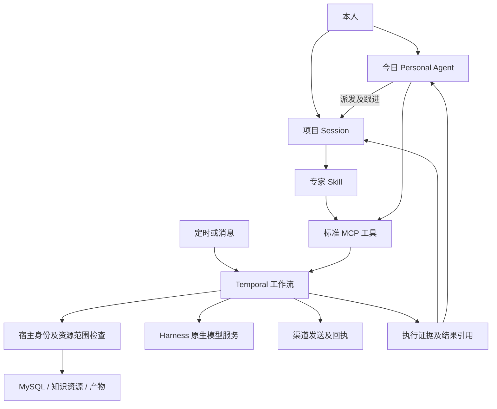

# 原生 Harness 工作台重构

状态：用户已批准实施；尚未验收或上线。2026-11-07，Asia/Shanghai。

## 已确认决策

- 原生 Harness Web，固定 `dsh-v0.2.2-rc.1` / `66491b05e3f05ad35bcdd4f6cd7ed26041d9e3db`；扩展通过 Cordis 插件，不修改上游。
- 业务、资源、记忆及执行持久化使用 MySQL；Temporal 管任务、定时、等待、并发和恢复。取消 DBOS/SQLite 方案。
- 今日完整保留：全局只读、每日安排、项目派发、持续跟进、到期复查、本人决定、通知、规则和可纠正/遗忘的记忆；默认读取所有业务资源，不读取凭证。
- 连接、资源、项目引用分开。资源可以是数据库视图、知识文件、产物；共享默认只读，可到板块粒度。
- 项目身份由宿主绑定；今日派发后按目标项目执行。所有查询、产物、缓存、下载及恢复均重新检查允许列表与来源链。
- 旧资料不迁移，切换前本机完整备份并验证恢复；不在云端保留旧工作台备份。上下文中心和 CRM 继续运行。
- 前端使用 Product Design，沿用原生 UI，增加今日、资源库、项目引用及通用执行节点；不恢复专项运营后台。

## 业务流程

## 接口与执行约定

MCP 使用官方 Go SDK 的类型化输入/输出；长任务返回稳定 runRef，查询/取消/继续走同一原始任务。MCP Tasks 不作为此版本依赖。服务身份来自 Host 注入的凭证与 Session 绑定，模型输入不得声明身份。内部 API 仅供 Host 及 Worker 使用。

资源发布流程：读取来源→清洗校验→不可变快照→事务切换发布指针。任务冻结输入版本、方法版本和参数；数据只通过引用传递。结果包含来源、完整性、过期状态及逐条状态。生成产物继承来源读取要求。撤销共享阻止后续操作，不宣称收回已经展示的信息。

批量分页默认200条；初始模型并发4；今日和即时回应保留独立配额。工作流历史不保存整批内容，按有界子任务管理。一人一次模型输入，不创建2000个交互 Agent，也不把2000人全文给一个模型请求。

自动应答：消息验签与去重→固定对象/项目/Session→资源读取→专家结构化决定→回复/忽略/转人工→回执。人工接管在发送前再次检查；unknown 不重发。本人回复“发”绑定明确批次及内容版本；企微受理不等于实发。

今日每日09:00 Asia/Shanghai，时间可改。持续跟进默认最多自动复查3次；等待不占用执行 Worker；重复回答和取消竞态不能重复执行业务。

## 开发顺序及验收

| 阶段 | 交付 | 门槛 |
|---|---|---|
| P0 | 官方底座、MySQL、Temporal、MCP | 版本固定、真实服务/模型、重启恢复 |
| P1 | 资源连接、板块、引用、来源链 | A/B/C/D矩阵及撤销、缓存、恢复隔离 |
| P2 | 今日、安排、记忆、持续跟进、决定 | 跨重启、限次、重复回答、目标项目范围 |
| P3 | 拉取、发布、切片、生成、产物 | 30–50真实样本、2000真实生成、10000模拟 |
| P4 | 消息、抽检、发送、回执、通用复用 | 第二业务无需修改宿主，真实渠道证据 |
| P5 | Product Design、独立/re、备份恢复、上线 | 无阻断问题、安装读回、旧环境清退 |

所有模拟、单元测试、真实 Provider、真实渠道和部署证据分别记录。任一门槛未通过，不宣称完整交付或上线。切换只沿现有发布锁及入口实施；本次本机备份/云端清退要求优先于旧的兼容发版策略。
