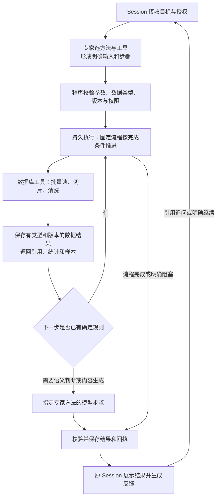

# 工具插件标准化研究与架构建议

2026-11-07。范围：官方资料调研、当前代码核对、架构取舍。未安装框架、未开发插件、未运行容量测试、未改生产。批量上下文 PRD 的实施顺序以本次标准化决策为前置。

## 1. 结论

已有可采用的标准和实现，但没有一个协议能同时保证 Agent 会调用、数据库读得快、万条业务不中断以及外部动作不重复。应组合四件事：

1. **MCP + 严格输入输出 Schema**：统一发现、调用和返回；优先使用官方 SDK。
2. **现有专家方法包向 Agent Skills 格式靠拢**：描述适用任务、方法和资源；权限仍由宿主控制。
3. **一套共享持久执行能力**：复用现有任务记录与恢复，在独立插件进程内收敛成可复用库；DBOS 是值得做替换对照的候选，Temporal 作为复杂分布式部署的候选。
4. **很薄的工作台接入约定**：补业务幂等、数据结果引用、逐项回执、数据库批量访问和模型预算。这部分是本产品约定，不冒充 MCP 已定义的行业通用业务语义。

当前建议采用第 1、2、4 项，并先复用现有执行层。是否以 DBOS 替换执行内核，应由同一套隔离恢复/容量对照决定；不同时维护两套执行权。不要继续让每个新插件自行设计队列、失败恢复和返回格式。

## 2. 推荐的业务判断流程



智能介入点由任务需要决定。已知的跨工具衔接也由程序完成；“读取成功后清洗，清洗通过后生成”无需每一步询问模型。新流程的设计、含糊业务决策和个性化内容生成才需要专家推理。模型不可用时，已受理的确定性数据处理仍应完成并保存事实。

## 3. 市面方案及适配判断

| 方案 | 官方能力 | 对本项目的选择 |
| --- | --- | --- |
| MCP 与官方 SDK | 工具发现、参数 Schema、结构化结果和输出 Schema | 采用；替代继续手写协议细节。参考 [Tools](https://modelcontextprotocol.io/specification/2026-07-28/server/tools)、[Go SDK](https://github.com/modelcontextprotocol/go-sdk) |
| MCP Tasks 扩展 | 以持久任务编号承接长调用，查询状态、补输入、取消 | 作为长任务对外标准方向；它不替插件完成逐项事务与数据库优化。见 [Tasks](https://modelcontextprotocol.io/extensions/tasks/overview) |
| Agent Skills | `SKILL.md`、说明、脚本、参考和素材的标准组织方式 | 复用现有专家方法包，按需加载资源；不把脚本目录变成默认任意执行授权。见 [格式规范](https://agentskills.io/specification) |
| DBOS | 库形式提供工作流检查点、恢复、队列与并发控制；有 Go SDK | 轻量执行内核候选。Go 当前配置支持 PostgreSQL/CockroachDB 与 SQLite；不是直接使用现有 MySQL 作为同一套原子持久事务。见 [配置](https://docs.dbos.dev/golang/reference/configuration)、[队列](https://docs.dbos.dev/golang/tutorials/queue-tutorial)、[事务](https://docs.dbos.dev/golang/tutorials/transaction-tutorial) |
| Temporal | 持久 Workflow、Activity 与恢复，有 Go SDK | 适合需要跨进程/多机调度、长时间等待、成熟运维能力时评估；增加运行平台和迁移成本。见 [Workflow](https://docs.temporal.io/workflows)、[Go](https://docs.temporal.io/develop/go) |
| Dify 插件 SDK | 以插件声明、工具实现、SDK组织开发 | 借鉴“脚手架＋声明＋处理函数”的开发体验；直接采用 Dify 插件格式会增加平台适配。见 [官方 SDK](https://github.com/langgenius/dify-plugin-sdks)、[开发模板](https://github.com/langgenius/dify-plugin-daemon/blob/main/cmd/commandline/plugin/templates/python/GUIDE.md) |
| n8n | 固定工作流与队列 Worker；队列模式使用 Redis 协调 | 可作为已有 n8n 场景的外部工具；为当前工作台再引入一整套编排系统不符合最小范围。见 [队列模式](https://docs.n8n.io/hosting/scaling/queue-mode/) |
| sqlc | 从预写 SQL 生成类型明确的调用代码 | 数据库开发辅助候选；复用当前 Go 驱动与池即可起步，不要求为了标准化重写全部查询。见 [官方说明](https://sqlc.dev/) |
| A2A | Agent 之间的协作协议，与 MCP 的 Agent-to-tool 职责互补 | 未来对接外部自主 Agent 时再考虑；当前确定性工具无需包装成独立 Agent。见 [官方边界](https://a2a-protocol.org/latest/topics/a2a-and-mcp/) |

这些是能力与集成成本比较，不是本项目已完成的性能测试。框架官方吞吐量不能直接作为本机/MySQL/原中心/DeepSeek 的性能指标。

### 协议版本需要明确

本次访问 MCP `latest` 实际落到 **2026-07-28**。当前本地插件固定返回 **2025-03-26**。官方 Go SDK 的兼容表列出 v1.7.0+ 同时支持新版本及多个旧版本；这提供渐进迁移路径，不代表本项目当前依赖、Harness 和受管桥已经兼容。见 [当前规范](https://modelcontextprotocol.io/specification/2026-07-28)、[SDK兼容表](https://github.com/modelcontextprotocol/go-sdk#version-compatibility)。

旧版 2025-11-25 的实验 Tasks 与当前扩展生命周期不同，不能复制旧示例声称已实现新规范。新协议的传输无状态也不意味着取消工作台 Session：应用 Session 继续负责项目、历史、授权与任务关联。

迁移应固定 SDK 与协议版本，验证新旧调用、受管授权及结果映射。能力未协商成功的客户端继续走现有 jobRef/status 兼容入口；同一业务任务只能有一个执行记录来源，不能同时启动新旧任务。

## 4. 现有实现为何还不够清晰

本轮代码核对发现：

- `internal/toolplugin/server.go` 已有 MCP JSON-RPC 接入，但 `tools/list` 的工具输入普遍只有 `type: object, additionalProperties: true`。工具有名字和说明，却缺少可验证的字段、必填项和范围。
- `internal/workbench/components.go` 已有项目授权、宿主绑定身份、稳定调用记录与方法快照基础，应复用；主模型通过通用调用入口传动态 JSON，参数规范必须进一步传到模型和校验端。
- `internal/toolplugin/jobs.go`、`batch.go`、`activity.go` 已有任务/条目持久化、恢复、取消等基础，但通用生成和活动生成的执行实现仍有差异，活动入口也不是通用并发配置的直接复用。
- 查询、生成和导入依赖的结果多为各自动作的 JSON；没有统一表达“这个引用是什么数据、来自哪个快照、是否完整、下一步能否消费”的语义。
- 原始任务、业务阶段、模型调用、Session 对话是不同寿命的对象。只靠对话轮次或工具连接状态无法承载完整批次恢复。

因此标准化应同时改善调用契约和执行复用。仅增加一本说明文档或升级协议版本，不能解决所有这些缺口。

## 5. Session、专家、工具、数据库、模型怎样组合

| 层 | 唯一主要职责 | 建议复用/补充 |
| --- | --- | --- |
| Session | 接收意图、保存用户决定、关联任务、展示结果和追问 | 复用稳定 Session/Harness 对应关系；不作为客户全量数据存储 |
| 专家方法 | 选择任务所需工具、资料、方法与输出要求，处理语义判断 | 复用方法包与版本；采用 Skills 的组织和按需加载习惯 |
| 宿主受管桥 | 暴露允许的工具，核验参数与权限，绑定任务身份 | 使用标准 Schema，仍保留宿主授权；工具声明不能自授权限 |
| 持久执行层 | 固定流程推进、任务领取、限流、超时、检查点和恢复 | 收敛共享执行库；本期逻辑层不等于增加新服务 |
| 业务工具处理函数 | 给定明确输入完成一件事，并返回标准结果 | 取数、切片、生成、导入等分别复用公共能力 |
| 数据库访问 | 预定义查询、快照/游标、参数绑定、分页、连接池 | 在数据插件内完成；生成时不由 Agent 临时写 SQL |
| 模型调用 | 使用固定方法和本条必要资料完成需要推理的步骤 | 复用模型适配，统一限流、预算、用量与输出校验；每人上下文隔离 |

这是职责划分，不是七个产品或七个部署。保持现有工作台和独立插件部署即可。纯数据工具不必调用模型；模型步骤也不必开新的 Harness 会话。

## 6. 最小接入规范应写清什么

规范以 MCP 的工具定义为来源，不再手工维护两套名字、参数和说明。平台增补执行与产物约定，用 SDK 自动生成文档、验证与测试样例。

| 契约 | 最少内容 | 解决的问题 |
| --- | --- | --- |
| 工具输入输出 | 名称、用途、明确字段类型、必填、枚举、范围、输出 Schema、例子 | Agent 不猜参数，程序可校验 |
| 调用身份 | 项目/会话作用域、逻辑操作编号、输入摘要、版本 | 重复请求可查回；同编号异参拒绝；权限不靠模型自报 |
| 任务执行 | 立即/异步、执行编号、阶段、数量、时间、取消和可继续条件 | 受理不等于完成，断连不丢任务 |
| 数据结果 | 类型、Schema版本、受管引用、数量、快照、摘要、完整性、有效期 | 工具之间可以校验后直接衔接 |
| 错误与恢复 | 错误码、失败阶段、可重试性、原回执、需要补什么 | 参数错误不死循环；未知外部副作用先查回 |
| 执行限制 | 每批最大量、分页上限、DB/模型并发、超时和预算 | 大批量运行有边界，不无限扇出 |

这些不是全部新增后台设置。大部分由插件声明和共享库实现，用户只配置业务需要的参数。普通即时查询不强制建立逐项账本；长批量和外部副作用工具才承担对应恢复合同。

### Agent 更容易调用

发现目录只给名称、用途和简短约束，选中工具再加载完整 Schema 和例子。受管桥把真实契约交给 Harness，调用前后做机器校验，错误返回精确字段和允许范围。工具说明中的“只读”等标注是提示，实际权限仍由宿主和插件验证。

例如用户说“用这份名单读取最近交流和需求”，专家只需提供名单引用、资料块和时间范围。数据库连接、游标遍历、重试次数和运行恢复由程序处理。相同任务既可由 Agent 调用，也可由固定程序或 CLI 调用，行为和结果保持一致。

### 工具之间传什么

下面是建议的业务数据描述，**不是 MCP 原生对象或已实现接口**：

```json
{
  "schema": "user-context-batch.v1",
  "ref": "opaque-managed-artifact-reference",
  "snapshot": "fixed-source-version",
  "count": 10000,
  "complete": true,
  "digest": "content-digest"
}
```

取数工具保存数据，切片工具消费该引用，生成工具消费切片结果；主模型接收摘要和抽检样本。数据类型匹配不代表可以直接传递：还要校验字段含义、版本、用户身份、项目授权、快照与完整性。不兼容时使用明确的转换函数，不能每次让模型猜字段关系。

引用由登记数据源解析并再次鉴权，不是可以任意访问的外部 URL。跨插件消费只传最小授权的数据集合，不共享数仓管理员凭据。初期继续用现有 MySQL/文件保存结果，无需先建设对象存储服务。

### MCP Tasks 怎样对接业务任务

MCP Task 是对外执行句柄，不是业务完成事实的全部。协议终态与业务逐项结果分别保留：`completed` 时仍需看结果中各项成功/失败/待核数量，不能把任务结束解释为全部成功。协议取消请求得到受理，也不证明实际执行进程或外部动作已停止。当前扩展的终态不回退，因此“继续原业务失败项”要保留原业务 jobId 和已成功条目，以新的执行尝试/协议任务承接，不能把原终态句柄改回运行中。具体规则参照 [Tasks 生命周期](https://modelcontextprotocol.io/extensions/tasks/overview)。

提交断连时，按宿主的业务幂等键查回；JSON-RPC 请求 id 本身不是业务幂等保证。任务句柄过期与业务证据保留分开管理。对外摘要、真实数据库状态和原渠道回执始终来自同一份执行事实。

## 7. 数据库能力应怎样程序化

采用“注册查询＋类型明确的参数＋同代结果”，而不是通用自然语言查库：

1. 维护少量有名称的读取函数，例如按身份列表读取、按已批准条件选取、按水位增量读取；条件只允许已登记字段和操作符。
2. SQL 预先开发与测试，参数绑定；每页按稳定键与固定快照读取。可以考虑 sqlc 减少参数和结果转换代码，但它不自动设计索引或保证查询速度。
3. 优先使用已有不可变发布代；避免在长生成任务期间维持数据库事务。对尚无发布代的其他数据源，明确水位和一致性合同后才接入。
4. 批量查询、必要列投影、有限缓冲和消费者速度控制共用一套实现。数据消费者慢时暂停预取，不让内存随总人数线性增长。
5. 数据库连接数、外部 API 并发和模型并发分别限制。Go `database/sql` 已提供连接池和统计，应复用，而不是为每人打开连接。见 [官方连接池说明](https://go.dev/doc/database/manage-connections)。
6. 记录查库、原接口等待、模型、导入各阶段耗时和错误，先判断瓶颈再调并发。

“一万人”表示批次长度，不表示同时开一万个请求。沿现有每批最多 2000 的活动限制，可由固定程序按确定名单分为多个子批次；原本人确认和发送边界仍按各实际批次执行，不借父任务合并授权。更大规模应通过产物引用分区消费，而非扩大聊天参数和上下文。

## 8. 插件作者最终需要做什么

建议交付一套以官方 MCP SDK 为基础的薄脚手架，首先服务当前 Go 插件。对外协议保持语言无关；其他语言可使用相应 MCP SDK，只有通过相同批量合同验证后才宣称支持受管大批量运行。

插件作者提供四样东西：

1. 输入输出的类型与说明，注册业务工具。
2. 一个处理单项/一页数据的函数，或既有外部任务适配函数。
3. 所需数据连接能力、效果类型、业务幂等/查回方式和执行上限。
4. 成功、缺失、失败与恢复样例。

公共库负责协议、校验、上下文作用域、状态保存、领取、重试框架、进度和结果引用。作者仍须负责业务规则正确、查询合理、外部接口幂等语义；SDK不能凭空保证第三方系统不重复执行。

基础协议合格与受管批量能力合格应区分：现有第三方 MCP 工具可以接入即时调用，但不能因为它有 `tools/call` 就承诺断点恢复。已有后台任务 API 的插件应包装其原任务，不再内部执行一遍同样的业务。

## 9. 执行内核怎样选，怎样避免越做越重

### 当前首选：复用并收敛

现有任务库、发布代、逐项保存和活动导入已经承接业务。先补严格契约和数据引用，把重复执行逻辑集中到共享库。此路径部署增量最小，但团队继续承担恢复正确性的维护成本；不能把“代码已有”当成成熟可靠证明。

### 替换候选：DBOS

如果共享库开始演变成自建工作流引擎，优先用 DBOS 做同一工作负载的隔离对照，比较业务代码量、重启恢复、取消、版本变化、吞吐、内存和部署依赖。其库形态符合轻量诉求。Go 当前可使用 SQLite 或 PostgreSQL 等作为系统状态库，但其事务数据源接口并未把 MySQL 列为同等支持；MySQL业务步骤仍需幂等和查回，不能据“持久执行”宣称跨库原子。见 [系统库配置](https://docs.dbos.dev/golang/reference/configuration)、[事务合同](https://docs.dbos.dev/golang/tutorials/transaction-tutorial)。

若通过对照，替换现有插件执行内核，外部 MCP/数据合同和 Session 保持稳定；不是再加一个同时调度同一任务的系统。本轮没有作出迁库或框架安装决定。

### 分布式需求明确后：Temporal

若需要多执行节点、跨服务长流程、较长人工等待和统一运维，Temporal更值得评估。恢复机制不能免除外部副作用的幂等设计：已完成 Activity 的回放与“发出操作后还没保存结果就崩溃”有不同语义。见 [Temporal 幂等要求](https://docs.temporal.io/activity-definition#idempotency)。仅有一万人名单不足以证明必须迁移 Temporal。

## 10. 对抗性检查

| 疑问 | 约束 |
| --- | --- |
| 全部采用 MCP 后是否自动稳定？ | 否，MCP解决接口与交互；执行持久化、业务事实和数据库性能另验 |
| 给 Agent 更长的说明能否取代 Schema？ | 不能；说明帮助选择，类型和校验负责拒绝错误 |
| 每个插件都自带队列是不是独立性更好？ | 一般工具复用公共执行能力；已有业务任务系统只做适配，避免多重调度 |
| 每个跨工具衔接都让专家判断是否更智能？ | 固定映射与条件由程序推进，减少无必要的模型循环 |
| 数据结果有 JSON Schema 就能任意接下一个工具？ | 还要核对语义、版本、身份、快照和权限；单位/时区/来源不匹配也要拒绝 |
| 数据访问也做成通用万能 SQL 工具是否最灵活？ | 面向生产批量执行使用注册查询，临时分析查询另有受限入口，不能混用 |
| 新协议无状态是否要拆掉 Session？ | 无需；应用 Session 与传输会话是不同对象 |
| 共享执行库是否等于所有客户正文进工作台？ | 否，共用代码和合同；客户数据仍在插件拥有的数据存储，宿主只保存引用 |
| 统一模型接入是否必须新建网关服务？ | 无需，先共用调用库、配置、预算和统计；有跨进程统一配额需求再扩展 |
| 万级运行是否意味着业务绝不失败？ | 稳定意味着可见、可恢复、资源有界、结果可核对；不能承诺外部系统永不失败 |

## 11. 后续先交付的最小标准化成果

下一阶段先确定下面四个成果，再回到批量上下文 PRD 的业务开发：

1. **工具接入规范 v1**：MCP版本兼容、严格 Schema、数据结果、任务和错误语义、授权边界。
2. **薄 SDK/模板**：官方 SDK 接入，复用既有执行和查回；第一版只支持当前确实需要的能力。
3. **两个示例**：一个无模型的数据库批量读取/转换；一个消费结果引用的内容生成。再接一个已有外部 job API，确认不会重复造执行器。
4. **同一套验收**：Agent 能正确选参；CLI与Agent同参同语义；1万条隔离数据的资源上限、断点、重复提交、取消、限流和跨工具结果衔接。

容量验收先固定机器、记录大小、字段数量、数据源、查询与输出量，观察整批耗时、阶段 P95、内存峰值、连接等待和恢复时间。正确性要求包括无静默丢项、无重复有效结果、无串人、成功项不重做、状态可对账。针对未知模型/外部接口副作用保留实际尝试，不承诺其执行恰好一次。

真实文案质量继续使用之前的 30～50 人 A/B/C 方案；1万条合成数据验证运行机制，不能代替真实模型质量、费用或客户发送验收。独立 /re 与生产发布仍在实现并完成适用验证后进行。

## 12. 对上一份 PRD 的影响

- 业务目标和按人隔离生成保留。
- 资料切片应成为共享数据读取合同的一种参数，而不是活动插件专属分支。
- 并发与恢复先收敛共享执行能力，再由活动入口使用。
- 输入输出改为明确类型与受管结果引用，减少模型搬运名单和正文。
- 专家方法选择与固定流程执行分开；已知跨工具步骤程序化。
- 暂缓新增活动特有参数实现，先确定这套最小标准；不扩展为新平台迁移项目。
