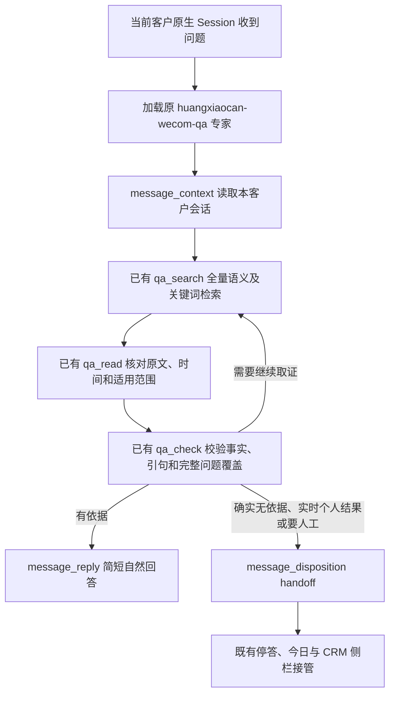

# 恢复原应答方法与语料库

## 业务逻辑

## 范围和复用

- 直接复用上一版实际绑定的 `huangxiaocan-wecom-qa`，源 digest `e330fd180d38206d3397cb7c5212f86e34da04d00315741817f6293aec533508`。保留完整语义理解、全量检索、原文证据、1～3句回答、销售推进及当前政策/历史事实区分。26 条快捷答复不是上限。
- 原 MCP 服务仍运行于本机 loopback，原始语料和中文混合索引实际可查（73,343 条 / 35,723 片段）。不新建检索服务、数据库适配器、客服后台或场景编排。
- 语料仍是已保留的知识文件与派生索引；新工作台通过 MySQL 登记逻辑知识资源的固定清单、指纹及项目读取范围，再由原 MCP 提供正文。登记的是明确的外部语料资源引用，不声称把全量语料已搬入 MySQL。现有派生检索缓存不作为新业务或任务状态库。
- 原MCP协议只补结构化 request 对象输入并兼容旧 JSON 字符串，解决真实验收中长引句的嵌套转义失败；检索与 qa_gate 业务校验代码保持原样。纯非业务问候由专家直接礼貌应答，业务事实仍须校验。
- 仅让自动化应答项目引用该语料，外部 MCP 限定 `qa_search/qa_read/qa_check`，不暴露维护、CRM写入、shell或任意文件读取。客户标识仍由宿主绑定。
- 专家安装为项目范围 Agent Skill。旧版最终 reply/handoff JSON 改接现有 `message_reply/message_disposition`；原文方法及适用规则保留，并内联必要参考，避免当前会话需要任意文件阅读器。
- 沿用现有 toolServers 配置；启动 patch 仅补一行通用 WORKBENCH_TOOL_SERVERS 环境配置映射（现有宿主已经支持标准外部 MCP），密钥来自私有宿主环境。不增加宿主业务逻辑或前端，不覆盖不可变发布目录。启用接入设置会递增原配置版本，旧待发稿失效。
- 业务资料与历史记录不进 Git。原服务语料源保持原位，本期不恢复暂停的每日 CRM 采集/维护任务，不把历史价格当当前政策，不新增客户发送范围。

## 验收

1. 先在隔离 Harness / MySQL / Temporal namespace 中运行真实模型与原检索服务。渠道使用本机验收接收器，仅保存结果，不发客户。
2. 验普通业务问题、26条以外问题、连续追问、确实未知、当前退款政策、个人实时结果、指令注入和问候。保存原问原答及实际工具链，不以旧15次收据替代。
3. 检查未授权项目/客户工具不能访问该引用；撤销引用后阻止后续调用；来源指纹与清单前后不变。
4. 独立 review-agent 检查配置、方法适配和验收证据，修复复审。配置通过后接正式原客户 Session，保留原配置作为一份恢复点，成功后代码只留正式09和回滚08。
5. 正式读回技能、工具清单、资料指纹与接入设置，明确真实模型/资料与模拟渠道边界。最后真实微信收发需要本人新消息及平台在线，不能用模拟消息冒充。

## 标准依据

[Agent Skills](https://agentskills.io/specification)：方法包与资料分离，按需加载。官方 Harness 已安装 skill-filesystem 支持项目 `.agents/skills` 与用户 Cordis patch；[MCP 架构](https://modelcontextprotocol.io/docs/learn/architecture)用于直接连接既有标准工具服务。本次不引入新框架。

发布顺序：程序验收及发布提交前保持旧专家路由；程序提交成功后才启用新 Skill + 语料引用。这样发布中断恢复到08时仍使用08支持的原配置。日后主动退回08，须先恢复保存的一份旧专家/knowledge配置，再交换程序指针。已在隔离环境用实际08 Worker及08样式的启动 patch 验证旧配置可回复，再恢复新配置；不回退业务数据库。
