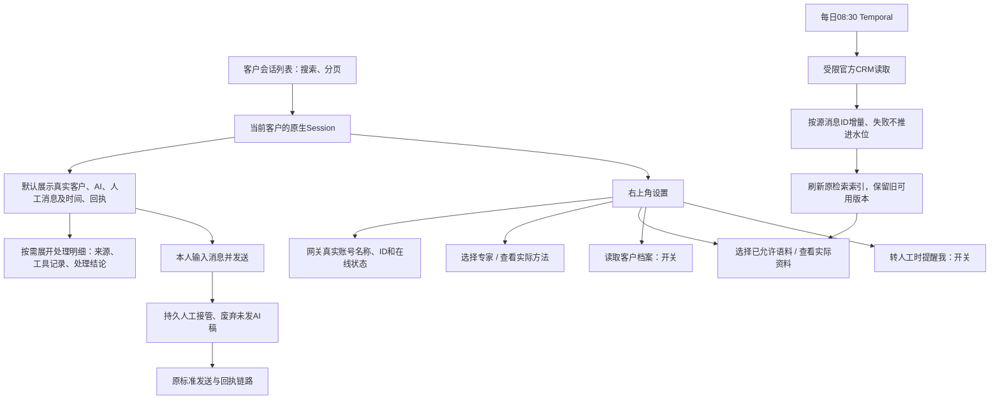

# 自动应答：客户对话优先、简化配置与每日增量恢复

本期沿用原生 Harness Session、标准 MCP、Temporal、MySQL 和现有网关。原上下文中心和 CRM 不下线；保留本人发送白名单。

## 已确认的产品交互

用户已选 Product Design 方案3，并明确修订：一级页面只保留客户会话；设置统一从右上角打开；不显示每日08:30更新时间；删除左侧“全部会话”和“按时间”；底部保持“发送消息给客户”；“读取客户档案”和“转人工时提醒我”都用右侧滑动开关。底部保留客户发送样式，删除“发送给专家”措辞；手动发送将接入真实标准外发。专家和语料在设置里选择、查看，不新设一级页面。

## 业务流程

## 对照现状与最小范围

- 截图一把内部代理解释当主内容；渠道记录才是真实消息。本期调整同一Session的展示投影，不重建聊天后端，不改项目/客户绑定，不删除原生执行记录。
- 截图二/三的专家是手填slug、语料仅勾选清单、账号是静态连接器名。本期增加实际目录/详情入口；前端不接触数据库或渠道密钥。
- “本用户资料板块”是按可信身份读当前客户档案，不是公共知识。用户只操作开关；来源与身份匹配复用宿主配置。没有可信绑定时显示缺少档案连接，不猜测客户、不扩大读取范围。
- 会话消息按当前客户分页读取；内部说明默认折叠，打开明细才挂载原生执行视图。错误、转人工、待提交、网关受理、已发送、已送达分别显示，不把模型说“已发”当回执。
- 账号从现有网关 `/accounts` 及 `/accounts/{id}` 读取真实名称、ID、status/sendEnabled。无结果、权限错误和离线不能退回“待联测”假状态。保留账号归属/旧会话不可重绑规则；新增账号通过原连接配置产生明确绑定，不能静默改写已有客户会话。
- 专家目录来自实际可用 Agent Skills，查看实际说明/方法；不另做专家注册中心。语料目录来自已授权资源，查看清单和实际原文/检索片段；不能把清单一行冒称全量正文已经进入MySQL。
- 手动发客户消息是明确的本人外发，复用现有持久任务、发送幂等、未知结果核回；提交时先切人工并拦截未提交AI稿。不会把“发送给客户”按钮接成内部Agent提问，也不会让页面刷新重新发送。
- 删掉工程化提醒文案，保留程序边界。

## 每日增量恢复

原规则：仅黄小璨指定员工私聊；全目录游标；近30天重读，旧水位减72小时补读；源消息ID去重；修改保留变体/冲突；失败或401/403不推进成功水位；同步不自动批准现行政策，不发送客户消息。原程序还依赖旧CLI环境与SQLite同步状态，不能仅打开timer。本期优先复用原官方读取接口与取数/候选/索引方法，新增持久状态用MySQL，调度恢复沿现有Temporal，不新增cron、第二套任务/权限平台或自制编排语言。

必须先核实当前官方CLI和凭据、真实读取权限及原状态；限定客户验收只称样本，不称完整日更。完整收齐并刷新索引后才更新资源发布引用；索引失败继续提供上一可用语料，并给出异常结果。检索不受更新期间半成品污染。

## 参考

- [企微网关官方接口文档](https://wecom-gw.zhishicat.com/api-docs.html)：账号ID来自accounts；列表cursor/limit；status=online且sendEnabled=true才可发；202只表示受理。
- [Intercom会话事件](https://www.intercom.com/help/en/articles/13334840-conversation-events-in-the-inbox)：实际会话为主体，事件可检查。
- [Intercom知识来源](https://www.intercom.com/help/en/articles/9440354-knowledge-sources-to-power-ai-agents-and-self-serve-support)：来源可查看、同步状态和异常可核实，复用既有工具而非另造知识引擎。
- Product Design 本轮用户截图审视、三种布局、用户选择第三种及两轮指定修订。最新生成图是视觉目标；其聊天样例不进入真实数据库。

## 顺序与验收

1. 固定产品图与当前合同，核对API/凭据、每日源状态；不改变生产发送范围。
2. 同Session客户消息视图与明细；分页不重复、不预加载全部Session；刷新不发送；手机不溢出。
3. 设置抽屉：真实账号、实际专家与资料、两开关；所有可见控件真连后端；失败明确显示，原配置不丢。
4. 人工发一条只到隔离接收器；同幂等键只一条；生成中接管拦旧稿；未知只核原回执。
5. 每日增量：样本读取、重复去重、补录/修改、401/403、失败不推进、索引失败旧版可用；真实完整日更与样本区分。恢复08:30定时后核实实际下一次触发时间。
6. 真实Harness隔离桌面/390px验收、Product Design同状态合图比较、独立review-agent，修复复审到无明显问题后固定入口上线。只留正式和上一成功回滚版。

CLI核查：用户指定独立仓库 qianlan33333-png/aicrm-cli，已查询官方latest release为v0.7.1，下载Linux amd64归档并核对同tag checksums。新鲜官方扫码授权在服务器完成，凭据私有文件保存，目录只读实查200。后台采集使用官方支持的服务器凭据模式；未变更全局CLI策略。
