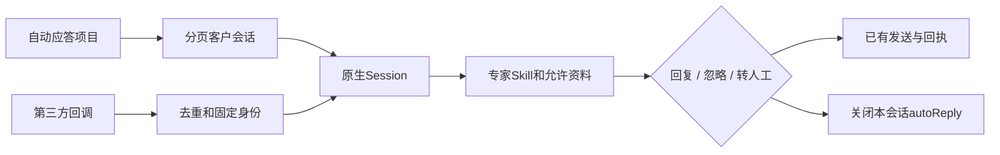

# 自动应答专项：实施计划

状态：实现与隔离验收完成，待正式部署；真实企微联测按用户要求延后。基线4de2615；原工作区的今日跟进改动保持原样。本版替代早期标准自动应答扩展设计。

只补三处：专项列表和最小配置、第三方薄适配、现有路由的版本化停答/恢复。复用Harness、MCP、Temporal和MySQL；不另建会话平台或编排器。

参考：MCP官方SDK、供应商公开协议https://wecom-gw.zhishicat.com/api-docs.html、Chatwoot Agent Bots的会话接管分工https://www.chatwoot.com/hc/user-guide/articles/1677497472-how-to-use-agent-bots。前期已核查原网关协议及旧版验收，首次开发前再次依据当前接口实现。

实现顺序：1.路由查询、配置与模式版本；2.第三方签名回调、幂等收发和接管；3.原生Session接续、受限资料和运行释放；4.Product Design按原生资源页样式扩展列表/配置；5.隔离MySQL、真实Harness、桌面/手机与故障验收。

验收：重复事件不重发；人工接管阻断旧草稿（包括恢复后）；暂停消息保留；其他用户资料拒绝；超时只查原回执；一万客户分页50条且侧边栏不增长，不常驻一万个Agent。先合成渠道闭环，再单个指定真实测试对象，后五人并行。真实账号联测与模拟结果分别记录，旧功能与客户回调不变。

新增业务表为零：专项配置复用wb_settings，客户绑定与autoReply复用wb_message_routes，原消息/发送复用wb_messages/wb_deliveries。查询增加生成列索引；后台复用现有Worker、Temporal与连接器。单客户暂停/未运行模型的入站保留原文，在同一原生Session的只读渠道记录查看；不是新的会话/客服系统。

正式部署时新账号接入默认停用。为后续可回滚，沿用既有发布控制器先建立验证成功的本版基线，再轮转到同制品正式版；两版均支持Incoming与配置代次，不向不支持该协议的旧Worker热回退新客户任务。全程只保留current与一个previous，既有业务与原回调继续运行。
