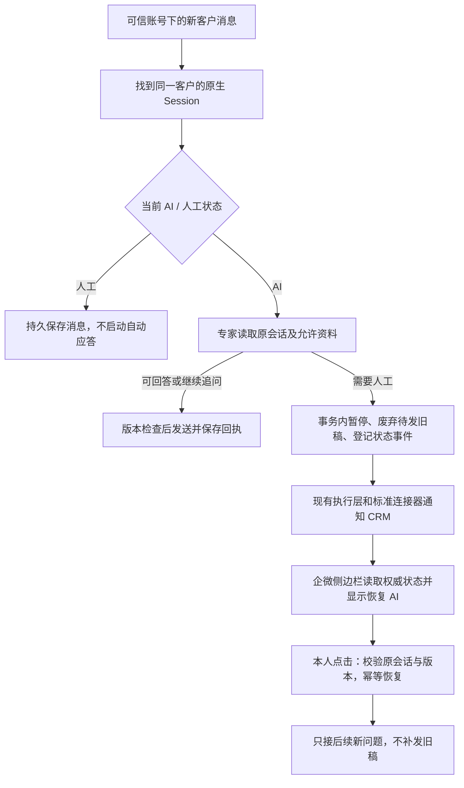

# 会话接续与人工接管恢复：最小交付

基线：已上线原生工作台 9d76d5f，文档基线 75f7d73。原上下文中心、CRM 和回调继续运行。本期不新增客服后台、表单设计器、Agent 框架或业务专用采集器。

## 业务判断流程

## 三个问题的处理范围

1. 推进型 Agent 可以在同一 Session 按专家 Skill 追问。必填项、顺序和解释属于方法配置；严格登记必须由通用 Schema 校验和业务写入工具保证。姓名、年龄、收入、现状仅为示例，本期不硬编码字段，不猜测第五项，不新增采集后台。
2. 同一账号和客户稳定对应原生 Session；切换客户、释放空闲 Agent、重启都不能换会话。验收模拟数日时间间隔、穿插另一客户并重启，使用真实 Harness 读回前次随机事实。长期任务的结构化采集状态将来应由资料/登记工具保存，不把有限模型上下文当数据库。
3. 本期实现缺失的 CRM 状态通知、状态查询和恢复，以及即时回复与已配置批量通道共用的客户发送门禁。复用旧跨端协议、现有 MySQL 事务/版本、Temporal、消息连接器和投递记录。

## 复用与新增

| 项目 | 实现 |
|---|---|
| 会话及上下文 | 复用原生 Harness 会话文件、固定 Session 身份和既有渠道历史工具；不引入过期后自动新建会话 |
| AI / 人工权威 | 复用 wb_message_routes.autoReply 与递增 revision；CRM 只展示/请求变更，不维护第二个权威开关 |
| 外部身份 | 入站可信 externalUserId 固定到路由；缺失时仅使用宿主已核验的映射；重名、冲突、多匹配不猜测 |
| CRM 跨端协议 | 复用旧 v1 签名、status/resume/configure、状态事件与请求幂等；凭证只在宿主配置，限定一个连接和托管员工 |
| 通知执行 | 状态和事件同事务；复用现有通知扫描、Run/Delivery 与 Temporal；独立于本人通知是否启用，通知失败不恢复 AI |
| 统一外发门禁 | 提交即时回复、普通客户消息及批量消息前读取同一客户状态；不同发送适配器通过本人配置的模式来源连接关联 |
| 配置与页面 | 优先复用已有 CRM 侧边栏及按钮，本期不重做工作台页面；只有实际需要修改页面时才进入 Product Design |

## 稳定边界

- 不让模型设置其他客户、账号、接收方或恢复 AI；恢复只能来自本人入口或已验证的 CRM 请求。
- 同请求 ID/同载荷返回原恢复收据；同 ID/不同载荷、旧版本、错误员工、未知或多个会话拒绝，不创建客户。
- 停答在通知前生效；通知丢失时侧边栏仍能读取准确状态。通知重试不重跑专家、不触发客户消息。
- 恢复不能复活旧输入、旧草稿或其他客户任务；已经被外部设备接受的消息只能保留原结果核实。
- 发送模式按同一托管账号和客户生效。跨适配器须显式关联模式来源，不能按姓名猜身份。
- 保留既有本人微信、飞书、今日与项目资料范围；仅用本人白名单进行真实发送测试。

## 参考

- 旧工作台 `docs/plans/auto-reply-contract-v1.md` 与 `gateway_crm.go`：复用已确定的双端行为，不复活旧服务。
- [Chatwoot Agent Bots](https://www.chatwoot.com/hc/user-guide/articles/1677497472-how-to-use-agent-bots)：专家决定交接，由程序改变会话状态，人工显式接回。
- [MCP 工具规范](https://github.com/modelcontextprotocol/modelcontextprotocol/blob/main/docs/specification/2026-07-28/server/tools.mdx)：稳定工具、输入 Schema、结构化结果；不接入新编排语言。本期仍使用当前 SDK 已支持的协议子集。
- 真实 CRM 的旧状态通知地址 GET 返回 405，仅作为路由存在的线索；没有据此认定签名配对、按钮和设备验收成功。

## 开发及验收顺序

1. 固定身份、模式事件和统一发送前检查，覆盖立即停答、草稿失效、恢复后不补发、并发旧版本和批量拦截。
2. 接入现有跨端协议及标准连接器，验证签名/身份、重复请求、通知失败、乱序和重启恢复。
3. 真实 Harness 验证 A→B→A、多日间隔与重启后接续；不把模拟渠道当作真实客户外发。
4. 复原成对配置，真实无客户正文 probe、侧边栏状态读回及恢复联测；没有必要凭证时继续完成可独立验证的实现，明确保留真实联测边界。
5. 独立 review-agent 审查完整改动，修复后复审到无明显问题；按工作台固定发布入口同包上线，只保留正式和上一成功版本。CRM 若需改代码则走其现有发布路由，不在工作台服务器旁路安装。
