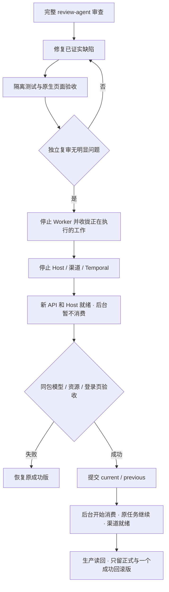

# 原生工作台审查修复与两版交付

## 业务判断

## 参考与取舍

复用现有部署临时文件、发布锁、Temporal Worker 生命周期、资源允许列表与 MCP SDK；不新增业务平台、调度语言或权限模块。后台等待提交发生在 Worker 开始轮询之前，不把维护时间消耗为业务 Activity 的失败次数。

Temporal 官方将可失败操作放在 Activity 并由重试策略接续；本次更早阻止尚未获准的后台消费，不对已经提交给渠道但结果未知的发送重试。参考：[错误处理](https://docs.temporal.io/develop/go/best-practices/error-handling)、[重试策略](https://docs.temporal.io/encyclopedia/retry-policies)。

## 修复范围

1. 标准回滚命令能直接回到 previous；新候选继续要求完整验收，已成功的 previous 回滚仍核验制品与服务。
2. Worker API 可以供 Host 启动与只读验收；所有后台轮询等到部署提交后开始。健康信息分别报告 API 与后台状态；提交后必须读回后台已启动。
3. 停止顺序先收拢 Worker，再停止其依赖的 Host、渠道和 Temporal，防止正常发送被中断成未知结果。
4. 常规两版轮转复用已有容器挂载和启动定义检查，保护独立服务引用的依赖。
5. 项目引用页包括维护资源；共享说明明确所属/维护项目的固有能力。
6. memory_save 返回数据库实际版本与来源，支持紧接着纠正和忘记。

## 验收与交付

- 直接走标准回滚分支，无额外临时环境变量；失败不得删除原 current / previous。
- 等待部署提交、取消、错误门禁、启动失败均有行为验证；模拟发送在提交前为零，原 delivery 身份不变。
- 用隔离 MySQL / Temporal 验证；真实渠道不创建客户任务。
- Product Design 按原生资源页验收维护方、所属方、普通共享与无权项目，桌面及390px截图。
- MCP 连续保存、纠正、忘记回传版本1/2/3；过期版本仍冲突。
- 目前唯一旧原生版本缺少后台门禁。首次升级需先核清在途操作；最终保留的回滚基线也应含门禁并经过真实启动与读回。必要时同一已审查制品先建立成功基线，再完成最终两版轮转；不保留旧缺陷版本充数。
- 全部修复独立复审后才发布。旧资料、CRM、原中心、当前业务库和渠道回执不重置。
