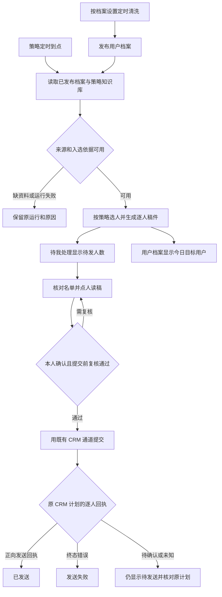

# 自动化运营专项 PRD

2026-11-09 修订。首个策略用「新人前 7 天承接」验证，从定时产出名单和稿件，到本人确认及 CRM 逐人回执。

## 业务判断

到点完成选人与写稿，人的第一步是看已生成的结果。档案清洗、策略准备和发送是三个独立动作。策略运行时读取授权范围内的已发布版本，稿件保留当次采用的依据。档案不可用或过期时，策略按照配置停止或使用明确允许的已发布版本，运行原因留在明细。

## 页面

工作台左侧只有一行「自动化运营」，直达专项页。顶部只有「待我处理」「用户档案」两个入口，右上角是低权重的「历史」「设置」。沿用现有工作台的侧栏、按钮和列表样式。

| 页面 | 展示与操作 |
| --- | --- |
| 待我处理 | 每个已配置策略一行，显示「策略名称 · 待发 24 人」和「核对名单」。人数为当前可确认提交的稿件数。确认为零则显示 `0 人`，尚无可用结果显示 `—`，点开看实际原因。 |
| 策略明细 | 标题用当次策略版本的名称。上方右侧是「设置」和「确认并发送」。名单只有「客户昵称」「入选依据」「状态」。点一行，右侧显示该人的已生成正文、入选依据及已有回执，手机端可点开逐人查看。 |
| 用户档案 | 列表标题「今日目标用户」。同一用户命中多条策略只列一次，逐个策略的人数各自计算。点开后显示原工作台档案的字段名和字段值。右上角「档案设置」配置整类档案的更新。 |
| 历史 | 在角落进入，按策略及执行日期回查。复用策略明细查看当时的名单、正文、依据和逐人回执，可展开原执行记录。当天结束后移入历史的未处理记录保留原状态和稿件，续办仍指向原任务并复核资格。 |

用户档案沿用现有资料字段的顺序及文本，包括基础字段、互动提炼摘要、当前主需求、背景与经历等实际已有内容。移除「辅助谈单 · 当前阶段：明确需求」等销售组件和提示条。正式工作台已发布的 `live-context-snapshot` 当前包括画像与需求、权益与关系、交互摘要、联系限制等资源板块。旧界面字段与这些板块的覆盖程度需要逐一比对，空值沿用来源的空值或待确认状态。原始事实和专家清洗产物分别存储，运营页按既有客户身份与授权取用。

### 发送状态

| 名单状态 | 数据来源及动作 |
| --- | --- |
| 待发送 | 包括尚未提交和提交后等待正向回执两种情形。后一种在逐人明细里显示「待手机确认」或「核对回执中」，继续查询原 CRM 计划。首页的待发人数只算尚未提交且可确认的稿件。 |
| 已发送 | CRM 原计划下匹配该客户与运营账号的正向发送回执已读回。现有连接器校验企微回执状态和发送时间。 |
| 发送失败 | 原提交被明确拒绝或收到终态错误，逐人明细显示原因。 |

「确认并发送」沿用一次本人确认，展示本次实际人数、运营企微账号和稿件版本。确认与当次的对象、正文、账号绑定。提交前复核资格，范围或内容变化则回到同一名单核对。已提交或回执未明的记录继续引用原 CRM 计划与操作标识。历史和详情通过同一逐人记录呈现结果。

## 设置

| 入口 | 配置 | 接线 |
| --- | --- | --- |
| 专项页右上角「设置」 | 关联知识库、运营企微账号 | 知识库从项目可读范围选择。账号关联已有 CRM 发送通道及实际企微员工身份。连接状态可在字段旁提示。 |
| 「用户档案」右上角「档案设置」 | 清洗时间、专家、清洗方式 | 定时读取授权的数据来源，调用所选专家的已发布方法版本，把结果发布给档案页与策略消费。原始 CRM 定时采集继续独立运行。 |
| 策略明细右上角「设置」 | 自动运行时间、运行方式、专家、知识库 | 时间交给现有 Temporal 日程，方式和专家解析为现有方法或登记入口。默认用专项关联的知识库，可在已授权范围选具体知识库。保存后的配置适用于后续执行，历史保留实际使用版本。 |

专家选择器需要映射到实际可运行的方法引用。当前定时生成工具接受已发布方法记录 `methodRef`，产品里展示专家和方法名。第一版只列已经登记、可执行的运行方式。

## 现有能力与接线核查

2026-11-09 以 owner 身份读回正式版 `native-20261109-07-workbench-nav`（`651e776edc36`）的 Worker 状态、资源登记、日程、运行目录和标准 MCP 工具。前后台 Worker 就绪。可见三条已启用的日程，分别为 CRM 原始资料定时更新、答疑语料更新、定时数据拉取清洗与配置资料发布。北京时 18:20 和 18:35 的两条资料更新根任务均已完成，都是无生成目标的资源刷新计划。日程和近期根任务目录均未看到「新人前 7 天承接」的每日产物链路。

| 环节 | 查到的现状 | 这次需要接入 |
| --- | --- | --- |
| 专项入口 | 现有项目类型路由识别普通项目和自动应答专项。 | 沿用专项直接路由，为自动化运营绑定独立页面和项目身份。 |
| 用户档案 | CRM 的八类原始事实资源以及原上下文中心 `live-context-snapshot` 已发布。旧档案页面另有现成的基础、诊断和背景字段合同。 | 对照旧字段与已发布资源，接入档案页。把档案设置绑定到清洗方法、来源及产物。当前档案日程读回的是源刷新；由所选专家清洗整类档案、覆盖字段并发布仍需验收。 |
| 定时生成 | 正式 MCP 提供 `program_schedule`、`program_run` 和 `batch_generate`。现有计划可刷新资源，并用固定方法逐条生成及发布结果。 | 把首个策略的动态选人规则或已有候选选单接进来，提供当天有依据的固定名单给生成器，再把生成结果关联到策略与当次名单。当前 `selection` 接受指定 ID 或按 ID 游标、限量选择，无法表达「新人前 7 天」的动态条件。 |
| 确认及回执 | 正式工具已注册 `crm_push`、`crm_receipts`、`message_batch_read`，查到一个启用并绑定项目的 `crm-cli` 通道。有本人范围的历史计划读回。 | 按现有合同为策略登记逐人发送资格与 CRM 客户、员工账号、业务动作键的绑定。正式资源登记未见这条策略的检查合同。核对专项项目权限及实际可用账号范围，验同一次确认到原回执的读回。 |

旧上下文中心有候选选择能力的历史记录，接线时先核对其现行入口、权限和输出合同，优先复用。工作台现有 `batch_generate` 已解决名单确定后的多人逐条写稿，一次任务最多 2,000 条，支持固定输入和原任务续办。已有 2,000 条真实模型技术验收。首期直接复用这项能力，多个策略各自使用已有定时入口。整类档案继续使用现有源刷新，专家清洗覆盖的板块及记录范围单独验收。涉及跨任务的汇总，用策略、业务日期和原运行引用关联名单、稿件、确认及逐人回执，历史可按原记录分页。专项使用现有 Cordis 外壳。

## 首条策略验收

1. 先用同一份档案事实核对「新人前 7 天承接」实际入选对象及理由，并逐字段对照旧档案。验证明确零人、缺来源和仍在生成三种情形。
2. 等正式配置的日程自然触发，核对同一原任务发布的名单、逐人稿件和对应版本；首页可确认人数与明细对齐。
3. 先用隔离及本人授权范围走「确认并发送」，核对账号、冻结后的正文、受理、待确认、明确失败和正向发送回执；重复点击与结果未知均能从原计划查回。
4. 验桌面和 390px 手机的专项单行导航、点人看稿、历史回查和三个设置入口。页面读回配置的下一次运行及当次真实产物。

## 参考

- 参考 Braze 在同一发送对象下保留受众、内容、发送设置与确认的关联，以及区分提交和投递状态。 [Braze Approvals](https://www.braze.com/docs/user_guide/messaging/governance/approvals) · [Braze Messaging Observability](https://www.braze.com/docs/user_guide/analytics/dashboards/dashboard_builder/messaging_observability)
- 参考 n8n 将单次执行明细留在原执行记录。 [n8n Executions](https://docs.n8n.io/build/understand-workflows/understand-executions/view-all-executions.md)
- [项目导航](2026-11-09-workbench-navigation.md) · [运营工具](../../native/docs/OPERATIONS.md) · [原档案发布读回](../REAL-DATA-ACCEPTANCE-2026-11-08.md) · [CRM 档案采集](../CRM_ARCHIVE_ACCEPTANCE.md) · [批量生成验收](../../native/ACCEPTANCE.md)
