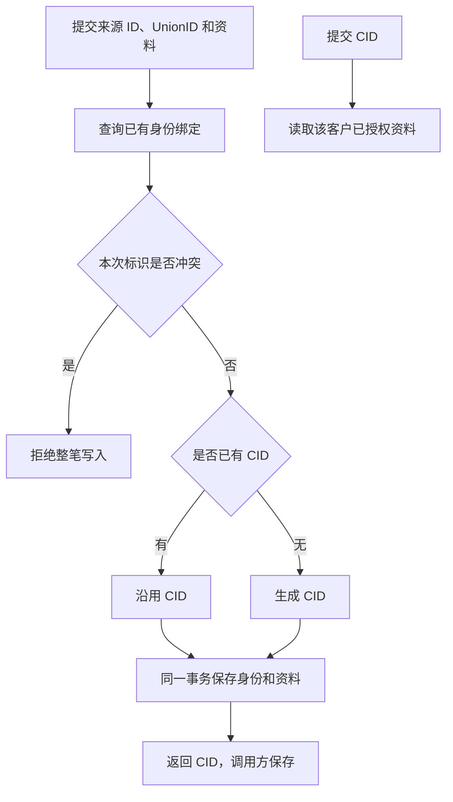

# 客户数据基建：MySQL + 两个 MCP 工具

状态：2026-11-09 用户已确认并授权开发。按最新要求重写，替代上一版开放平台设计；本次仅做身份识别、数据写入和读取。实现与调用说明见 [客户工具说明](../../native/docs/CUSTOMERS.md)。

## 1. 业务判断流程



业务结果：CRM 和黄小璨提交同一人的标识时，得到相同的工作台 CID；以后用 CID 读取资料。CID 指业务客户，不是工作台登录账号。

## 2. 参考与选择

已查阅 [官方 MCP Go SDK](https://github.com/modelcontextprotocol/go-sdk) 和 [MCP 工具协议](https://modelcontextprotocol.io/specification/2025-06-18/server/tools)。当前 `native/worker/go.mod` 已有官方 SDK，继续复用现有服务和 MySQL。

选择两张普通表和两个函数，直接封装为 MCP 工具。身份按明确 ID 匹配，不使用模型、姓名或手机号猜测。

## 3. MySQL 只建两张表

| 表 | 最小字段 | 用途 |
|---|---|---|
| `wb_customers` | `cid` 主键、`data` JSON、创建/更新时间 | 存工作台独立 CID 和来源资料 |
| `wb_customer_identifiers` | `kind`、`scope`、`value`、`cid` 外键 | 把外部 ID 绑定到 CID |

- CID 由服务端生成，采用 `cid_` 加 UUID，不依赖任何外部系统 ID。
- 身份表唯一键为 `(kind, scope, value)`，并索引 `cid`；ID 使用区分大小写的精确比较。
- `kind` 支持 `union_id`、`crm_one_id`、`wecom_external_userid`、`hxc_user_id`。
- `scope` 表示该 ID 的有效范围：UnionID 对应微信开放平台账号，其他 ID 对应所属企业或应用。范围由接入凭据的配置确定，不由调用者随意指定。
- `data` 按来源存放，例如 `{"crm":{"nickname":"示例"},"hxc":{"level":"示例"}}`。来源只能更新自己的字段；读取按已有授权范围返回。
- 更新只替换本次提交的顶层资料字段；未提交字段保留，嵌套对象和数组作为一个字段整体替换，`null` 原样保存。通过数据库事务和行锁避免并发更新丢失。

这一期存身份和来源提交的当前资料。订单、聊天记录等大量明细继续留在原数据表，不塞入客户 JSON。

## 4. 识别写入规则

1. 至少提交一个有效来源 ID；有 UnionID 时一并提交。缺少 UnionID 仍可按来源 ID 建立或查回客户，但不能据此宣称跨端识别成功。
2. 优先按同一范围的 UnionID 找 CID，再核对本次所有来源 ID 的已有绑定。
3. UnionID 未命中但来源 ID 命中，沿用该 CID 并补充 UnionID；全部未命中才新建 CID。
4. 本次标识指向不同 CID，或来源 ID 已绑定另一个同范围 UnionID，整笔拒绝，不覆盖、不自动合并。
5. 在一个 MySQL 事务内保存 CID、新身份绑定和资料；提交成功后才返回。唯一键冲突时重新查回并判断，保证并发和重复请求不重复建人。

例如：CRM 先提交 `union_id=U1`、`crm_one_id=C1`、`wecom_external_userid=W1`，返回 `cid_xxx`；黄小璨随后提交同范围 `union_id=U1`、`hxc_user_id=H1`，返回同一个 `cid_xxx`。

## 5. MCP 只暴露两个工具

| 工具 | 输入 | 输出 |
|---|---|---|
| `customer_upsert` | `identifiers`：ID 类型与值的列表；`data`：可选资料对象 | `cid`、`created` |
| `customer_get` | `cid` | `cid`、授权可见的 `identifiers` 和 `data` |

来源和范围从已认证的调用上下文取得；调用方不传数据库、表名或 SQL。客户端程序和模型均调用相同工具。

```json
{"identifiers":[{"kind":"union_id","value":"U1"},{"kind":"crm_one_id","value":"C1"},{"kind":"wecom_external_userid","value":"W1"}],"data":{"nickname":"示例"}}
```

写入成功返回：`{"cid":"cid_xxx","created":true}`。重复提交返回原 CID，`created:false`。读取不存在的 CID 返回明确的 `NOT_FOUND`。

协议统一使用官方 SDK、Streamable HTTP、`tools/list` 和 `tools/call`；两个工具均提供 JSON Schema 的 `inputSchema`、`outputSchema`，结果通过 `structuredContent` 返回，并附等价文本内容兼容客户端。业务失败使用 `isError:true`，结构化返回稳定错误码，例如 `IDENTITY_CONFLICT`；输出 Schema 同时覆盖成功和失败结构。

实现只有现有 MCP 注册入口 → 客户读写函数 → MySQL。沿用已有鉴权并绑定来源和读写范围，不新建权限平台，不把 Host 管理凭据分给业务调用方。

## 6. 最小验收与交付

按顺序验证：首次写入并读回；同一请求重复调用；CRM 与黄小璨双向接入返回同一 CID；缺 UnionID 后补齐；并发同一身份只建一人；冲突整笔回滚；不同来源资料互不覆盖且读取遵守授权。

交付就是两张表、两个工具、上述行为测试及调用示例。CID 使用独立数据库与来源凭据，库中只有上述两张表。验收使用现有工作台 MCP 入口。
