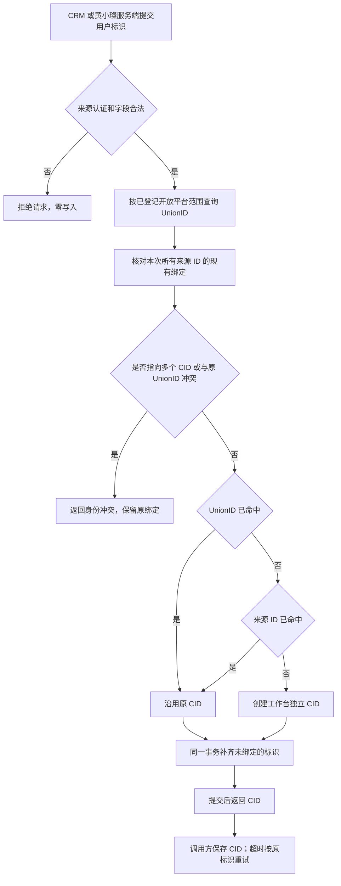

# 工作台开放接入：独立 CID 与多端身份绑定

状态：方案草案，未实现、未发布。2026-11-09 用户确定先补齐原有采集验收，本轮只整理 CID 方案。这里的“用户”指业务客户，不是工作台登录账号。

## 业务判断流程



UnionID 优先用于跨端识别；来源 ID 保证同一来源重试、缺 UnionID 或后续补齐时不重复建人。一次请求中所有已有绑定必须一致，不能用“UnionID 优先”覆盖其他人的来源 ID。

## 当前能力和复用边界

本轮开始时现场读回正式版 `native-20261109-04`，`data_refresh`、`crm_push`、`crm_receipts` 已注册，当时正式 CRM 档案连接为零。后续已将 CRM 专用只读授权和八个记录数组接入正式 `native-20261109-05`，首轮发布 204,449 条记录，并验证项目读回与重复调用复用原任务。采集结果见 [CRM 档案验收](../CRM_ARCHIVE_ACCEPTANCE.md)。这不表示原包全部映射字段、HXC 原始来源或策略验收均已完成。策略选单按用户要求暂缓，本人计划 391 仅证明传输验收。

现有 `wb_message_routes` 绑定渠道、联系人、项目和会话，`wb_sessions` 保证会话项目不可改。它们不是跨来源的客户主表。现有 API 的 Host 凭据可调用工作台管理能力，不能作为对外接入凭据分发。

CID 在工作台内独立生成；CRM OneID、黄小璨用户 ID、企微外部联系人 ID 都是外部映射。保留 CRM 自己的 OneID 及其解析和建客合同。身份绑定不改变会话项目，不合并聊天历史，不自动共享项目正文，也不授予登录或发送权限。

## 参考与设计选择

已查阅公开标准和产品案例：

- [SCIM RFC 7643 §3.1](https://www.rfc-editor.org/rfc/rfc7643.html#section-3.1) 区分服务端生成的稳定 ID 和来源系统自己的 externalId，externalId 必须在来源范围内解释。本方案借鉴该区分，不宣称实现完整 SCIM。
- [Auth0 User Account Linking](https://auth0.com/docs/manage-users/user-accounts/user-account-linking) 展示同一主身份关联多个外部身份，且身份关联不等于自动合并业务资料。这里采用受信服务端提交，禁止浏览器自行声明可信身份。
- [TapTap 内建账户指南](https://developer.taptap.cn/docs/en/v3/sdk/authentication/guide/) 给出移动端与小程序通过同一微信开放平台的 UnionID 关联账户的实际接入案例。不能假定不同开放平台账号的 UnionID 可直接互认。

| 方案 | 判断 |
|---|---|
| 工作台 CID 加外部标识表 | 推荐。满足独立 ID，两个表、一个接入接口即可覆盖创建和补充绑定 |
| 直接使用 CRM OneID 作为工作台主键 | 不采用。让黄小璨先依赖 CRM 建客，不符合任意来源可先接入的要求 |
| 引入完整身份平台或通用身份图谱 | 不采用。本期只需要精确匹配，没有必要增加新的服务和管理后台 |

## 最小接口合同

建议 `POST /open/v1/customers/resolve-or-create`，HTTPS、JSON Schema，外部服务端使用各自的受控接入凭据。调用方身份由凭据确定，不能通过请求体或 `X-Workbench-*` 请求头切换来源、企业或项目。

CRM 接入请求：

```json
{
  "unionId": "union_example",
  "crmOneId": "crm_example",
  "externalUserId": "wecom_example"
}
```

黄小璨接入请求：

```json
{
  "unionId": "union_example",
  "hxcUserId": "hxc_example"
}
```

成功返回同一最小格式，来源方持久保存：

```json
{"cid": "cid_550e8400-e29b-41d4-a716-446655440000"}
```

首次成功和再次成功均返回 200 与稳定 CID。参数无效返回 400，未认证返回 401，来源不允许的字段/范围返回 403，身份冲突返回 409 `identity_conflict`，暂时不可用返回 503。错误不返回另一位客户的 CID 或标识。

成功响应必须在数据库事务提交后返回。超时或丢回应时，调用方使用相同标识重复调用并获得原 CID，不新增补发接口或调用方可指定的 CID。CID 是关联键，不能作为访问凭据。

## 标识规则与最小存储

建议仅新增 `wb_customers` 与 `wb_customer_identifiers`，继续使用现有 MySQL。

- `wb_customers` 保存工作台生成的 CID 和创建时间，CID 使用现有 UUID 库生成，不从任何外部标识推算。
- `wb_customer_identifiers` 保存 CID、标识类型、来源范围、标识值。`类型 + 来源范围 + 标识值` 唯一且区分大小写，每个外部标识只能属于一个 CID。
- UnionID 的范围是已核实的微信开放平台账号。CRM OneID 的范围是对应 CRM 实例/企业。企微外部联系人 ID 的范围是企业及实际取得该 ID 的应用/服务商上下文。黄小璨 ID 的范围是该产品实例。
- 上述范围在服务端受控配置中登记。CRM 和黄小璨只有在实际属于同一开放平台时，才使用同一 UnionID 范围。不得把各自的 appid 当成同一个开放平台的证明。
- 每个 CID 在同一 UnionID 范围只能绑定一个 UnionID。请求只能补充新标识，不能替换或搬迁已有绑定。
- 不按昵称、头像、手机号猜测同一人。不改变标识大小写，不自动裁剪导致两个不同 ID 相等。

接入凭据仅允许调用该接口及登记来源的字段，不能复用工作台 Host 管理 token。复用当前配置和 HTTP 服务，增加一个窄鉴权分支即可，不开发应用管理后台或通用权限平台。

一次解析、创建和补充绑定在一个事务内完成。数据库唯一约束作为并发裁决；唯一键竞争和死锁只重试整个事务，再读取已经提交的 CID，不能留下无绑定的孤立客户。调用成功后两端只保存 CID，不需要工作台再回调两端才能完成本次绑定。

## 缺失与冲突的处理

| 情况 | 建议结果 |
|---|---|
| CRM 先提交三个标识，均未存在 | 新 CID，原子绑定三个标识 |
| 黄小璨随后提交相同范围的 UnionID 与自己的 ID | 返回原 CID，并补充黄小璨 ID |
| 两端接入顺序倒置 | 得到相同绑定结果 |
| 完全相同的请求重复或并发到达 | 只保留一个 CID，响应都返回它 |
| UnionID 未命中，来源 ID 已存在且原来没有 UnionID | 沿用来源 ID 的 CID，补齐 UnionID |
| 来源实际暂时拿不到 UnionID | 建议允许 `unionId:null`，按来源 ID 建立/复用 CID，暂不承诺跨端识别；真实接入前核对源接口的可用性 |
| UnionID 与来源 ID 已属于不同 CID | 409，全事务回滚，不自动合并或更换 CID |
| 同一来源 ID 再次提交不同 UnionID | 409，保留原绑定 |
| 两端之前缺 UnionID，各建了 CID，后来发现是同一个人 | 返回冲突；首版不实现两个已对外返回 CID 的自动归并 |
| 不同范围出现相同标识文本 | 保持独立，不能仅比较文本关联 |
| CRM 客户在其自身系统合并或标识迁移 | 沿 CRM 已有权威接口另行核对，本接口不把新请求当作自动迁移授权 |

`unionId:null` 是对实际源数据缺失的建议处理，不表示已验证两端当前都能取得 UnionID。若业务决定严格必填，则缺失时返回 400，不能伪造值，也不能声称覆盖了所有新用户。

## 后续开发与验收顺序

1. 读回两端实际 UnionID 来源及开放平台范围，核对新客户事件的现有持久任务、源 ID 和保存 CID 的位置。原上下文中心继续只读取证。
2. 实现两个表和一个事务函数，使用隔离 MySQL 验证首建、补绑、冲突和并发；再接独立来源认证与 HTTP 合同。
3. CRM 消费者复用自己的 Identity Port 和既有持久任务。黄小璨复用自己的用户创建入口。各方创建成功后提交本方真实标识，并保存返回 CID；丢响应沿原来源 ID 重试。此阶段需要对应仓库的实现与测试，不以工作台接口成功替代。
4. 用同一位获准测试用户做双向顺序联测，读回工作台绑定与两个来源各自保存的 CID。只有三处一致且重复事件不建第二人，才算多端身份闭环通过。

必要测试还包括未认证/跨来源字段/伪造范围零写入、提交后丢回应、事务中断零残留、大小写精确匹配，以及绑定 CID 后原会话/项目权限不变。性能只核对索引命中与必要的并发行为，不另建压测系统。

本期交付范围是上述接口、两张表、接入说明和必要测试。不增加前端；如后续确需“开放平台”页面，先使用 Product Design 插件再开发。现在不新增策略、治理、版本管理、通用流程或账号合并后台。
