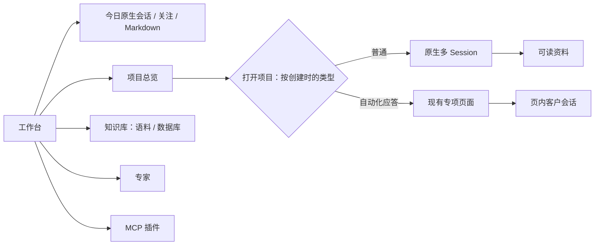

# 工作台：五个入口与项目会话

用户已确认 18 张图的产品方向；场景 08 的最终修订是：专项项目只在项目树占一行，无展开箭头、无客户子项。客户只在专项页面内搜索和分页。

- 普通项目复用官方会话树、附件、草稿、置顶与归档。新建项目入口明确普通或自动化应答，类型创建后固定。
- 今日直接进入固定 Session，原有待决定、近期执行、个人记忆和定时配置保留在可折叠关注区域。按旧版文件名编辑 SOUL.md、AGENT.md；保存后下一轮读取，不新建会话。
- 普通项目只提供项目级资料授权。知识库继续使用现有连接、快照及 MCP Resources；只有来源实际可读／可写的操作才出现。
- 专家使用官方 Skill 目录；MCP 管理展示现有标准工具和连接，复用现有宿主配置。对话保留官方能力调用入口。共同能力入口不代替底层资源或渠道授权。
- 自动化应答的客户列表、消息、人工接管、回答配置及回执合同沿用已有实现。验证期间不新增客户发送。

参考：用户的两层侧栏设计、旧工作台原生多会话交互、[Harness Slots](https://github.com/deepseek-ai/deepseek-harness/blob/dsh-v0.2.2-rc.1/docs/subsystems/slots.md)、[Obsidian Links](https://help.obsidian.md/links)、[Open WebUI Knowledge](https://docs.openwebui.com/features/workspace/knowledge/)。

验收：今日一步进入、普通多会话、专项单行直达与页内客户、知识与专家/MCP 入口；桌面与 390px 下验证导航、草稿、设置；独立复审后沿既有正式发布控制器切换。
