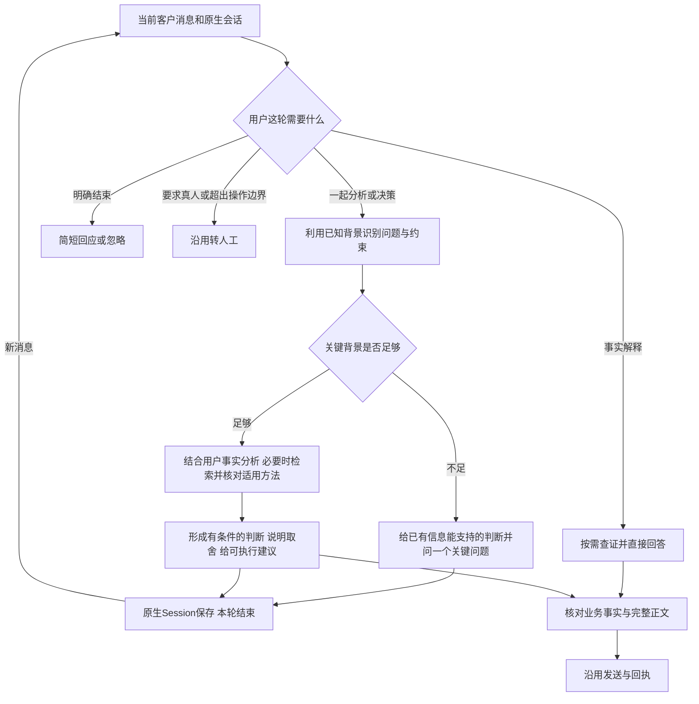

# 专家分析与持续交流：最小实施 PRD

## 业务判断流程

## 范围与标准方案

保持 Harness、MCP、Temporal、MySQL、渠道和前端不变。主要调整现有通用 customer-reply 方法及黄小璨实例；同时修复已证实的原生模型思考配置缺口。不加专用宿主分支、表、模式开关、关系评分、独立审稿Agent或新检索系统。

采用 Agent Skills 既有结构；遵循[官方最佳实践](https://github.com/agentskills/agentskills/blob/main/docs/skill-creation/best-practices.mdx)的真实场景迭代，以及[上下文工程实践](https://www.anthropic.com/engineering/effective-context-engineering-for-ai-agents)的清晰指令与代表性例子。复用现有参考文件编译和实际工具链，不引入框架。

## 必要修改

1. 方法先理解用户意图；“开始咨询”直接开始了解问题，不检索同名产品介绍。
2. 分析时明确用户事实、资料依据和本轮推断。先有可用判断，再问能改变判断的问题；背景不足不假装已有结论。
3. 检索围绕待判断问题、条件与方法。宣传文案和其他客户问句不能作为专家方法；命中无关资料不强行引用。
4. 对已有信息做应用、比较和验证建议，不循环复述原文；用户纠正时修正判断，拒绝时收住。没有明确配置和用户意愿不转销售。
5. 保留 qa_check 事实与正文合同。纯澄清、会话回应无需伪造来源；涉及业务事实时检查完整稿件。建议明确为建议，不能把来源方法扩大成保证、真人经历、产品能力或当前政策。
6. 增加多轮示例覆盖咨询启动、具体问题分析、纠正、分歧、方法不足和结束；现有事实/隐私/接管边界不放松。

## 验收

正式当前语料固定同一版本，新旧各使用独立固定原生Session、相同用户消息、相同模型、相同工具和事实检查。真实检索和模型，发送至隔离收件器，不发客户；不能把它说成实际企微已收到。

至少覆盖咨询启动→提供背景→推进分析→纠正约束→结束，以及事实问答、真人请求、当前政策缺失与技术支持第二实例。记录逐轮正文、工具、来源版本和回执；对照按具体行为人工审阅，不以长度、自动评分或多反问判定质量。任何虚构承诺、串人、隐私泄露、接管失效阻断发布。

复用已有测试设施与固定发布控制器。独立 review-agent 审查变更及部署脚本，修复后复审；候选与安装专家摘要一致，服务和原渠道状态读回；只保留正式与上一成功版。上线不重放历史消息，不自动改变人工接管决定。

## 实测后的必要收敛

中间稿实际暴露：遗漏信息被当作不存在、模糊群消息当证据、用户背景拆成空claims导致重复校验、回复过长、虚构“上周”、默认代客户承诺免费。均据实际输出调整方法；程序证据门禁未放宽。最终对照须重跑干净Session，失败尝试不删除、不算最终通过。

发布审查暴露：项目专家位于版本目录外，单独退代码不退专家。仅在现有发布控制器start中增加通用版本绑定的方法包恢复，在启动消费者前校验并恢复；两个版本的源/目标/摘要存root发布配置，不进入Agent工具或新增业务架构。覆盖标准rollback及中断recover，移除外层重复恢复写回。

## 原生思考参数的实测修复

Host原本在创建及恢复Session时将同一DeepSeek Flash的reasoningEffort写死为off。中间稿六轮虽可回复，仍出现把“已有流程”直接当成需求证据、把“没有订单数据”直接当作无法分析的依据。相同专家、相同输入、相同语料改用该模型原生high后，能区分评价与采用承诺、在纠正后缩小建议范围并继续完成行动建议。该对照仅证明本轮样本改善，不构成所有问题质量保证。

采用官方已有选项，见[DeepSeek思考模式](https://api-docs.deepseek.com/guides/thinking_mode/)。宿主增加通用的全局默认及projectId映射，默认off；本次私有部署仅将自动应答项目配置为high。项目ID仍由宿主工作区路径计算，不由模型传入。无专用模型、人物分支或新任务引擎。

官方原生会话的已记录模型选择优先于创建默认值，因此恢复时对明确配置的项目调用SDK model.select，仅更新reasoningEffort，保留已选择的provider/model。真实隔离恢复验证：原先off的客户Session恢复为high，同时今日仍为off。该选择属于原生会话记录；程序回滚不抹除会话历史或模型选择，如需恢复off应显式修改项目配置。
