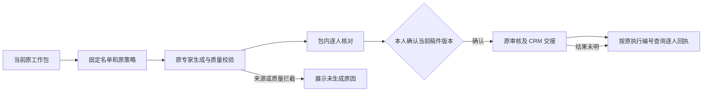
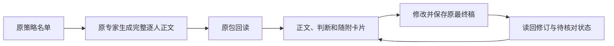

# 原运营工作包执行接线

从专项的工作包详情完成逐人核对。原中心持有候选、原策略版本、生成结果、本人审核和 CRM 回执，工作台按原工作包与执行编号读回。

- 包内保留客户昵称、入选依据和状态。点击客户看原正文、随附素材及其回执。保留原执行编号，工作包已有稿件时直接读取。
- 按原策略准备、导出、生成和导入。只有原中心认可的稿件可进入核对。来源变化时重新核对名单和稿件。
- 发送使用原包的精确审核版本和逐人选集。原中心再次验证资格并记录审核与交接。超时后按原执行编号读回。CRM 受理、手机待确认和实际发送分别显示。
- 首轮仅在「新人前 7 天承接」当前 3 人名单上验证生成并读回稿件，验收止于本人核对之前。

状态边界参考 [Braze 发送前审批](https://www.braze.com/docs/user_guide/messaging/governance/approvals) 和 [Temporal 工作流恢复](https://docs.temporal.io/workflows)。

## 逐人审稿对齐

点原名单的一人后，在右侧显示当前完整正文。判断依据和随附卡片分别展开。判断依据使用原审稿页的六个维度，保留能核对的事实、来源时间与推测状态。小程序卡片显示原标题、用途、页面和核验状态。图片卡片使用同一工作包、同一条目关联的原图。

编辑区默认收起。修改并保存时提交原执行编号、逐人条目、当前包摘要和正文修订号。保存只改原审稿正文。成功后读回原正文与修订，重新核对当前版本。发生冲突时保留输入并提示重读，不覆盖原稿。历史与已交接稿件仅供回看。

线上首轮开放生成和审稿。发布验收回读新人承接已有两条正文、判断和卡片。修改和冲突在隔离环境核对，试跑原稿保留原版本。CRM 交接动作在本轮关闭。内容保存和审批分开也见 [Braze 发送前审批](https://www.braze.com/docs/user_guide/messaging/governance/approvals)。
