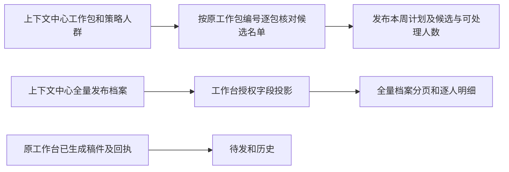

# 自动化运营对齐原计划与全量档案

工作包用原 `package_id` 和周次标识。同名不同场景分开列。策略人群同时保留没有实际工作包的零值或未就绪口径。目录人数、名单核对人数、待发人数各自显示，无法读回名单时标为待核对。使用原只读候选入口，不生成稿件。参考 [Braze 的人群统计口径](https://www.braze.com/docs/user_guide/audience/segments/measuring_segment_size)。

全量档案读取已有的 `live-context-snapshot`，以发布快照和稳定档案 ID 分页。接入基础事实、身份与背景、需求和诊断、权益和商品、渠道互动、关系中心历史及可读的字段来源和状态。只发布所需的项目字段投影。历史事实和待核判断分组保留。原中心的写入按钮、审批和谈单工具属于原中心。对照同一档案时，记录每个字段的实际来源和水位。

计划目录、档案查询和已有本人确认分别使用授权资源。工作包统计不会改变发送资格。档案页全量不会扩大专家试点名单或触发全量模型生成。验证包括五个工作包的逐人去重和差异、六个策略人群的候选与外发口径、全量人数与分页、同人档案字段、缺值、跨项目访问及桌面和手机。

## 2026-W46 来源核对

| 原中心工作包 | 场景 | 目录候选 | 目录可处理 | 实际名单去重 |
| --- | --- | ---: | ---: | ---: |
| 到期承接 | 服务跟进 | 330 | 330 | 330 |
| 新人前 7 天承接 | 服务跟进 | 3 | 3 | 3 |
| 老客关系维护 | 服务跟进 | 18 | 18 | 18 |
| 黄小璨常态服务 | 内容推荐 | 405 | 405 | 405 |
| 黄小璨常态服务 | 服务跟进 | 47 | 47 | 47 |

策略人群层的候选／外发候选为内容推荐 410／406、周复盘回访 0／0、在服召回 360／0、新人前 7 天承接 394／3、福利建档 0／0、过期与沉默关系恢复 0／0。内容推荐 406 与工作包 405 使用不同层级口径，前者数策略决策的外发候选，后者数现行工作包中实际通过原名单入口的人。

原 `archive/users` 不加筛选读回 25,142 条，与工作台现有同源发布快照总数一致。原首期的 8 人来自专项试点资源，只展示 9 个取值字段。原中心的单人明细还组合了 operator_contact、人工修订、会话提炼、黄小璨精确关系补充、运营跟进及产品判断。Avi 的手机号、历史订单、互动和关系中心历史资料分属这些不同来源。
