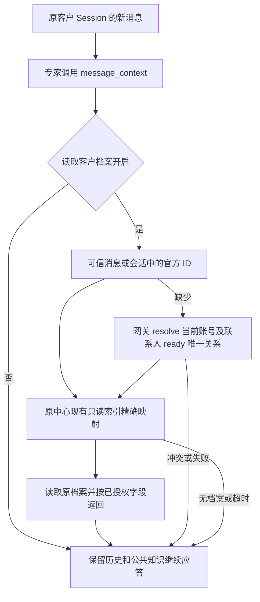

# 客户档案接入 PRD — 最小实现

## 目标与范围
现有应答专家按需调用 `message_context`，读取当前客户的原中心档案。复用原 Session、连接器、运营档案读取和资源允许列表；不新增页面、表、定时器、身份中心、unionId 匹配、写回或重试工作流。

## 已核实的复用点
- [网关 API 文档](https://wecom-gw.zhishicat.com/api-docs.html)：GET /api/v1/contacts/resolve?contactId=…，只接受当前账号、联系人、ready 映射。unionId 不参与本期。
- 原中心已有 canonical_archive_index，mode=ro&immutable=1 读取已发布索引；不建立索引、不同步复制客户表、不扫描全量 JSON。
- 原运营 profile() 用 safe_user_ref 读取档案，校验快照和身份；本次补 exact external_userid→safe_ref 接线。
- 标准 MCP 官方 SDK、现有资源授权和来源追溯、原 message_context 的历史和知识能力。

## 实现
1. 宿主从已持久化消息/原路由读取 externalUserId；缺少时调用内部连接器 contact_identity。模型不能选择客户 ID。成功只补写路由 ID 字段，不改变 Session、发送对象、接管状态或版本。冲突不覆盖。
2. 原资料适配器增加 profile_lookup；用原索引精确查询最多两行，唯一命中后读取原档案；无匹配返回空，多匹配/索引缺失/版本变动失败关闭。
3. 新增一份“原中心客户档案”资源配置，复用既有连接；空记录 schema-v1 是读取契约，不宣称已经复制全量档案。它与八人试点资源独立。应答设置 Subject 绑定此来源，复用现有读取开关。
4. message_context 给身份查询和档案读取共同 5 秒 deadline；失败仅写原日志，空档案返回，历史/公共知识继续；不转人工、不通知、不重跑回复。
5. 结果记录来源资源，按已授权字段过滤并遵循既有 24KB 预算；超过预算本次跳过，不能宣称已读取完整档案。档案内容带原快照和证据时间。关闭开关只阻止后续读取，不抹去已进入原 Session 的历史。

## 对抗性验收
- 旧 Session 按需补 ID，接管版本和发送目标不变；缓存 ID 后不重复 resolve。
- 精确命中/无匹配/多匹配/索引缺失/源版本变化均验证；不以昵称或 unionId 匹配。
- 身份冲突、跨 Session、撤销共享、关闭读取开关、超时与原历史保留验证。
- 同一客户档案与运营侧一致，真实读取记录耗时、字节数及未读取原因。
- 既有重复消息和人工接管回归；本次只读验收不向客户发消息。

## 发布
隔离 MySQL、Node/Python、独立 review-agent 复审通过后发布；复用现有发布控制器、锁、current/previous，仅保留正式版与一个成功回滚版。原中心及 CRM 业务继续运行，只升级工作台资料桥接适配器的兼容只读入口。
