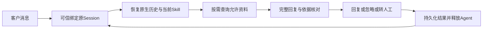

# 原生会话与标准专家包（实施范围）

基线为已上线 7f9ad84。用户已确认先验证会话、完善专家与现有证据组件，再隔离验收、独立审查、本人真实联测、通过后上线。旧上下文中心和 CRM 不停。

不新增记忆库、关系评分、数据表、前端、任务引擎或每轮额外审稿Agent。原生压缩有损，不承诺永久精确记忆。

- 通用底座：修正客户渠道事件中的通用任务汇报指令；message_context说明只返回补充历史。现有Session恢复、空闲释放、去重、人工接管均保留。
- 专家：标准customer-reply模板；黄小璨实例和另一份技术支持方法，实例位于native/examples，不默认加入空底座。
- 证据组件：qa_check可选draft，原gate与旧接口继续可用。完整稿保留已核验事实句；手机号/邮箱检查覆盖全文。语义支持仍由当前专家核对，不能以哈希或结构检查宣称语义正确。
- Skill来源沿用Agent Skills规范。当前宿主无任意文件读工具，prepare-skill.py将源码明确引用的references编入部署SKILL；不新增运行时工具或文件权限。assets只供验收，不自动加载。

参考： https://agentskills.io/specification 、https://www.anthropic.com/engineering/effective-context-engineering-for-ai-agents 。条件行为参考Parlant，不引入其宿主。

验收：实际模型输入中的历史、原生压缩、空闲释放和重启恢复；12组多轮专家样例；第二专家配置复用；同客户去重与不同客户隔离；独立review-agent。真实渠道只用本人测试对象，逐项展示新旧回复并由本人确认口吻。隔离回执不能等同真实客户发送。先通过审查与真实验收再用原固定发布控制器切换，保留一份成功回滚版本。
