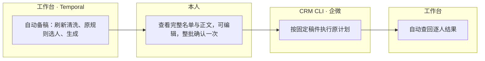

# 自动化运营极简设计与开发 PRD

日期：2026-11-11。状态：已进入开发和隔离真实验收，正式切换尚未完成。本次文档与开发 skill 交付不代表迁移、定时切换或实际发送已经完成。

## 目标与业务判断

工作台统一保存一份名单、一份稿件和一次执行结果。业务只保留四个阶段，正常情况下本人确认整批一次。原中心作为只读来源和历史查询，不再共同维护新工作包。

备稿中来源失败则停在失败步骤；来源正常但无人适用则完成为零；缺依据、身份冲突和过期动作有逐条原因。合格名单才进入生成。发送前失效条目只能阻断，不能自动换收件人或改正文。企微必要的员工确认仍按平台合同执行。

## 取舍与成熟参考

保留现有 Harness、MCP、Temporal、MySQL 和 CRM CLI。选择工作台统一持有运营任务，消除双边稿件状态；继续包装原中心无法去掉往返，让 Agent 自主编排确定性步骤则增加不确定性。

- [Harness 模型层](https://github.com/deepseek-ai/deepseek-harness/blob/master/packages/llm/llm/README.md)：通过现有 `/model` 接线使用官方 `ctx.llm.prepareCall`。语义提炼、话术生成按需调用；规则不由模型重算。
- [MCP Tools](https://modelcontextprotocol.io/specification/2025-06-18/server/tools)：官方 SDK、Streamable HTTP、JSON Schema 与 `structuredContent`，沿用当前兼容版本。
- [Temporal](https://docs.temporal.io/encyclopedia/retry-policies)：固定顺序、等待确认、有界执行和失败恢复。外部操作仍用稳定编号与原回执处理重复。

不新增治理中心、策略管理后台、版本管理后台、路由/授权平台、异常中心、工作流编辑器或专项生成器。新模块必须对应本 PRD 中无法复用的具体缺口。

## 工具与接口变化

五个工具保持独立职责，放在同一现有 MCP 服务中。复用已有四个入口，新增原确定性策略的薄适配 `strategy_select`；不另造规则语言或策略执行器。

| 工具 | 输入 | 输出与职责 |
|---|---|---|
| `data_refresh` | 已注册来源、操作编号 | 实际拉取并清洗；结果引用、数量、异常 |
| `strategy_select` | 固定资料引用、原策略引用、联系/执行历史 | 名单引用、原动作参数、适用/排除/待核原因 |
| `batch_generate` | 名单引用、方法引用 | 逐人结果和稿件引用，不能重新选人 |
| `crm_push` | 已确认名单、稿件引用 | 原任务及 CRM 计划编号，不改正文或目标 |
| `crm_receipts` | 原任务/计划编号 | 逐人受理、待员工确认、实际发送、失败或未知；只读不补发 |

已有公开参数保持兼容；新能力通过对应工具的来源或固定结果引用接入。专项页面与 MCP 调用同一批量提交实现，不能继续保留两套不同的建计划流程。长任务立即返回 `runId`，查询/恢复复用现有入口，不扩展 `program_run` 成通用方案系统。

已有 `crm_push` 的先准备、后本人确认调用方式继续有效；确认后的专项提交复用同一底层提交函数，以持久化确认记录为依据，不能增加由模型传 `confirmed:true` 即可发送的捷径。

已有 `data_refresh` 的单资源输入保持有效。同一轮 CRM 导出通过原操作编号复用原包，各集合独立校验后发布；多源清洗输出本轮固定的资源引用集合，不承诺跨提供方原子快照。`strategy_select` 返回的名单资源按原记录键、动作参数和方法引用供现有生成器消费。

模型只得到当前对象必要资料。批量生成按现有容量分段，收齐全部条目才形成可确认批次；不使用省略选择参数所代表的默认前 N 人。CRM 单批上限按现有合同执行，超限在外发前明确失败，不静默截断或擅自拆成多次发送。

CID 专库继续只有 `wb_customers`、`wb_customer_identifiers` 两张表以及 `customer_upsert`、`customer_get` 两个工具。运营事实、稿件和状态使用工作台已有资源及任务表，不把业务字段塞入 CID，不新增本专项业务表。

## 数据、定时与单一保存位置

1. **来源**：新工作台实际读取 CRM/HXC 原始资料并执行清洗，沿用现有受控只读入口。确需经原机读取时只用既有只读入口，不安装程序、改配置、定时或业务数据。成品导入单独统计，不算独立清洗。
2. **同轮复用**：CRM 一份导出供各数组消费，HXC 同轮读取一次。保留各来源时间及完整性，不声称跨端事务快照。原清洗、字段选择、去重和异常规则复用；必要语义提炼通过已有生成能力完成。
3. **身份**：有效 UnionID 按已核实范围匹配 CID，单边可以建 CID。缺企微 ID 不挡资料入库，缺 UnionID 与冲突单列；无可发送目标的记录不进入对应发送名单。
4. **规则**：原适用条件、排序、冷却、冲突、截止时间与必要服务保留。联系和执行历史只读输入。没有依据不是不满足事实，过期活动不复活。对原规则未覆盖的冲突只报告，不自行加优先级。
5. **稿件**：名单、输入、生成结果、编辑与整批确认只保存在工作台。固定模板可直接填变量，个性化稿才调用模型。成功且输入未变的结果复用。
6. **日程**：本专项默认北京时间每天 09:00 一条固定 Temporal 流程，从刷新清洗依次到备稿，再等待既有确认。迁入验收通过后替换本专项独立的清洗/备稿日程；其他消费者依赖的公共采集日程保留，共享有效结果避免重复采集。

一次配置来源、策略、专家、员工和渠道；任务继承，不要求日常反复选择路由。只保留防混批的固定输入引用和稿件摘要，不增加版本管理界面。

## 删除与必要保护

新任务删除原工作包创建、逐条导出、生成回灌、原中心编辑、编辑后同步读回、确认/建计划/批准时重复查询原工作包授权六类动作。旧包、旧计划与回执只读保留；应答等其他消费者使用的来源读取接口继续可用。

确认固定名单、正文、素材和员工。入口验证已有项目身份；资料使用检查现有允许列表；外发出口集中核对当前有效性并领取任务。取消、接管或配置撤销仍生效，检查合并不能产生可发送旧稿的窗口。CRM 预览、摘要和批准合同由连接器自动完成。

同消息/同业务动作采用稳定标识；业务 slot 跨日去重，不能只按当天批次防重。确认和提交意图使用现有事务保存；数据库与 Temporal 之间的启动失败用已有扫描恢复。外发未知查询原编号，禁止重建计划。已提交到渠道的请求不能保证撤回，回执如实显示。

用户本轮明确调整：旧自动化程序保持现状，新工作台独立运行，停止旧消费者不作为上线前提。新工作台只读原联系、已确认任务和逐人回执，在实际本批成员上排除同一业务动作、未知提交、冷却和人工接管；不从旧消费者心跳或 bridge 开关推导新工作台权限。新库内的稳定动作槽防重复提交；跨系统未来同时新增的动作没有共享事务，不声称全局互斥。

## 对抗性测试与验收

| 场景 | 必须成立 |
|---|---|
| 来源报错、数据缺失、零候选 | 三类结果可区分；失败不发布新资料、不自动用过期资格发消息 |
| 同人命中多条规则、活动过期、缺资格 | 与原规则同输入结果一致；输出动作参数与原因 |
| 双端身份、缺 ID、并发写入 | 精确关联同 CID；无猜测合并；重复零新增 |
| 确认前后修改稿件或账号 | 旧确认不能提交新对象/正文；相关未提交任务失效 |
| 双击或并发确认、跨日重跑 | 同业务动作只提交一次；成功结果复用 |
| DB 提交后工作流启动失败 | 原任务补启动，无新编号、无重复模型生成 |
| CRM 已收但响应丢失 | 原计划查回，未知不重推 |
| 部分生成/发送失败、乱序回执 | 逐人保留结果，失败可定位；回执不触发补发或模型 |
| 生成或提交上限 | 总数核对，超限明确阻断，无隐式遗漏 |
| 原程序继续运行 | 保持只读，不要求停用；本批已知原动作和未知结果不重复安排 |

顺序为资料清洗 → “新人前 7 天承接”原规则/生成 → 一次确认及 CRM → 其他规则逐条业务验收。42 条规则均有适用/排除/缺据/冲突检查，启用范围按结果确定。没有真实合格候选时记录该限制，不伪造资格。

验收包括同输入原规则对照、真实名单样稿、故障注入隔离测试、正式自然定时触发和已授权范围的真实业务链路。本人传输验收单列。程序完成、模型成功、平台受理、实际发送和客户实收分别取证。

用同规模同内容批次记录当前链路基线：原中心业务写入目标零；工作台每批人工确认一次；六类旧交接清零；冗余跨系统往返减少至少 50%。不据此承诺整体耗时减半，不新增测量平台。

实现与发布复用既有项目测试、Product Design 和发布入口。保留正式版与上一成功回滚版，回滚应用不能重放已确认或未知的外发任务。交付仅五个工具、一条固定流程、现有待处理入口、必要测试和说明。

## 与后续开发 skill 的关系

统一开发规则为本机 `workbench-harness-development`，由 `AGENTS.md` 引用。自动化应答仍是原 Session 的消息驱动流程，运营仍是固定定时流程；它们共享底座和小工具规范，不合并业务状态或人工确认要求。

本 PRD 的设计已转入实现。当前代码与隔离环境进展见 `docs/IMPLEMENTATION.md`；原服务器只读，正式版本与定时尚未切换。

## 本轮只读报告接线

黄小璨仅提供已发布资料、报告正文和原页面路径。报告页通过客户本人登录读取其已有资产；旧 dispatch 注册用于归因，不作为本任务的必需写入。CRM CLI 按来源描述准备本地小程序素材，沿用已批准模板的应用和封面，固定素材后进入唯一整批确认。素材创建响应丢失只按原精确内容查回；明确未创建的拒绝或创建前取消才释放本次占位。

发送前复用原报告/服务指引校验，并用只读 SQL 比较本批账号的权益源事实摘要；不重新计算另一套权益规则。正文依据、报告版本或权益发生变化时保留旧稿和原因，由下一轮新资料重新选单。未确认稿不占执行槽；确认后的未知回执继续占槽，最终失败不会永久封锁其他后续节点。
