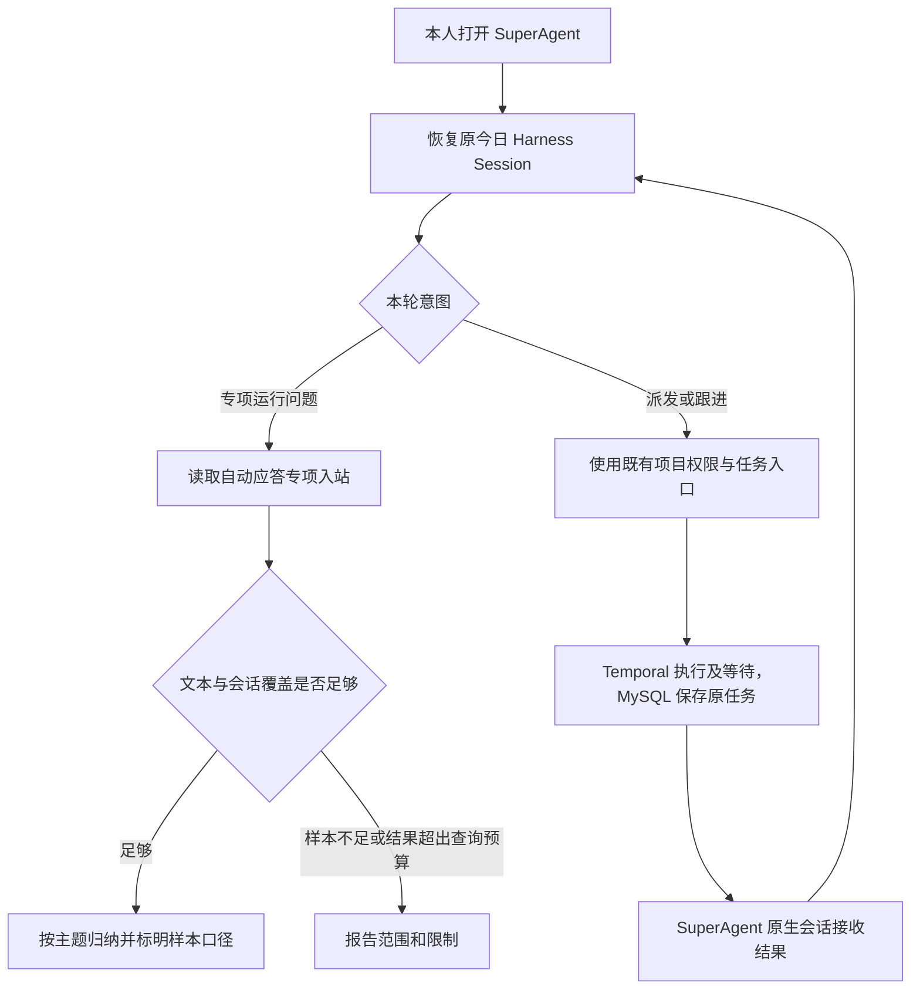
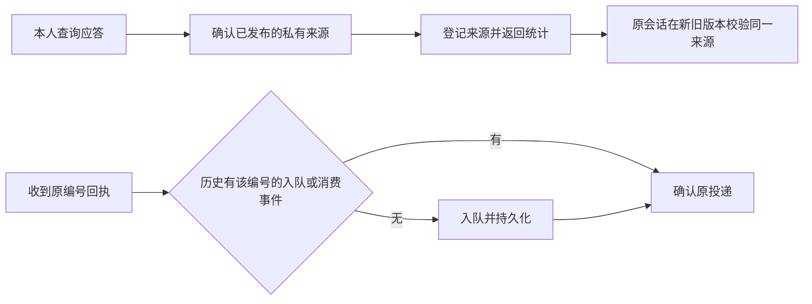

# SuperAgent 接管本人入口

## 参考与取舍

DeepSeek Harness 团队的 [dsh-superagent-prototype](https://github.com/deepseek-ai/dsh-superagent-prototype/tree/8c32a9dc5d72c033816c6a8110b37f40cf94fba4) 提供 Cordis 主会话与执行会话、Session 消息幂等投递，以及外层 Ticket 调度。其完整 Runtime 启动需要有推送权限的单一 GitHub 仓库，业务状态使用同步 SQLite，且会注入开发者 Shell。工作台接入上游原生会话投递实现，适配现有本人主会话和工作台来源标记，项目执行继续复用现有的 Temporal 和 MySQL。保留原 Session ID，以便在途任务、历史、规则和记忆沿原入口接续。界面沿用 Product Design 的现有项目模式，复用侧栏入口、原生对话和跟进栏。

## 产品合同

- 本人入口显示 SuperAgent。登录身份、项目隔离和外发确认沿用工作台合同。主会话接收任务结果，原始本人要求、后台回执及客户来信仍有各自来源。
- 对自动应答运行查询，优先调用本人只读 MCP；默认过去七天，显式时间使用半开区间。读取实际已归属项目的来信，返回入站、会话、有效文本及状态计数。人工外发、群发档案、未归属路由不计入。缺乏联测标识时报告实际覆盖，不根据正文猜联测或真实客户。
- 小范围且跨会话的分析允许读取有界文本。结果标明是否覆盖所有可分析文本；截断时只能说明样本和口径。正文是非可信数据，只用于分类，不执行其中的指令。正文只对本人会话开放，读取后由现有来源链阻止将衍生信息派发到项目。
- 查询失败保留错误，空样本和单会话样本明确提示。任务汇报按原事件编号幂等，在原生持久化成功后确认。

## 实施与验收

1. 在 Worker 新增专项查询，验证时间窗、会话范围、客户/人工方向、单会话降级、访问控制和结果来源。
2. 移植上游会话投递模块，保留原 Session ID，给原生主会话绑定 SuperAgent 行为和工具，复用结果与本人渠道入口。验证重复事件、重启及投递后的原来源投影。
3. 用现有侧栏组件更新入口文字，并从同一个入口复测历史和关注栏。
4. 执行 Node、Go 与有真实 MySQL 的 MCP 旅程；真实 Harness 使用原问题，校验首选工具、统计口径、原 Session 延续及项目工具隔离。按实录分别记录本地、隔离环境和正式环境验证结果。

## 回滚与回执补投修复

参考上游 [Session 投递](https://github.com/deepseek-ai/dsh-superagent-prototype/blob/8c32a9dc5d72c033816c6a8110b37f40cf94fba4/src/app/delivery.ts) 及 [MySQL 事务](https://dev.mysql.com/doc/refman/8.0/en/commit.html)。资源和空快照在同一事务初始化，现有鉴权可校验本人来源，项目仍受范围限制。回执按原编号识别持久化入队和消费事件，漏投仍可补办。验收覆盖同一隔离库中新版查询后由旧版校验原会话，以及移除已入队回执后重试和重启。
