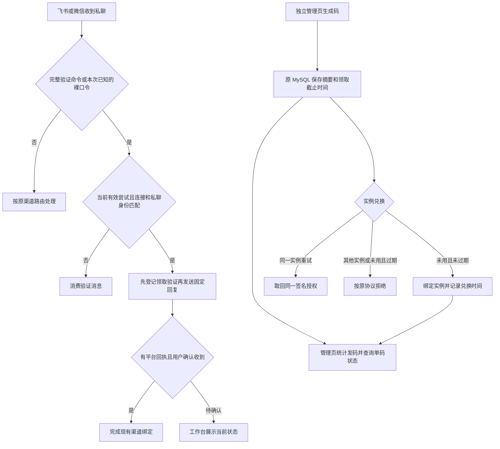

# 私聊验证与独立激活码管理 PRD

## 业务判断

## 现状与证据

1. 截图里的「链接飞书/微信」显示带前缀的整句，现有复制按钮也复制整句。
2. 飞书与微信收到的两条实际消息只有 12 位口令。渠道连接器按整句精确匹配，旧的本人路由把未识别消息交给了 Super Agent。两条对话都收到了模型回复，网页仍显示「待验证」。截图能够证明界面和消息文字，设备端剪贴板操作与真实平台验收需要实测。
3. 旧发码页挂在 Harness，只有生成动作。原表 `wb_activation_codes` 保存摘要、到期时间、绑定实例和领取时间。发码函数统一使用七天期限，因此旧码的生成时间可按到期时间减七天还原。旧库无法恢复原码或推断发送对象。

## 标准方案

| 方案 | 已核对的能力 | 接入判断 |
| --- | --- | --- |
| SQLPage | MIT，自托管，MySQL，现成表格与表单，支持独立路径 | 选用标准组件接原账本，独立进程负责管理鉴权和原协议签发 |
| Keygen | 授权管理、单设备策略、离线授权文件 | 适合新授权体系。现有摘要无法填入自定义旧码，且现有客户端签发方、公钥与授权格式仍需兼容 |
| Appsmith | REST、MySQL 和标准表格组件 | 可做管理页。官方自托管入门基线为 2 vCPU、8 GB 内存，这个单页场景可用更轻的组件 |

[SQLPage 官方仓库](https://github.com/sqlpage/SQLPage) · [SQLPage 表单文档](https://sql-page.com/component.sql?component=form) · [Keygen 创建授权](https://keygen.sh/docs/getting-started/) · [Keygen 设备激活](https://keygen.sh/docs/activating-machines/) · [Appsmith 自托管](https://docs.appsmith.com/getting-started/setup)

## 功能与口径

- 渠道入口识别 `链接工作台 <12位口令>` 或当前已知裸口令。大小写和前后空白允许复制差异。已知口令仅在其绑定的连接、身份、私聊和尝试有效时触发固定回复。最近八次已知旧口令、重复投递或串渠道只消费，避免进入会话。其它消息沿用原路由。验证回执成功后仍由本人点击「已收到回复」。
- 独立入口 `/activation-codes/`。页面只放今日新增、累计生成、已兑换数量，「生成激活码」、原码查询和记录表。统计日界线按北京时间。原码只在签发结果中展示。按已有原码查状态时仅使用 POST 和摘要匹配，页面列表显示记录编号和日期。
- 状态为「待兑换」「已兑换」「已过期」。以原库成功绑定的时间记已兑换，已兑换状态优先于领取期限。手动复制或转发不计作兑换。原码由用户在自己的渠道分发。
- 同一 MySQL 账本，管理页使用 SQLPage 只读账号，独立签发服务用仅该表的读写账号。已发未领取的旧码继续有效，旧实例沿用既有兑换 URL、签发方、公钥和 Ed25519 授权字段。已有授权照常离线验签。
- 管理入口独立验证管理员，浏览器写操作检查来源并禁止缓存。公开兑换仅接受原合同。反向代理先做精确路径分流，独立服务验证后切换，原入口可在回滚时接回同一表。

## 实施与验收

1. 在渠道连接器内加入命令判断。回归覆盖微信和飞书裸码、整句、身份不符、过期、重发、换尝试和普通私聊。模拟收发验证后，正式切换再用本人设备完成两个渠道实发和网页确认。
2. 将已有发码及兑换事务提取为 Go 包，保留旧 Worker 路由用于回滚。独立服务复用该包，保持原 HTTP 和签名合同。
3. 用 Product Design 核对 SQLPage 原生组件及桌面、手机管理流程。验证新增计数、历史逐码查询、今日边界、匿名拒绝、跨站拒绝及旧码和新码兑换。实际安装前先核对现有数据和代理入口。
