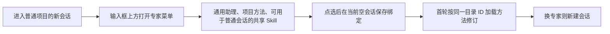

# 新会话专家下拉

正式版 46 的「私域运营」只返回通用助理：会话候选过滤掉随安装提供的通用 Skill。另有项目专属方法、本人主会话方法和运营批量方法，可在本人目录管理，运行入口各有权限边界。

- 用图一的项目菜单作为交互及样式基准，复用 Harness 同一个 Menu、选中勾、锚点与键盘操作。去掉专家绑定弹窗。保留原生新会话和项目切换，保留显式设为项目默认。
- 私域运营至少显示通用助理、内置新人承接、档案整理、工作台工具开发；项目方法和可用的共享自建 Skill 按当前项目显示。多候选无默认时显示「选择专家」并在选定前阻止提交；默认、唯一候选及通用回退继续走现有规则。
- 客户应答模板需要可信渠道上下文，仍从自动化应答入口选择。黄小璨客服留在其项目；六个运营批量方法仍由运营批次加载，不将批量输入、工具或资料权限带给普通会话。本人方法继续只用于 Super Agent。
- 正式版走新会话、目录、应答、运营四个入口，记录实见候选和目录 ID。候选在桌面和手机验证点选、原 Session 绑定、换专家、新会话默认及真实 Harness 方法调用；专项保存和复制用隔离数据实际提交。

参考：[DeepSeek Harness Skill 作用域与发现](https://github.com/deepseek-ai/deepseek-harness/blob/master/docs/subsystems/skills.zh.md)；[W3C 菜单按钮交互](https://www.w3.org/WAI/ARIA/apg/patterns/menu-button/)；已安装 Harness 的工作区选择器与 Menu。
