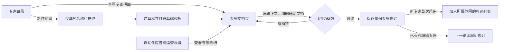

# 专家明细 Markdown 编辑页

**交付范围：页面设计，第二版。** 「查看专家明细」直接打开文档页。复用语料库的 Markdown 编辑和渲染能力，页面只保留左编辑、右预览。专家文档从专家入口维护；应答和运营设置链接到同一份专家明细。



## 页面与操作

| 位置 | 设计 |
| --- | --- |
| 顶栏 | 「返回专家」或「返回应答设置／运营设置」，专家名称、保存状态和主要动作。名称、描述和原有使用位置在同页的「基本信息」中维护，默认不占正文区域。 |
| 文档目录 | 「方法正文」始终排首位，创建后一直存在，可直接编辑，无删除或更名入口。下方的「判断示例」「辅助案例」「执行边界」等是普通 Markdown 文档，可通过「新建文档」添加，通过对应行的「…」删除。未引用文档可一键插入正文。 |
| 主区 | 桌面固定左「编辑」、右「预览」，实时同步，无模式栏，不显示 YAML 文件头。编辑区沿用现有 Markdown 编辑能力，去掉代码行号等非必要装饰。手机以「编辑／预览」切换替代并排，文档目录收起。切换文档时保留未保存内容。 |
| 回退 | 返回原入口，保留搜索、滚动和原设置页的未保存选择。离开时提醒尚未保存的内容。 |

新建页只填「名称」「描述」；系统生成稳定 Skill 名称，修改显示名称不会改变绑定。从项目进入沿用当前项目；从全局目录进入默认工作台共享，表单旁直接标明范围。「创建」保存草稿并进入明细，主文档自动生成。尚未启用的草稿不出现在会话或应答候选中；草稿直接在现有目录读回。

## DeepSeek Harness 依据

对照官方仓库和本地 Harness `0.2.2-rc.1` 随包的 `agent-experience`、`cordis-plugin-development`。后者的主文件定义任务、边界和操作顺序，用相对链接指向 `references/` 的具体做法；正文保持简短，重点约束放在执行步骤前。官方已有实现把这些职责分开：

| Harness 层 | 工作台设计 |
| --- | --- |
| 原生 Session 与 Agent Preset | Session 保存会话；Cordis YAML 的 Preset 装配 persona、工具、Skill 消费插件等。当前 `workbench` Preset 继续使用；新建或编辑专家不会创建新的 Agent 或装配插件。 |
| `SKILL.md` | 专家主文档。文件头的稳定 `name`、`description` 供发现；页面的显示名称和简介由基本信息维护。主文档编辑区只露出方法正文。 |
| `references/` | 可选辅助 Markdown，采用 Skill 内相对链接，按任务范围组织。专家可没有任何辅助文档；写入判断必要的约束仍放主文档。 |
| 工作区规则与本人配置 | Harness 的 `dsh-agent-instructions` 读取适用范围内的 `AGENTS.md` 等工作区规则；工作台现有 Super Agent 使用本地约定的 `AGENT.md`，仍是原主会话规则。两者都不作为新建专家的主文件。 |

Harness 的原生消费路径按会话作用域发现 Skill，由 `skill({name})` 或用户显式 `/名称` 加载；官方通过 `resourceBase` 提供被显式引用的资源。当前工作台对会话先固定专家修订，再由宿主将主文档直接链接的参考内容并入该修订，供原生 Session 使用。此次设计保留工作台已有装载方式，复用官方 Provider 的作用域与调用，不引入目录全量读取或额外文件权限。

## 基础模板

名称和简介用于发现；主文档按官方随包实例的写法，说明使用条件、先后顺序、关键约束和交付。创建时只生成主文档，无必填的附加文件。以下为底层示例，文件头由宿主生成，页面仅编辑分隔线以下的正文。

```markdown
---
name: private-ops-followup
description: 根据本会话允许读取的信息，为已有交流的客户拟定下一步跟进建议。
---

## 任务描述
客户已有明确交流记录，需要判断是否跟进、如何跟进。

## 判断顺序
1. 核对最近一次有效交流及尚未解决的问题。
2. 无法从现有证据判断时，写明待核实项。
3. 给出建议动作和依据；保持在建议范围内，不触发发送。

## 辅助参考
- [判断示例](references/decision-examples.md)
```

模板不限制标题和章节。上面的链接仅在已添加对应文件时出现。对话关键判断即使删除辅助文件也应该能由主文档说明；长示例、例外说明放进辅助文件。该示例已用本机 `0.2.2-rc.1` 的官方文件系统 Provider 在临时项目中验证发现和读取。

## 删除与保存

1. 未被引用的辅助文档，点「… → 删除文档」后从当前草稿移除，保存前可撤销。
2. 被引用的文档，指出引用它的正文或其他辅助页。可移除这些链接后删除，或先改指其他文档；不留下断链。当前文档被删后回到主文档。引用校验以相同的 Markdown 相对链接规则为准。
3. 主文档只有编辑入口，宿主同样拒绝删除或保存空正文。提交时一次保存正文、保留的辅助文档和链接变更；不先删正式文件。已开始的轮次或已固定的批次继续读原版；正常会话下一轮读新修订。

## 保存与运行边界

- 已启用的会话专家用「保存修改」；新专家用「保存并启用」首次开放调用。自动保存若开启，只保存编辑草稿。点击保存时统一校验正文、链接和参考页，作为一个修订生效；冲突保留草稿，已开始的轮次继续读原修订。
- 自建和项目专家沿用 `SKILL.md`、`references/*.md`。显示名可用中文，内部文件名继续符合现有引用校验。只复用语料库的编辑器、Markdown 渲染和相关交互；不调用语料库的发布、检索或权限接口。专家文档不进入语料目录或索引。
- 发行包和运营原方法在同一页面只读，可在原归属范围复制。运营工作台版复用相同编辑区，保留原有输入字段、输出校验、固定模板、试跑和按策略启用。若开放独立参考页，参考正文必须随该运营方法版本一起保存，并在试跑与真实批次按同一规则加载；不能显示成已可用于生成却只存了编辑稿。Super Agent 复用编辑视图，原 `AGENT.md` 仍对应唯一主会话。
- 使用专家已有的项目与工具权限。预览能打开方法文档，不代表调用方因此获得语料、数据库或渠道权限。

验收：已有专家打开即改，桌面无模式栏；两字段创建主文档；增删无引用和有引用的文档、撤销与并发保存冲突；主文档不可删除；同一真实 Harness 会话旧轮次维持原修订、下一轮不再加载已删参考。再确认自动化设置指向原专家、语料库无新增记录。

参考：[DeepSeek Harness Skill 发现和调用](https://github.com/deepseek-ai/deepseek-harness/blob/master/docs/subsystems/skills.zh.md) · [官方 Agent Preset 配置](https://github.com/deepseek-ai/deepseek-harness/blob/master/packages/preset/agent-preset/README.md) · [官方工作区规则加载](https://github.com/deepseek-ai/deepseek-harness/blob/master/packages/context/agent-instructions/README.md)。对照本机随包示例 `@deepseek-ai/dsh-agent-preset/skills/cordis-plugin-development`；现有工作台实现 `native/harness/cordis.patch.yml`、`owner-catalog.js`、`expert-library.js`、`session-expert.js` 和 `vault-editor.js`。
