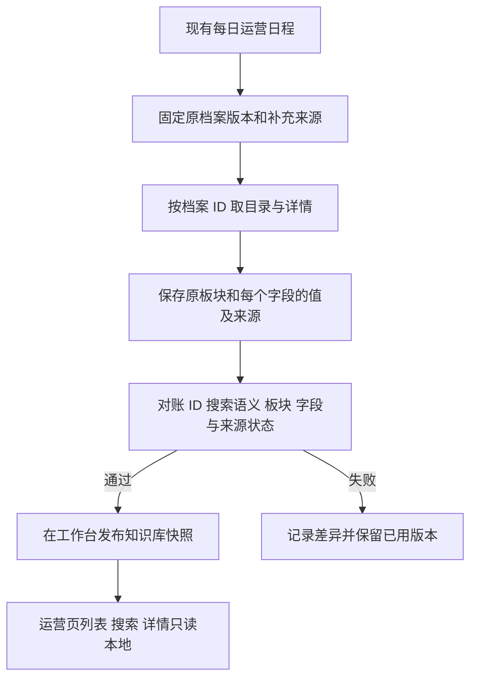

# 自动化运营本地用户档案

## 目标

知识库发布一份完整的运营用户档案。运营页面沿用现有列表、搜索和详情接口，三种读取都使用同一版本的本地数据。现有每日运营任务负责更新。正式切换前，以原中心页面的实际接口口径完成全量对账。

## 数据与读取

- 沿用知识库资源和版本化记录。用原档案 ID 作为唯一键，保存原页面的八个板块、字段值、来源、时间、引用和确认状态。目录的称呼、搜索范围和分页顺序按原接口对账。运营策略清洗结果继续供选人和备稿使用。
- 固定目录版本和补充来源的读取边界。原中心发布切换、读取中断、字段截断或来源异常时，本轮保留上一成功版本。空字段、真实空结果和来源失败分别记录。
- 运营页的列表、搜索和详情固定同一个本地快照。详情页沿用原字段组和来源提示。第一次切换以全量对账成功为条件，回滚通过现有发布入口恢复原读取路径。
- 访问权限沿用运营项目及已授权的工作台本人范围。手机号和来源引用保留原读取边界。对账报告只保留计数、来源版本和校验摘要。

## 实施与验收

1. 读回正式原中心和工作台当前版本。核对全量稳定 ID、缺失和重复、目录顺序及按字段值和来源元数据的差异。
2. 复用原投影生成本地发布资料，验证原接口与候选记录逐条一致。读取失败保留旧版并可按同一任务恢复。
3. 把刷新并入已有运营定时，验证候选版本的列表、中文搜索、分页、详情、版本变化和跨项目拒绝。验证浏览入口在原中心连接不可用的条件下仍能从本地读取。
4. 使用工作台现有发布与回滚入口。上线后读回发布快照和实际消费者。

设计参考为 PostgreSQL 官方资料中的[物化视图更新与唯一索引](https://www.postgresql.org/docs/current/sql-refreshmaterializedview.html)。本项目沿用自己的 MySQL 快照发布机制，保存完整版本并切换资源指针。
