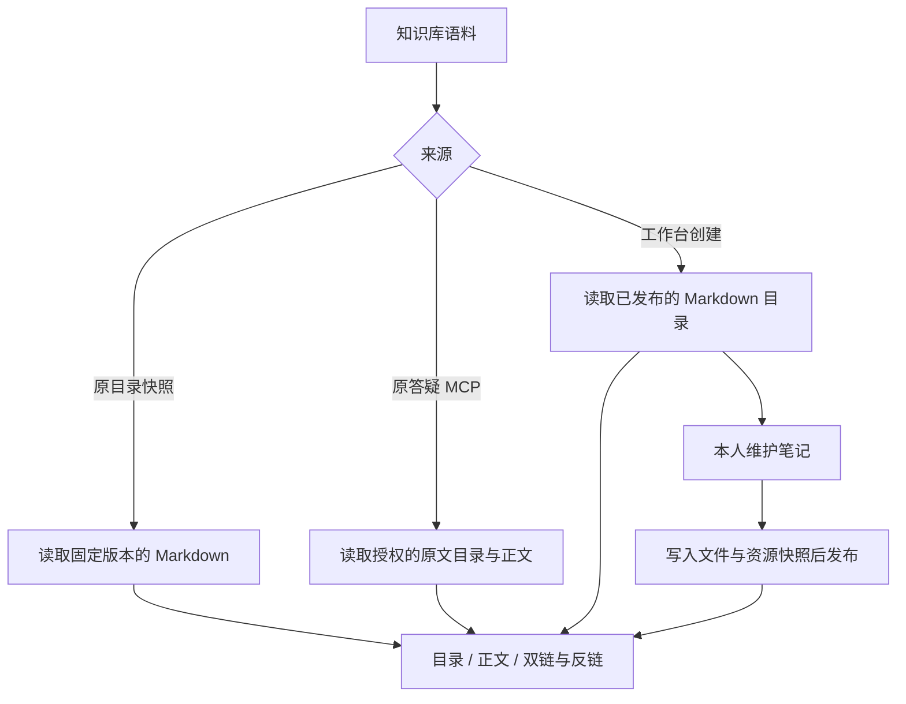
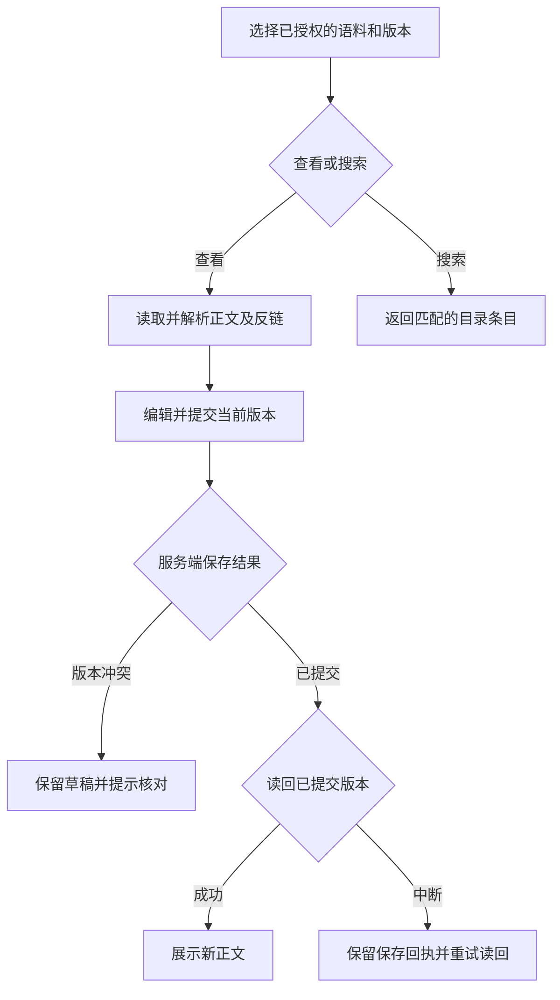

# Obsidian 语料内容接入

**目标**。现有两份语料按 Vault 打开。新增语料库只需名称，工作台维护的新库以 Markdown 文件保存。

**本轮边界**。项目资源的标准权限交给「梳理 DeepSeek Harness 专家能力」任务，最终从项目设置管理，Super Agent 按该任务已经确认的默认规则使用资源。当前浏览沿用原有身份和资源检查。现有来源及消费路径按固定版本接入，保留原运营与应答绑定。工作台内新建的库由原本人网页身份管理。

## 实施顺序

1. 在 `native/worker/internal/core/vault.go` 与 `native/worker/internal/api/vault.go` 接通建库及笔记提交。复用资源 ID、板块与快照表，原件保留于版本化 Markdown 目录。通过旧版本比对、确定性操作版本和原子发布校验并发、重复提交和失败重试。既有连接的两份来源沿用原资源接口。
2. 在 `native/harness/vault-markdown.js` 接入 Quartz 的 MIT 解析器并生成目录、双链、反链和可安全渲染的正文。沿用目录资源快照读取及现有 MCP Resources。用中文路径、锚点、代码内字面量和外链输入覆盖解析验收。[Quartz 解析器](https://github.com/quartz-community/remark-obsidian) · [Obsidian 链接规则](https://obsidian.md/help/links)
3. 按 Product Design 库内稿接入现有 Cordis 页面。以开源 CodeMirror 编辑 Markdown，授权来源的目录、正文、反链由同一工作台入口呈现。确认新建、打开、保存、链接导航与返回目录。[WebObsidian 的编辑行为](https://github.com/xnohat/webobsidian) · [CodeMirror](https://github.com/codemirror/dev)
4. 在隔离服务验新建库与原两类读取。目录资料依然能从 `resource_list`、`resource_search`、`resource_excerpt` 按已有授权读取。正式切换与共享权限模块一起验收。

## 整体复查与修复

以已确认的第 1 张稿为界面基准。复查覆盖目录分页、来源超时、双链与 Markdown 引用、并发发布、保存回执和编辑失败。保存使用现有资源快照与项目读权，单次提交先在库内锁定基础版本，再发布完整文件版本和 MySQL 记录。保存成功与页面读回分开呈现。搜索沿用同一已授权来源，返回匹配路径。标准权限仍由统一项目设置接入。

验收覆盖不同草稿并发、同一提交重试、断开的读回、编辑器加载失败、原有资源入口及桌面和 390px 交互。链接和分页行为对照 [Obsidian 内部链接](https://obsidian.md/help/links) 与 [MCP Resources](https://modelcontextprotocol.io/specification/2025-06-18/server/resources)，目录边界沿用 [Go 文件系统](https://pkg.go.dev/os#Root) 和既有资料读取。

## 与正式权限模块合并

权限沿用库侧「权限设置」。网页建库和 SuperAgent 的明确建库指令共用 Markdown 建库路径，网页保存和原生 `resource_item_write` 共用同一事务。普通项目、自动化应答和自动化运营通过已有授权读取或维护，管理需要整库板块授权，客户对象会话继续使用对客工具。撤权后，旧版本和重复提交也必须通过当前权限。

原答疑连接要求已登记的项目身份。工作台先后核验实际调用者与连接的授权，再通过该连接读取固定版本。两个现有库沿用原资源 ID、已发布来源和授权。已有数据继续按原读法打开。
