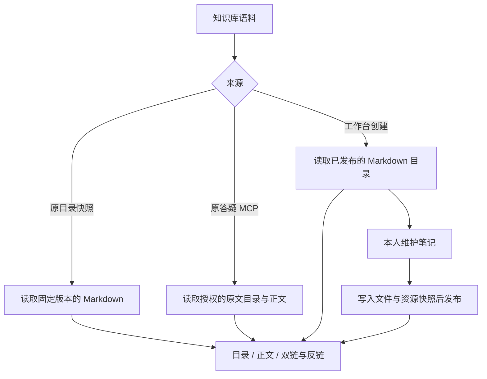

# Obsidian 语料内容接入

**目标**。现有两份语料按 Vault 打开。新增语料库只需名称，工作台维护的新库以 Markdown 文件保存。

**本轮边界**。项目资源的标准权限交给「梳理 DeepSeek Harness 专家能力」任务，最终从项目设置管理，Super Agent 按该任务已经确认的默认规则使用资源。当前浏览沿用原有身份和资源检查。现有来源及消费路径按固定版本接入，保留原运营与应答绑定。工作台内新建的库由原本人网页身份管理。

## 实施顺序

1. 在 `native/worker/internal/core/vault.go` 与 `native/worker/internal/api/vault.go` 接通建库及笔记提交。复用资源 ID、板块与快照表，原件保留于版本化 Markdown 目录。通过旧版本比对、确定性操作版本和原子发布校验并发、重复提交和失败重试。既有连接的两份来源沿用原资源接口。
2. 在 `native/harness/vault-markdown.js` 接入 Quartz 的 MIT 解析器并生成目录、双链、反链和可安全渲染的正文。沿用目录资源快照读取及现有 MCP Resources。用中文路径、锚点、代码内字面量和外链输入覆盖解析验收。[Quartz 解析器](https://github.com/quartz-community/remark-obsidian) · [Obsidian 链接规则](https://obsidian.md/help/links)
3. 按 Product Design 库内稿接入现有 Cordis 页面。以开源 CodeMirror 编辑 Markdown，授权来源的目录、正文、反链由同一工作台入口呈现。确认新建、打开、保存、链接导航与返回目录。[WebObsidian 的编辑行为](https://github.com/xnohat/webobsidian) · [CodeMirror](https://github.com/codemirror/dev)
4. 在隔离服务验新建库与原两类读取。目录资料依然能从 `resource_list`、`resource_search`、`resource_excerpt` 按已有授权读取。正式切换与共享权限模块一起验收。
