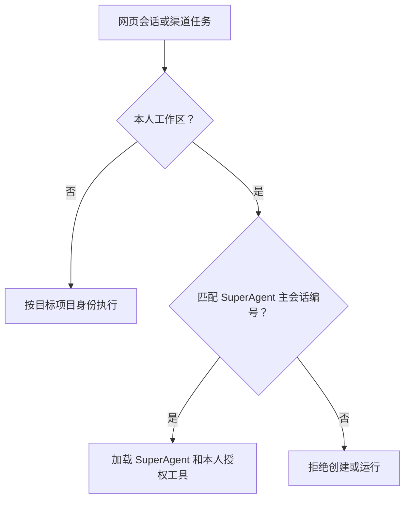

# SuperAgent 唯一本人会话

本人网页和已绑定的本人渠道统一使用 SuperAgent 主会话。复用现有会话编号，原历史、规则、记忆、定时配置和任务回执继续由同一会话读取。

[DeepSeek SuperAgent 的会话设计](https://github.com/deepseek-ai/dsh-superagent-prototype/blob/main/docs/001-domain.md) 采用主会话统筹、执行会话承接任务。工作台沿用已有的 SuperAgent 原生会话投递和项目执行链。

- Harness 在挂载 Agent 和通过桥接加载会话时核对主会话编号。Worker 使用已保存的本人定时配置核对内部本人调用。主会话首次初始化沿用原入口。
- 沿用侧栏 SuperAgent 和现有任务面板。本人入站提示、工具说明和应用描述统一使用 SuperAgent。历史键及路由保持可接续。
- 验收覆盖直接打开旧会话、请求创建第二个本人会话、主会话的本人工具与历史、项目会话、两条本人渠道的绑定、原定时设置和待投递结果。正式核对只读，隔离环境验证运行行为。
